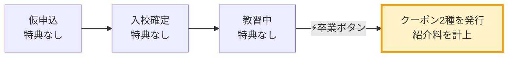

# ドキュメント目次 — BestBike × 教習所マッチング

版数 **v1.1** ／ 2026-08-04
**企画資料（PDF）2件を反映済み**

| # | 文書 | 内容 | 主な読み手 |
|---|---|---|---|
| 01 | [要件定義書](01_requirements.md) | 事業概要・ステークホルダー・業務フロー・機能要件（FR-1〜FR-12）・業務ルール（BR-1〜BR-13）・**確認事項A〜L** | クライアント／全員 |
| 02 | [画面仕様書](02_screen-spec.md) | サイトマップ・画面遷移図・画面別仕様（全15画面）・デザイントークン・アクセシビリティ | デザイナー／実装者 |
| 03 | [データモデル設計書](03_data-model.md) | ER図・テーブル定義（DDL）・インデックス・RLSポリシー・権限マトリクス | 実装者／DBA |
| 04 | [API仕様書](04_api-spec.md) | エンドポイント・リクエスト/レスポンス・エラーコード・認可マトリクス・本体連携 | 実装者 |
| 05 | [非機能要件・技術方針](05_nonfunctional.md) | 技術スタック選定と根拠・セキュリティ・事業リスク対応・性能・法令対応 | CTO／実装者 |
| 06 | [開発指示書（Codex向け）](06_dev-instructions-codex.md) | 共通コンテキスト・**チケット20本**・そのまま貼れる実装指示・レビューチェックリスト58項目 | 実装者／レビュアー |
| 07 | [テスト計画・受入基準](07_test-plan.md) | 単体・統合・E2E・セキュリティテスト**約180ケース**・リリース判定基準 | QA／レビュアー |
| 08 | [開発計画・体制・概算見積](08_plan-and-estimate.md) | スケジュール・体制・チケット別工数・見積・収益構造・リスク | クライアント／経営 |
| **09** | [**PDF突合結果**](09_pdf-reconciliation.md) | **企画資料と v1.0 設計の差分・改版記録** | **全員（最初に読む）** |

---

## 読む順番

### はじめて読むとき
1. **[09 PDF突合結果](09_pdf-reconciliation.md)** — なぜこの仕様になっているかが分かる
2. [01 要件定義書](01_requirements.md) §1〜§4 — 事業モデルとスコープ
3. プロトタイプを操作する（`../prototype/index.html`）

### クライアントに提示するとき
1. [08 開発計画・見積](08_plan-and-estimate.md) §7 提案の要旨
2. プロトタイプを実際に操作してもらう
3. [01 要件定義書](01_requirements.md) §4 スコープ（MVP必須／可能なら追加／第2段階）
4. [01 要件定義書](01_requirements.md) §8 確認事項 — **A・B・C の回答をもらう**

### 開発を始めるとき
1. [06 開発指示書](06_dev-instructions-codex.md) §1 共通コンテキスト → Codex に一度だけ渡す
2. [06 開発指示書](06_dev-instructions-codex.md) §3 → T-01 のブロックをそのまま貼る
3. [03 データモデル](03_data-model.md) → T-02 の実装時に参照
4. [04 API仕様](04_api-spec.md) → 各チケットの実装時に参照
5. [07 テスト計画](07_test-plan.md) → 受入基準の判定

### レビューするとき
1. [06 開発指示書](06_dev-instructions-codex.md) §5 レビューチェックリスト（58項目を1つずつ）
2. [05 非機能要件](05_nonfunctional.md) §2.1 特典情報の漏洩対策
3. [07 テスト計画](07_test-plan.md) §4 セキュリティテスト（SEC-01〜50）

---

## この設計で最も重要な1点

> **収益と特典は「卒業」という1つのイベントに集約される。**
> **この1点の正確性・不可逆性・検証可能性を守ることが、このシステムの設計の全て。**

教習所の担当者が管理画面で「卒業」ボタンを押す。
この操作ひとつで、ユーザーに**2種のクーポン**（初回5,000円OFF／永久10%OFF）が発行され、
紹介料が計上される。それ以外の場所でお金も特典も動かない。



だからこの1点に、3つの防御を重ねている。

| 層 | 実装 | 防ぐもの |
|---|---|---|
| **冪等性** | `Idempotency-Key` ＋ `SELECT … FOR UPDATE` ＋ `UNIQUE(application_id, kind)` | 連打・リトライ・並行リクエストによる**二重発行** |
| **監査** | `graduated_by` ＋ `audit_logs`（UPDATE/DELETE を DBロールから剥奪） | 「誰がいつ押したか分からない」状態。取消は運営のみ |
| **突合** | 教習中の長期滞留アラート ＋ ユーザー側の卒業申告導線 | 押し忘れ・失念による**特典の未発行と売上の取りこぼし** |

関連：[03 §3.13](03_data-model.md)、[04 §4.4](04_api-spec.md)、[06 T-12](06_dev-instructions-codex.md)、[07 §5.1](07_test-plan.md)

### なぜ「三重」なのか

二重発行はアプリのバグでは済まない。
永久10%OFF が2枚出れば、それは恒久的な損失になる。

逆に、押し忘れを検知できなければ、**ユーザーは約束した特典を受け取れない**。
提携が10校のうちは目視で追えるが、100校になったら追えない。
しかも仮申込から卒業まで **2〜3ヶ月**あり、その間に担当者交代・失念が必ず起きる。

このシステムで技術的に最も難しいのは検索でも料金表でもなく、
**この1つのボタンを正しく作ること**にある。

---

## v1.0 → v1.1 で何が変わったか

企画資料（PDF）を参照できない状態で作った v1.0 は、
リポジトリにあったプロトタイプから要件を逆算していた。
**そのプロトタイプが、企画資料と根本的に異なる業務モデルで作られていた。**

| | v1.0（プロトタイプ準拠） | **v1.1（企画資料準拠）** |
|---|---|---|
| 特典の発行 | **入会確定時** | **卒業時** |
| 特典の種類 | 永年10%OFF の1種 | **初回5,000円OFF ＋ 永久10%OFF の2種** |
| ステータス | 4段階 | **5段階＋キャンセル** |
| 用語 | 入会確定 | **入校確定** |
| 一覧 | 現在地＋地図 | **都道府県→市区町村（SUUMO型）** |
| 料金 | 免許種別のみ | **希望免許 × 現在保有免許** |
| 免許種類 | 4種（原付を含む） | **6種**（小型二輪MT/AT を追加、原付を削除） |
| 紹介料 | ¥5,000 固定（誤り） | **未定**（確認事項A） |
| 口コミ・評価 | あり | **削除**（企画資料に記載なし） |

詳細は [09 PDF突合結果](09_pdf-reconciliation.md)。

> **旧プロトタイプ（`src/App.js`）を参照するときは、必ず 09 を併せて読むこと。**
> 見た目は流用できるが、業務モデルは異なる。

---

## リポジトリ構成

```
docs/                 本ドキュメント群（00〜09）
prototype/index.html  クライアント提示用プロトタイプ（ビルド不要・単体で開ける）
src/                  プロトタイプの React ソース
```

### プロトタイプの起動

```bash
# ビルド不要（推奨・クライアント提示用）
open prototype/index.html

# React版
npm install && npm start
```

---

## 現時点の前提と制約

| # | 内容 |
|---|---|
| 1 | 確認事項 **A（紹介料の計算ルール）・B（ベストBike本体との連携）・C（ステータスの変更権限）** が未回答。企画レビューが「システム会社へ渡す前に必ず確定した方がよい」とした3点 |
| 2 | A・B は**設定テーブル／Adapter で吸収する設計**にしてあるため、回答が遅れても Phase 1 の着手自体はブロックされない |
| 3 | 紹介料の金額はまだ決まっていない。v1.0 の「¥5,000」は誤り（あれはユーザーへの初回クーポンの割引額） |
| 4 | 「NORUZO」が社名・サービス名・プロジェクト名のいずれかが不明（確認事項L）。画面上のブランドは「ベストBike」で統一している |
| 5 | 旧プロトタイプの評価値（★4.7 / 342件）・提携校数（24校）・4校の教習所はすべてダミー |
