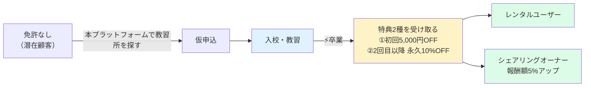
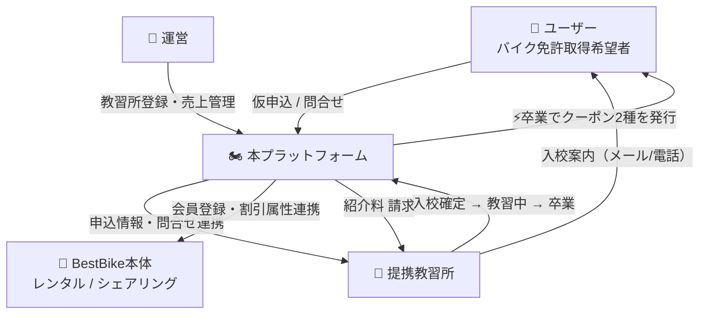
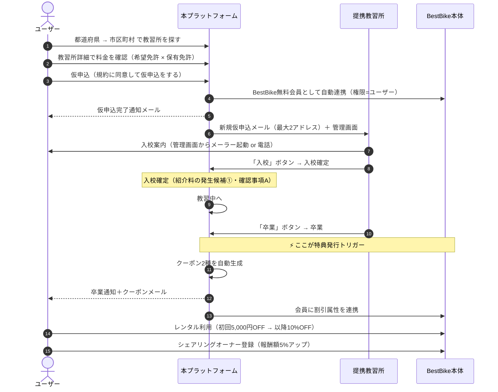
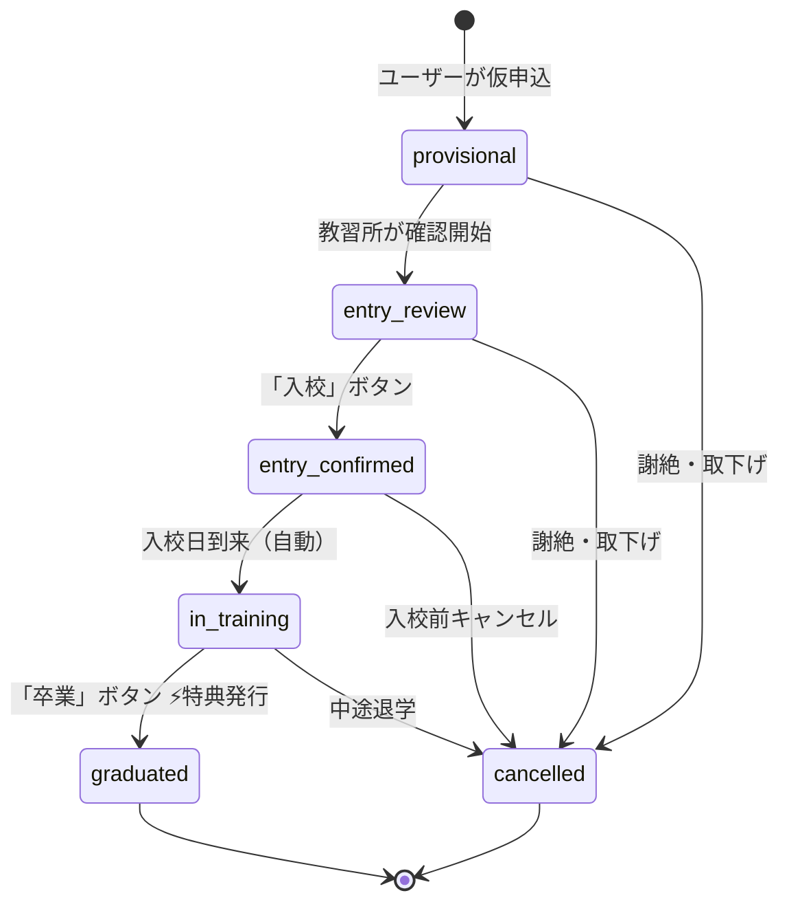

# 要件定義書 — BestBike × 教習所マッチング

版数 **v1.1** ／ 2026-08-04 ／ 作成: プロジェクト責任者（CTO）

> **v1.0 からの改版**：企画資料（PDF）受領により全面改版。
> 差分の全量は [`09_pdf-reconciliation.md`](09_pdf-reconciliation.md) を参照。

---

## 0. 本書の位置づけ

### 0.1 仕様の一次ソース

| # | ソース | 扱い |
|---|---|---|
| **P-1** | しょーくん宿題.pdf（NORUZO宿題分・3ページ） | **一次要件。本書はこれを正とする** |
| **P-2** | チャッピー追加.pages.pdf（P-1のレビュー・3ページ） | **P-1 の解釈が割れる箇所は P-2 の推奨を採用** |
| S-1 | 動作プロトタイプ（`src/App.js` 全10画面） | 参考。**P-1/P-2 と矛盾する箇所は破棄** |

> プロトタイプは企画資料と根本的に異なる業務モデル（入会確定＝特典発行）で作られていた。
> 実際は **卒業時に特典を発行**する。詳細は `09_pdf-reconciliation.md` §2。

### 0.2 命名

| 呼称 | 指すもの |
|---|---|
| **本プラットフォーム** | 今回新規開発する教習所マッチングサイト |
| **BestBike本体** | 既存のバイクレンタル／シェアリングサービス |
| **提携教習所** | 本プラットフォームに掲載される自動車学校 |
| **入校** | 教習所側の用語。ユーザーが教習所に通い始めること |
| **会員登録** | BestBike本体への登録。**「入会」という語は使わない**（P-2 §2） |

---

## 1. 事業概要

### 1.1 目的

> P-1 副題：**レンタルバイクユーザーとシェアリングオーナー獲得に向けて**

バイク事業の最大の制約は「免許を持っている人しか顧客にならない」こと。
免許取得の入口を押さえ、**卒業のタイミング**で BestBike の顧客に転換する。



### 1.2 収益・価値の構造

| 対象 | 得るもの | タイミング |
|---|---|---|
| **ユーザー** | ① 初回 5,000円OFF クーポン<br>② 2回目以降 永久10%OFF クーポン<br>③ シェアリングオーナーで報酬額5%アップ | **卒業時** |
| **提携教習所** | 成果報酬型の集客・申込のオンライン化・事務削減 | 継続 |
| **BestBike** | 紹介料（**金額・発生時点ともに未定**・確認事項A） ＋ レンタル/シェアリングへの送客 | 未定 |

> **注意**：v1.0 で「紹介料 ¥5,000／入会確定時」としていたのは誤り。
> PDFに紹介料の金額の記載はない。5,000円は**ユーザーへの初回クーポンの割引額**である。

---

## 2. ステークホルダー



| ロール | 主な関心 |
|---|---|
| `user` | 通える教習所を、保有免許に応じた正しい料金で見つけたい。卒業したら特典が欲しい |
| `school_staff` | 申込を確認し、入校・卒業を記録したい。自社情報と料金を自分で更新したい。請求書が欲しい |
| `platform_admin` | 教習所を登録したい。入校待ち／教習中／卒業者の人数と売上を把握したい |

---

## 3. 業務フロー

### 3.1 正常系



### 3.2 ステータス遷移（P-2 §1 準拠）



| # | ステータス | 表示名 | 遷移させる者 | 金銭・特典 |
|---|---|---|---|---|
| 1 | `provisional` | 仮申込 | user | — |
| 2 | `entry_review` | 入校確認中 | school_staff | — |
| 3 | `entry_confirmed` | 入校確定 | school_staff（「入校」ボタン） | 紹介料の発生候補①（確認事項A） |
| 4 | `in_training` | 教習中 | 自動（入校日到来） | — |
| 5 | `graduated` | 卒業 | school_staff（「卒業」ボタン） | **⚡クーポン2種を発行**／紹介料の発生候補② |
| 6 | `cancelled` | キャンセル | school_staff / user / platform_admin | 発生済み紹介料は取消 |

**運営ダッシュボードの3分類との対応**（P-1 §8）

| 運営の分類 | 含むステータス |
|---|---|
| 入校待ち | `provisional`, `entry_review` |
| 教習中 | `entry_confirmed`, `in_training` |
| 卒業者 | `graduated` |

> **運営はステータスを双方向に進退できる**（P-1 §8「仮申込⇄申込承諾⇄卒業者で進退できるように」）。
> ただし `graduated → 前の状態` への差し戻しは、**発行済みクーポンの失効を伴う**ため
> 理由の記録を必須とし、`platform_admin` のみに限定する（BR-7）。

---

## 4. スコープ（P-2 の要請により3分類）

### 4.1 MVP必須

| # | 機能 | 出典 |
|---|---|---|
| 1 | 教習所一覧（**都道府県 → 市区町村の階層**・SUUMO型） | P-1 §1 |
| 2 | 教習所詳細（名称・所在地・電話・メール・HP・特色・備考・自由記入欄） | P-1 §2 |
| 3 | 料金表示（**教習費用テーブル ＋ 別途費用テーブル**） | P-1 §2 / P-2 §3 |
| 4 | 仮申込フォーム（BestBike無料会員へ自動連携） | P-1 §3 |
| 5 | マイページ（申込状況・特典コードのコピー） | P-1 §4 |
| 6 | 教習所ダッシュボード（申込者詳細・**入校ボタン**・**卒業ボタン**） | P-1 §5・§6 |
| 7 | 教習所によるセルフ情報管理（自社情報・料金設定） | P-1 §5 |
| 8 | **卒業トリガーによるクーポン2種の自動生成・メール送信** | P-1 §4・§10 |
| 9 | メール通知（仮申込・卒業・クーポン） | P-1 §9 |
| 10 | 運営：提携教習所の登録・編集 | P-1 §7 |
| 11 | 運営：一覧と売上の簡易ダッシュボード | P-1 §8 |
| 12 | 認証（ユーザー／教習所／運営の3ロール） | — |

### 4.2 可能なら追加

| # | 機能 | 出典 |
|---|---|---|
| 13 | 問合せフォーム | P-1 §3 |
| 14 | Google地図表示（詳細ページ） | P-1 §2 |
| 15 | 写真4枚（詳細ページ） | P-1 §2 |
| 16 | 通知先メールを2アドレスまで登録 | P-1 §5 |
| 17 | メーラー起動（教習所→申込者） | P-1 §5 |
| 18 | 請求書ダウンロードページ | P-1 §5 |

### 4.3 第2段階

| # | 機能 | 理由 |
|---|---|---|
| 19 | 免許証画像アップロード | P-2 §5：重要な個人情報。閲覧権限・保存期間・削除方法・暗号化の設計が必要。**BestBike本体に機能があるならそちらへ寄せる** |
| 20 | シェアリングオーナー連携の深掘り | クーポンメールのリンク誘導までがMVP |
| 21 | 売上の年次分析・グラフ | 日次／月次から開始 |
| 22 | 運営によるステータスの双方向操作UI | MVPは運営が個別対応 |

### 4.4 スコープ外

| # | やらないこと | 理由 |
|---|---|---|
| X-1 | **教習料金の決済代行** | 資金決済法（収納代行／資金移動業）の論点。教習料金は教習所が直接収受する |
| X-2 | **口コミ・評価** | **PDFに一切記載がない**。プロトタイプのダミー（★4.7 / 342件）由来 |
| X-3 | **現在地からの距離順ソート** | P-1 §1 が明確に否定。「電車等で見ることを想定」 |
| X-4 | 教習所の予約枠のリアルタイム在庫連携 | 教習所側の基幹システムが各社バラバラ |
| X-5 | ネイティブアプリ | レスポンシブWebで足りる |

---

## 5. 機能要件

### FR-1 教習所一覧（SUUMO型）

| 項目 | 内容 |
|---|---|
| 出典 | P-1 §1 |
| ナビゲーション | **都道府県 → 市区町村** の階層。各階層に件数を表示 |
| 地図 | **一覧に地図は置かない**（P-1 §1「現在地から拾う必要はない」） |
| リスト項目 | **写真・名称・所在地・電話番号・HP・特色・価格例** |
| 価格例 | 「普通2輪MT (普通免許所持) 152,750円(税込)」形式。代表1件 |
| 絞り込み | 希望免許（6種）・保有免許・価格帯・特色 |

**受入基準**

- AC-1-1: 都道府県一覧 → 市区町村一覧 → 教習所一覧 の3階層で遷移できる
- AC-1-2: 各エリアに掲載件数が表示される
- AC-1-3: 位置情報の取得を一切要求しない
- AC-1-4: `status != 'active'` の教習所は表示されない
- AC-1-5: 価格例に「希望免許・保有免許の条件・税込/税別」が明記される
- AC-1-6: 電話番号・HPは一覧から直接タップ／クリックできる
- AC-1-7: 絞り込み・階層の状態がURLに反映され、リロード・共有で再現できる

---

### FR-2 教習所詳細

| 項目 | 内容 |
|---|---|
| 出典 | P-1 §2 |
| 表示項目 | 名称・所在地・電話番号・メールアドレス・HP・特色・備考・**自由記入欄**・**写真4枚**・**Google地図表示** |
| ボタン | **問合せボタン**・**仮申込ボタン** |

**受入基準**

- AC-2-1: 「仮申込」で申込フォームへ遷移し、教習所が引き継がれる
- AC-2-2: 写真は最大4枚。0枚のときプレースホルダを表示する
- AC-2-3: Google地図に教習所の位置が表示される
- AC-2-4: 自由記入欄は教習所が入力した書式（改行・箇条書き）を保って表示される
- AC-2-5: 存在しない／掲載停止中のIDは404
- AC-2-6: 自由記入欄はHTMLとして解釈せず、必ずエスケープして表示する

---

### FR-3 料金表示【重要】

| 項目 | 内容 |
|---|---|
| 出典 | P-1 §2 / **P-2 §3（Excel自由入力を否定）** |
| 形式 | 固定項目の「**行を追加できる表**」× 2 |

**① 教習費用テーブル**

| 列 | 必須 | 内容 |
|---|:---:|---|
| 希望免許 | ● | 普通二輪MT / 普通二輪AT / 大型二輪MT / 大型二輪AT / 小型二輪MT / 小型二輪AT の**6種** |
| 現在お持ちの免許 | ● | なし / 原付 / 小型二輪 / 普通二輪 / 大型二輪 / 普通自動車 / その他 |
| 料金 | ● | 整数（円） |
| 税込・税別 | ● | どちらかを明示 |
| 備考 | — | 任意 |

**② 別途費用テーブル**（卒検費用等）

| 列 | 必須 | 内容 |
|---|:---:|---|
| 詳細（費用名） | ● | 例：卒業検定料 |
| 費用 | ● | 整数（円） |
| 備考 | — | 任意 |

**受入基準**

- AC-3-1: 同一の希望免許でも、保有免許が違えば別の料金として表示される
- AC-3-2: 税込／税別が行ごとに明示される
- AC-3-3: 教習所が管理画面から行を追加・削除・並べ替えできる
- AC-3-4: 教習費用が0行の教習所は一覧に掲載されない
- AC-3-5: スマートフォン幅で表が横スクロールし、レイアウトが崩れない
- AC-3-6: 希望免許は6種の固定選択肢であり、自由入力できない

---

### FR-4 仮申込フォーム

| 項目 | 内容 |
|---|---|
| 出典 | P-1 §3 |
| 冒頭文言 | 「一度で登録完了！ベストBikeでの無料会員に自動連携致します！」 |
| 送信ボタン | 「規約に同意して仮申込をする」 |
| 会員権限 | BestBike会員権限は **"ユーザー"** で登録 |

**入力項目**

| # | 項目 | 必須 | 型 |
|---|---|:---:|---|
| 1 | 氏名 | ● | text |
| 2 | 郵便番号 | ● | 7桁。住所の自動補完に使う |
| 3 | 住所 | ● | text |
| 4 | 生年月日 | ● | date。**受講年齢の検証に使う** |
| 5 | 電話番号 | ● | 日本の電話番号形式 |
| 6 | メールアドレス | ● | email |
| 7 | 所持免許 | ● | **プルダウン**。料金の特定に使う |
| 8 | 希望免許 | ● | **プルダウン**（6種） |
| 9 | 教習所からのご案内方法 | ● | プルダウン：電話 / メール / その他 |
| 10 | 教習所への連絡事項等 | — | 自由記入欄 |

**同意項目**

| # | 同意 | 必須 | 根拠 |
|---|---|:---:|---|
| 1 | 利用規約・キャンセルポリシー | ● | — |
| 2 | プライバシーポリシー | ● | — |
| 3 | **氏名・住所・生年月日・連絡先を当該教習所に提供すること** | ● | 個人情報保護法 第27条 |
| 4 | **BestBike無料会員として自動登録されること** | ● | P-2 §4「自動会員登録への同意文」 |

**受入基準**

- AC-4-1: 必須未入力・形式不正で送信できず、項目単位でエラーが出る
- AC-4-2: 同意4件すべてにチェックがなければ送信できない
- AC-4-3: 郵便番号から住所が自動補完される
- AC-4-4: 希望免許の受講年齢を、生年月日から検証する（普通・小型二輪16歳／大型二輪18歳）
- AC-4-5: 選択した「所持免許 × 希望免許」に対応する料金が、確認画面に表示される
- AC-4-6: 対応する料金行が存在しない組合せは選択できない（またはその旨を表示する）
- AC-4-7: 同一 `Idempotency-Key` の二重送信で申込が2件作られない
- AC-4-8: 同一ユーザー×同一教習所の進行中申込があるとき、重複エラーを返す
- AC-4-9: BestBike会員としての自動登録に失敗しても、仮申込自体は成立する（後追いで再試行）
- AC-4-10: 同意の内容・版数・日時・IPが記録される

---

### FR-5 問合せフォーム（可能なら追加）

| 項目 | 内容 |
|---|---|
| 出典 | P-1 §3 / **P-2 §7（矛盾の解消）** |
| 問合せの種類 | 教習全般 / 料金や支払方法 / 教習車 / 施設や駐車場 / その他 |
| 入力 | 氏名、電話番号またはメールアドレス（いずれか必須）、問合せ内容（自由記入） |
| 送信先 | **教習所のみ**。運営画面には**履歴だけ残す**（P-2 §7 の推奨） |

**受入基準**

- AC-5-1: 電話番号・メールアドレスの少なくとも一方が入力されていること
- AC-5-2: 問合せメールが教習所の通知先アドレス（最大2件）すべてに届く
- AC-5-3: 運営には**メールが飛ばず**、管理画面に履歴のみ残る
- AC-5-4: ユーザーに問合せ送信通知メールが届く
- AC-5-5: 未ログインでも問合せできる（要検討・確認事項F）

---

### FR-6 マイページ

| 項目 | 内容 |
|---|---|
| 出典 | P-1 §4 |
| 方針 | **「基本的に１回しか経由しないHPなので、極端に平易で良い」** |

**申込状況の表示**

| ステータス | 表示 |
|---|---|
| なし | 「まだ申込がありません」＋ 教習所を探す導線 |
| 仮申込・入校確認中 | 教習所名・希望免許・申込日。「教習所からの連絡をお待ちください」 |
| 入校確定・教習中 | 教習所名・入校日 |
| **卒業** | **特典コード2種を表示（ワンタップコピー）**／第2段階で免許証アップロードボタン |

**特典コードの表示（卒業時のみ）**

| # | 特典 | 表示 |
|---|---|---|
| 1 | 初回 5,000円OFF | コード＋コピーボタン＋有効期限＋使用状況 |
| 2 | 2回目以降 永久10%OFF | コード＋コピーボタン＋使用状況 |
| 3 | シェアリングオーナー | 「報酬額5%アップ」＋「ベストBikeシェアリングHPを見る」リンク |

**受入基準**

- AC-6-1: `status != 'graduated'` のとき、**APIレスポンスに特典情報が含まれない**（キーごと存在させない）
- AC-6-2: 特典コードがワンタップでクリップボードにコピーできる
- AC-6-3: 各クーポンの有効期限・使用済み状態が表示される
- AC-6-4: シェアリングHPへのリンクが表示される
- AC-6-5: 画面は1スクロールに収まる程度に簡素であること

---

### FR-7 教習所ダッシュボード

| 項目 | 内容 |
|---|---|
| 出典 | P-1 §5・§6 |

| # | 機能 | 内容 |
|---|---|---|
| 1 | **自社情報管理** | FR-2 の全項目を教習所自身が編集（**MVP必須**） |
| 2 | **料金設定** | FR-3 の2テーブルを行追加・削除・並べ替え |
| 3 | **通知方法設定** | メールアドレスを**最大2件**登録。仮申込と問合せの両方が届く |
| 4 | 申込者の情報詳細 | 仮申込フォームの全内容を表示 |
| 5 | **入校待ち** | **「入校」ボタン**／メールアドレスを選択して**メーラーを起動**／**備考欄** |
| 6 | **教習中** | **「卒業」ボタン** |
| 7 | 卒業者 | 一覧表示 |
| 8 | 請求書DL | 月次の請求書をダウンロード |

**受入基準**

- AC-7-1: 自校の申込のみが一覧・詳細・APIすべてで取得できる
- AC-7-2: 他校の申込IDを直接指定しても404
- AC-7-3: 「入校」「卒業」はいずれも確認ダイアログを経由する
- AC-7-4: 「卒業」ボタンにクーポンが発行される旨が明示される
- AC-7-5: 連打・再送で紹介料もクーポンも重複しない
- AC-7-6: 通知先メールが2件登録でき、両方に通知が届く
- AC-7-7: メーラー起動で、宛先・件名・申込番号が事前に埋まる
- AC-7-8: 備考欄の編集履歴が残る
- AC-7-9: 教習所が自社の料金表を更新すると、公開ページに即座に反映される

---

### FR-8 ⚡ 卒業トランザクション【最重要】

| 項目 | 内容 |
|---|---|
| 出典 | P-1 §4・§10 |
| トリガー | 教習所が「卒業」ボタンを押す |

**実行内容（単一トランザクション）**

1. `applications.status = 'graduated'`、`graduated_at`、`graduated_by` を記録
2. **クーポン① 初回5,000円OFF** を1件生成
3. **クーポン② 2回目以降 永久10%OFF** を1件生成
4. 紹介料を計上（**確認事項A の回答次第**。入校確定時なら本処理では行わない）
5. `application_events` に履歴
6. `audit_logs` に操作者・IP・UA
7. `outbox_events` にクーポンメール送信・BestBike本体連携を積む

**受入基準**

- AC-8-1: 1〜3・5〜7 が単一トランザクション。1つでも失敗したら全ロールバック
- AC-8-2: メール送信・本体連携は非同期。失敗しても卒業は成立し、リトライされる
- AC-8-3: 同一申込に対しクーポンは**各種1件ずつ**しか作れない（DB制約）
- AC-8-4: 同一 `Idempotency-Key` の再送で重複発行しない
- AC-8-5: `in_training` 以外のステータスから卒業できない
- AC-8-6: 卒業後、教習所側UIに取消ボタンが存在しない
- AC-8-7: クーポンコードが第三者から推測できない（BR-4）

---

### FR-9 クーポン管理

| 項目 | 内容 |
|---|---|
| 出典 | **P-2 §6** |

**管理する属性**（P-2 §6 の要求）

| # | 属性 |
|---|---|
| 1 | 対象会員 |
| 2 | **使用回数** |
| 3 | **有効期限** |
| 4 | **使用済み状態** |
| 5 | 適用条件（5,000円OFF は初回のみ／10%OFF は2回目以降） |

**コードの採番（BR-4）**

> P-2 §6：「メールアドレスのローカル部分」や「生年月日＋メールアドレス」は
> 推測されやすく、個人情報も含むため危険です。サーバー側でランダムなコードを発行し…

P-1 §10 が代替案として挙げていた「メアドのローカルパート」「生年月日＋ローカルパート」は
**採用しない**。暗号論的乱数で採番する。

**受入基準**

- AC-9-1: コードが暗号論的乱数から生成され、個人情報を含まない
- AC-9-2: 使用回数・有効期限・使用済み状態が記録・参照できる
- AC-9-3: 5,000円OFF は1回のみ使用可能
- AC-9-4: 10%OFF は初回利用では適用されない
- AC-9-5: 卒業の取消（差し戻し）でクーポンが失効する

---

### FR-10 メール通知

| 出典 | P-1 §9 / **P-2 §7** |
|---|---|

| 宛先 | 通知内容 |
|---|---|
| **ユーザー** | 仮申込完了通知 / 問合せ送信通知 / 卒業通知（新しい免許を登録してね）/ **クーポンメール** |
| **教習所** | 仮申込 / 問合せ / 請求書（**通知先は最大2アドレス**） |
| **運営** | **問合せの履歴のみ（メールは送らない）**（P-2 §7 の推奨） |

**クーポンメールの文面**（P-1 §10 の原文を採用）

```
ご卒業おめでとうございます！
ベストBikeからの卒業祝いです！

ベストBikeでレンタルバイクを利用すると・・・
初回：5,000円オフ！
クーポンコード：XXXXXXXX

2回目以降：永久10%オフ！
クーポンコード：ZZZZZZZZ

さらに、バイクを所有してシェアリングオーナーになると
報酬額5%アップ！
「ベストBikeシェアリングHPを見る」
```

**受入基準**

- AC-10-1: 運営に仮申込・卒業のメールが飛ばない
- AC-10-2: 教習所の通知先2アドレス両方に届く
- AC-10-3: クーポンメールに2種のコードとシェアリングHPリンクが含まれる
- AC-10-4: 送信失敗時に再送される（Outbox）
- AC-10-5: 全メールに送信者情報と問い合わせ先を記載（特定電子メール法）

---

### FR-11 運営ダッシュボード

| 出典 | P-1 §7・§8 |
|---|---|

| # | 機能 |
|---|---|
| 1 | 提携教習所の登録・編集（FR-2 / FR-3 に準ずる） |
| 2 | 一覧：教習所一覧 / 申込者一覧 / 入校待ち / 教習中 / 卒業者 |
| 3 | 売上：**日次・月次・年次** |
| 4 | 教習所・会員情報の修正 |
| 5 | ステータスの双方向操作（第2段階） |

**売上に必要な項目**（P-1 §8）

| 列 | 内容 |
|---|---|
| 教習所名 | |
| 入校待ち人数 | `provisional` + `entry_review` |
| 入校人数 | `entry_confirmed` + `in_training` |
| 卒業人数 | `graduated` |
| 請求額 | 紹介料の合計 |

→ **教習所個別と全体の両方**を表示する。

**受入基準**

- AC-11-1: 5つの一覧すべてが表示できる
- AC-11-2: 売上が日次・月次・年次で切り替えられる
- AC-11-3: 教習所個別の数値の合計が、全体の数値と一致する
- AC-11-4: ユーザーのメールアドレスがマスク表示される
- AC-11-5: すべての数値がDBの実データから算出される

---

### FR-12 認証・権限

| ロール | 認証 | 見えるもの |
|---|---|---|
| `user` | メール＋パスワード（BestBike会員と同一） | 自分の申込・自分の特典 |
| `school_staff` | メール＋パスワード＋**MFA必須** | 自校の申込・自校の情報・自校の請求書 |
| `platform_admin` | メール＋パスワード＋**MFA必須** | 全データ（個人情報はマスク） |

**受入基準**

- AC-12-1: ロール判定はサーバ側で行う
- AC-12-2: 教習所スタッフが他校のIDを直接叩いても404
- AC-12-3: 金銭・特典が動く操作（入校確定・卒業・差し戻し）はMFA済セッションのみ

---

## 6. 業務ルール

| # | ルール | 根拠 |
|---|---|---|
| **BR-1** | **特典（クーポン2種）の発行トリガーは「卒業」のみ**である | P-1 §4・§10 |
| **BR-2** | 仮申込・入校確定の時点では、ユーザーに特典は一切発行されない | 同上 |
| **BR-3** | 1つの申込から生成されるクーポンは、**各種最大1件** | 二重発行の防止。DBのUNIQUE制約で担保 |
| **BR-4** | クーポンコードは暗号論的乱数で採番し、**個人情報を含めない** | **P-2 §6** |
| **BR-5** | 「卒業」は `in_training` からのみ実行できる | 実態のない卒業による不正発行の防止 |
| **BR-6** | 「入校」は `entry_review` からのみ実行できる | 同上 |
| **BR-7** | 卒業の差し戻しは `platform_admin` のみが実行でき、理由の記録とクーポンの失効を伴う | 教習所が自力で取り消せる状態は事業として成立しない |
| **BR-8** | 個人情報を教習所に提供する前に、ユーザーの明示的な同意を取得・記録する | 個人情報保護法 第27条 |
| **BR-9** | BestBike会員としての自動登録には、独立した同意を取得する | **P-2 §4** |
| **BR-10** | 教習料金の収受は教習所が直接行い、本プラットフォームは介在しない | 資金決済法上の論点を回避 |
| **BR-11** | 掲載する料金は教習所の入力を根拠として保持し、更新履歴を残す | 景品表示法（表示根拠の保存） |
| **BR-12** | 料金は「希望免許 × 現在保有免許」の組で一意に決まる | P-1 §2 |
| **BR-13** | 問合せは教習所にのみ送信し、運営には履歴のみ残す | **P-2 §7** |

---

## 7. 用語集

| 用語 | 定義 |
|---|---|
| 仮申込 | ユーザーが教習所への入校意思を示す操作。契約ではない |
| 入校確定 | 教習所が「この申込者は当校に入校する」と確定させる操作 |
| 卒業 | 教習所が「この申込者は教習を修了した」と記録する操作。**特典発行の唯一のトリガー** |
| 会員登録 | BestBike本体への登録。仮申込と同時に自動で行う |
| 初回クーポン | 5,000円OFF。1回のみ使用可 |
| 永久クーポン | 2回目以降の利用で永久に10%OFF |
| 紹介料 | 教習所が BestBike に支払う成果報酬。**金額・発生時点ともに未定** |

---

## 8. 確認事項

> P-2 が「システム会社へ渡す前に必ず確定した方がよい」とした3点を **A・B・C** に置いた。

| # | 確認事項 | 未確定だと何が起きるか | 暫定 |
|---|---|---|---|
| **A** | **紹介料の計算ルール**：①発生時点（入校確定時 / 卒業時）②固定額か料金比例か ③金額 ④キャンセル時の扱い ⑤締め日と請求書発行日 ⑥税込／税別 ⑦教習所側の確認・確定操作の要否 | **集計・請求機能が作れない**。売上計上のタイミングが決まらない | 卒業時・固定額・月末締め。校ごとに金額を上書きできる設計にしておく |
| **B** | **BestBike本体との連携方法**：①既存会員だった場合の処理 ②同一人物の判定方法 ③連携用APIの有無 ④連携失敗時の処理 ⑤自動会員登録への同意文 ⑥パスワード設定方法 | 認証・会員・特典連携の設計が根本から変わる。**最大の手戻り要因** | メールアドレスで突合。APIがなければクーポンのCSV運用で開始 |
| **C** | **各ステータスを誰が変更できるか** | 権限設計が定まらず、教習所が売上を操作できてしまう可能性 | §3.2 の表のとおり |
| D | 問合せの送信先（P-1 §3 と §9 の矛盾） | 通知設計が定まらない | **P-2 の推奨**：教習所のみ送信、運営は履歴のみ |
| E | 「入校確定」から「教習中」への遷移を自動にするか、教習所の操作にするか | 教習所の操作数が変わる | 入校日到来で自動遷移 |
| F | 問合せフォームをログイン必須にするか | 問合せのハードルとスパム耐性のトレードオフ | 未ログイン可＋reCAPTCHA |
| G | 免許証画像アップロードの要否。BestBike本体に既存機能があるか | MVPの範囲と個人情報の保護要件が変わる | **P-2 §5 の推奨**：MVPから外し、本体へ寄せる |
| H | 初回5,000円OFFクーポンの有効期限 | クーポン管理の設計が定まらない | 発行から1年 |
| I | 「永久10%OFF」の終了条件 | 景表法上の有利誤認リスク | 規約に変更・終了条件を明記 |
| J | 初期の提携教習所数と対象エリア | エリア階層UIの粒度が変わる | 首都圏から開始 |
| K | シェアリングオーナーの「報酬額5%アップ」の条件・期間 | 表示できない。景表法リスク | クーポンメールではリンク誘導に留める |
| L | 「NORUZO」は社名か、サービス名か、プロジェクト名か | 画面上のブランド表記が決まらない | ブランドは「ベストBike」で統一 |

### 回答のお願い

**A・B・C の3点は Phase 1 の着手前に必ず確定が必要**です。
特に **B（BestBike本体との連携）** は、認証・会員・特典連携の設計全体を左右します。

---

## 9. 要件と成果物の対応表

| 要件 | 画面仕様 | データ | API | チケット |
|---|---|---|---|---|
| FR-1 教習所一覧 | [02 §3.2](02_screen-spec.md) | `schools` | `GET /api/areas` `GET /api/schools` | T-04 |
| FR-2 教習所詳細 | [02 §3.3](02_screen-spec.md) | `schools`, `school_photos` | `GET /api/schools/:id` | T-05 |
| FR-3 料金表示 | [02 §3.4](02_screen-spec.md) | `school_tuition_fees`, `school_extra_fees` | 同上 | T-05 |
| FR-4 仮申込 | [02 §3.5](02_screen-spec.md) | `applications`, `consents` | `POST /api/applications` | T-06 |
| FR-5 問合せ | [02 §3.6](02_screen-spec.md) | `inquiries` | `POST /api/inquiries` | T-13 |
| FR-6 マイページ | [02 §3.7](02_screen-spec.md) | `applications`, `coupons` | `GET /api/me/applications` | T-08 |
| FR-7 教習所ダッシュボード | [02 §3.8](02_screen-spec.md) | 各種 | `/api/school/**` | T-09, T-10 |
| FR-8 卒業 | [02 §3.8.4](02_screen-spec.md) | 全テーブル | `POST /api/school/applications/:id/graduate` | **T-12** |
| FR-9 クーポン管理 | [02 §3.7.2](02_screen-spec.md) | `coupons` | — | T-12 |
| FR-10 メール通知 | — | `outbox_events` | — | T-07 |
| FR-11 運営ダッシュボード | [02 §3.9](02_screen-spec.md) | 集計 | `/api/admin/**` | T-14 |
| FR-12 認証・権限 | — | `users`, `school_staff` | — | T-03 |
