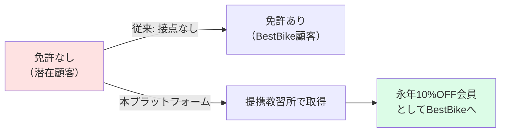
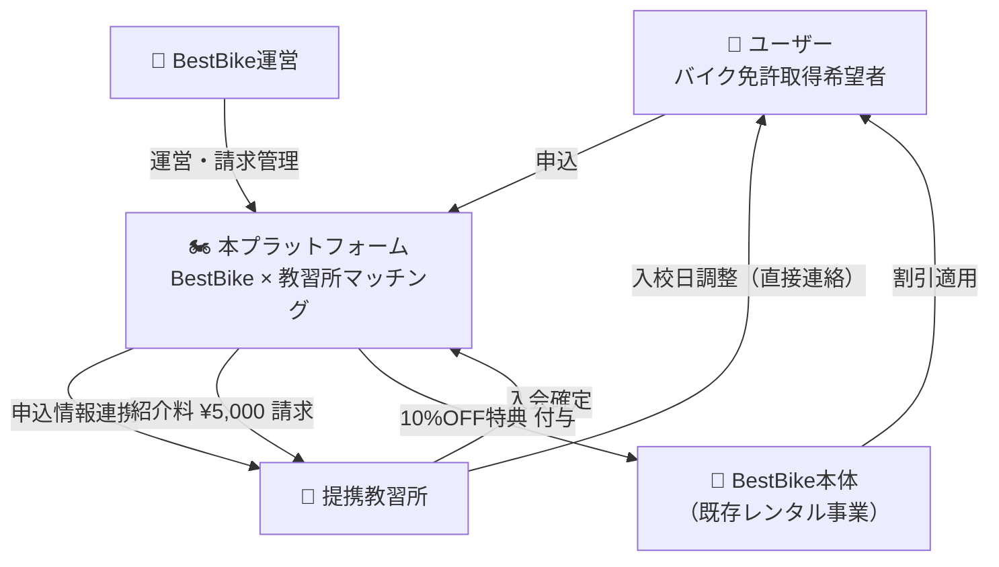
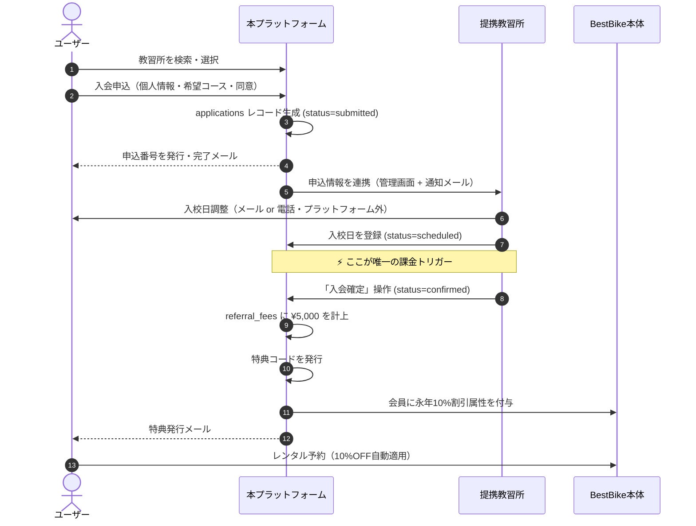
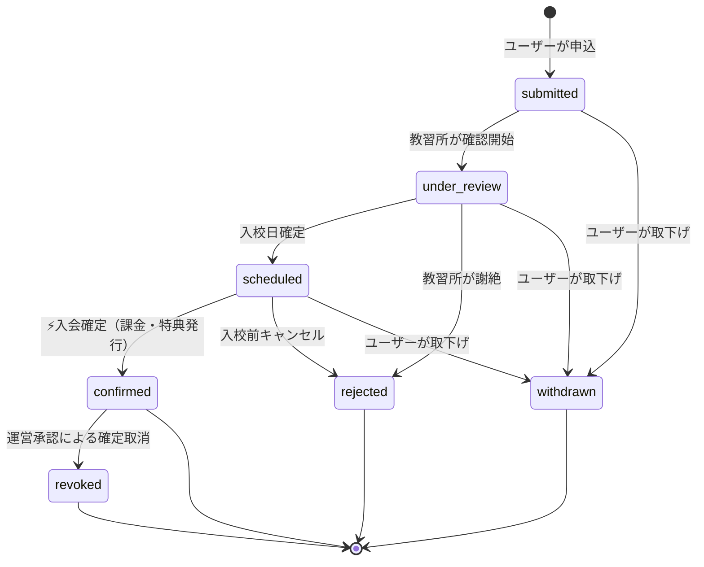

# 要件定義書 — BestBike × 教習所マッチング

版数 v1.0 ／ 2026-08-04 ／ 作成: プロジェクト責任者（CTO）

---

## 0. 本書の位置づけと前提

### 0.1 本書が定義するもの

BestBike（バイクレンタル事業）の会員基盤を、**バイク免許取得の入口**まで拡張する
マッチングプラットフォームの要件を定義する。

### 0.2 仕様の一次ソース

| # | ソース | 状態 | 本書での扱い |
|---|---|---|---|
| S-1 | 動作プロトタイプ（全10画面 / `src/App.js`） | **入手済** | **仕様の一次ソース**。画面・データ・業務ルールはここから起こした |
| S-2 | 企画資料（PDF） | **未入手** | 本セッションに添付されておらず参照できていない。§9 の確認事項で突合する |

> **重要**：本書は S-1（プロトタイプ）から機械的に要件を再構成したものです。
> PDF に S-1 と異なる記載がある場合、**PDF を正とし本書を改版**します。
> §9「確認事項」の A〜K は、PDF を読めば大半が自動的に埋まる項目です。
> PDF を再添付いただければ、差分を突合して v1.1 を発行します。

### 0.3 命名

本書では以下を用いる。

| 呼称 | 指すもの |
|---|---|
| **本プラットフォーム** | 今回新規開発する教習所マッチングサイト |
| **BestBike本体** | 既存のバイクレンタルサービス（会員・予約・決済を保持） |
| **提携教習所** | 本プラットフォームに掲載される自動車学校 |

---

## 1. 事業概要

### 1.1 何を解決するか

バイクレンタル事業の最大の制約は **「免許を持っている人しか顧客になれない」** ことにある。
免許取得は市場への入口であり、ここを押さえた事業者が LTV の起点を取る。

### 1.2 収益構造

| 収益源 | 金額 | 発生タイミング | 支払者 |
|---|---:|---|---|
| **紹介料** | **¥5,000 / 件** | 教習所が「入会確定」を押した時点 | 提携教習所 |
| （将来）掲載料 | 未定 | 月額 | 提携教習所 |
| （間接）LTV向上 | — | 免許取得後のレンタル利用 | ユーザー |

**MVPの収益源は紹介料のみ**。教習料金は本プラットフォームで決済しない（§5.3 参照）。

### 1.3 ユーザーへの提供価値

| 価値 | 内容 |
|---|---|
| **永年10%OFF** | 提携教習所に本プラットフォーム経由で入会確定すると、BestBike のレンタル料金が以後ずっと10%OFF |
| 立ちゴケ安心制度 | 標準付帯（※内容は確認事項 D） |
| 厳選掲載 | BestBike が提携した教習所のみを掲載 |

### 1.4 提携教習所へのメリット

| 価値 | 内容 |
|---|---|
| 成果報酬型の集客 | 入会が確定した分だけ ¥5,000。掲載だけでは費用が発生しない |
| 若年層への接触 | BestBike の既存会員・バイク関心層への露出 |
| 事務の削減 | 申込受付をオンライン化。管理画面で一元管理 |

---

## 2. ステークホルダー

| # | ステークホルダー | ロール名 | 主な関心 |
|---|---|---|---|
| A-1 | バイク免許取得希望者 | `user` | 近くて安い教習所を見つけたい。特典が欲しい |
| A-2 | 提携教習所の担当者 | `school_staff` | 申込を確認し、入会を確定したい。請求を把握したい |
| A-3 | BestBike運営 | `platform_admin` | 送客数・紹介料・提携校数を管理したい |
| A-4 | BestBike本体（システム） | — | 会員に割引属性を反映したい |

---

## 3. 利用者像（ペルソナ）

| # | 像 | 状況 | 本プラットフォームでの行動 |
|---|---|---|---|
| P-1 | 22歳・大学生 | 免許なし。バイクに興味。予算重視 | 価格順で並べ替え → 最安校に申込 |
| P-2 | 34歳・会社員 | 普通免許あり。二輪を追加取得したい | 駅近・営業時間・最短取得日数で選ぶ |
| P-3 | 28歳・女性 | 教習所に不安がある | 「女性講師在籍」バッジ・口コミで選ぶ |
| P-4 | 教習所の事務担当 | PC操作は得意でない | 管理画面で申込一覧を見て「入会確定」を押すだけ |

---

## 4. 業務フロー

### 4.1 正常系（ハッピーパス）

### 4.2 申込ステータス遷移

| ステータス | 日本語 | 課金 | 特典 | 遷移できる者 |
|---|---|---|---|---|
| `submitted` | 申込受付 | — | — | user |
| `under_review` | 確認中 | — | — | school_staff |
| `scheduled` | 入校日確定 | — | — | school_staff |
| `confirmed` | **入会確定** | **¥5,000計上** | **発行** | school_staff |
| `rejected` | 謝絶・キャンセル | — | — | school_staff |
| `withdrawn` | ユーザー取下げ | — | — | user |
| `revoked` | 確定取消 | **取消計上** | **失効** | platform_admin のみ |

> `confirmed → revoked` は **運営のみ**が実行できる。教習所が自分の判断で
> 紹介料の発生を取り消せてはならない（§7 BR-6）。

---

## 5. スコープ

### 5.1 Phase 1（MVP）— 本開発の対象

「ユーザーが教習所を見つけ、申込み、教習所が確定し、特典が出る」までの一本道。

| # | 機能 | 含む |
|---|---|---|
| 1 | 教習所検索・閲覧 | LP / 一覧（地図・リスト）/ 詳細 |
| 2 | 入会申込 | フォーム / 同意取得 / 申込番号発行 |
| 3 | ユーザーのステータス確認 | マイページ / タイムライン |
| 4 | 教習所の申込管理 | 一覧 / 入校日登録 / **入会確定** |
| 5 | 紹介料の自動計上 | referral_fees レコード生成 |
| 6 | 特典の自動発行 | 特典コード発行 / BestBike本体への連携 |
| 7 | 通知 | 申込完了 / 教習所への新規申込 / 特典発行 |
| 8 | 認証 | ユーザー / 教習所スタッフ / 運営の3ロール |

### 5.2 Phase 2 — MVP後

| # | 機能 |
|---|---|
| 9 | 運営ダッシュボード（KPI・ランキング・リアルタイム確定一覧） |
| 10 | 紹介料の月次締め・請求書発行（インボイス対応） |
| 11 | 口コミ・評価投稿 |
| 12 | 教習所セルフ掲載管理（料金・空き枠の自校編集） |
| 13 | 確定取消フロー（運営承認つき） |
| 14 | 監査ログ閲覧 UI |

### 5.3 スコープ外（MVPで作らないもの）と理由

| # | やらないこと | 理由 |
|---|---|---|
| X-1 | **教習料金の決済代行** | 資金決済法（収納代行／資金移動業）の論点が発生する。教習料金は教習所が直接収受する。§05 で詳述 |
| X-2 | 教習所の予約枠のリアルタイム在庫連携 | 教習所側の基幹システムが各社バラバラ。MVPは「残り枠」を手動更新の目安表示に留める |
| X-3 | ネイティブアプリ | レスポンシブWebで足りる |
| X-4 | 教習所の口コミ収集の自動化 | Phase 2 |
| X-5 | BestBike本体のUI改修 | 割引属性の連携のみ。本体画面は既存のまま |

---

## 6. 機能要件

> 記法：**FR-n**（機能要件）／各要件に受入基準を併記。
> 詳細な画面仕様は `02_screen-spec.md`、API は `04_api-spec.md` を参照。

### FR-1 教習所検索・一覧

| 項目 | 内容 |
|---|---|
| 概要 | エリア・駅名で提携教習所を検索し、地図とリストで表示する |
| 入力 | フリーワード（エリア・駅名）、現在地、絞り込み（車種区分・価格帯・特徴）、並び替え（距離順／価格順／評価順） |
| 出力 | 教習所カード（名称・エリア・距離・評価・レビュー数・価格帯・タグ・バッジ・残り枠・営業時間） |
| 表示切替 | 地図ビュー ⇔ リストビュー |
| 受入基準 | AC-1-1: 地図ピンをクリックすると該当教習所の詳細に遷移する AC-1-2: 現在地が地図上に表示される AC-1-3: 検索結果0件のとき、近隣エリアの提案を表示する AC-1-4: 掲載停止中（`status != active`）の教習所は結果に現れない |

### FR-2 教習所詳細

| 項目 | 内容 |
|---|---|
| 概要 | 1校の情報を提示し、申込へ導線をつなぐ |
| 表示要素 | ヒーロー画像 / 名称 / 評価・レビュー数 / エリア / タグ / **特典バナー** / 料金プラン一覧（コース名・税込価格・目安期間）/ アクセス・営業時間・電話番号 / 申込カード（sticky） |
| 受入基準 | AC-2-1: 「この教習所に申し込む」で申込フォームへ遷移し、教習所が引き継がれる AC-2-2: 申込カードに「申込み時点では課金されません」を明示する AC-2-3: 料金は税込表示で、コースごとに表示する |

### FR-3 入会申込

| 項目 | 内容 |
|---|---|
| 概要 | 個人情報とコース希望を入力し、申込レコードを生成する |
| 入力項目 | 希望コース（必須）/ 姓（必須）/ 名（必須）/ 生年月日（必須）/ メールアドレス（必須）/ 電話番号（必須）/ 希望入校日（任意）/ BestBike会員連携（既定ON）|
| 同意項目 | ① 教習所の規約・キャンセルポリシー（必須） ② BestBikeプライバシーポリシー（必須） ③ **個人情報の当該教習所への提供**（必須・§7 BR-8） |
| 出力 | 申込番号 `BB-EDU-YYYY-MMDDHHmm` 形式 |
| 受入基準 | AC-3-1: 必須項目が未入力・不正形式のとき、項目単位でエラーを表示し送信できない AC-3-2: 3つの同意すべてにチェックがなければ送信できない AC-3-3: 送信時点で課金は一切発生しない AC-3-4: 同意の内容・版数・日時を DB に記録する AC-3-5: 同一ユーザー×同一教習所の未完了申込が既にある場合は重複を弾く |

### FR-4 申込完了・通知

| 項目 | 内容 |
|---|---|
| 概要 | 申込番号と次のステップを提示し、関係者へ通知する |
| 通知先 | ユーザー（申込受付メール）／ 教習所（新規申込メール + 管理画面） |
| 受入基準 | AC-4-1: 申込番号が画面とメールの双方に同じ値で出る AC-4-2: 「① 教習所が確認 → ② 入校日調整 → ③ 入会確定で特典発行」の3ステップが表示される AC-4-3: メール送信に失敗しても申込レコードは失われない（再送可能） |

### FR-5 マイページ

| 項目 | 内容 |
|---|---|
| 概要 | 申込ステータスと、確定後の特典コードを表示する |
| 表示要素 | 申込中の教習所・コース・申込番号 / **ステータスタイムライン**（申込受付→確認→入校日確定→入会確定）/ 特典カード（`confirmed` のときのみ）|
| 特典カード | 特典名（BestBike 永年10%OFF）/ クーポンコード / コピーボタン / 適用先アカウント |
| 受入基準 | AC-5-1: `status != confirmed` のとき特典カードは**APIレスポンスにも含まれない**（§05 §2.1） AC-5-2: タイムラインの各ステップに実日時が出る AC-5-3: コピーボタンでクーポンコードがクリップボードに入る |

### FR-6 教習所管理画面

| 項目 | 内容 |
|---|---|
| 概要 | 自校宛の申込を一覧し、ステータスを進める |
| サマリー | 今月の新規申込 / 承認待ち / 入会確定 / BestBikeへの紹介料（当月累計） |
| 一覧 | 申込番号 / 氏名 / コース / 申込日 / ステータス / アクション |
| 操作 | 詳細表示 / 入校日登録 / **入会確定** / 謝絶 |
| 受入基準 | AC-6-1: 自校の申込**のみ**が見える（他校の申込はAPIでも取得できない） AC-6-2: 「入会確定」は確認ダイアログを経由する AC-6-3: 「入会確定」を二重に押しても紹介料は1件しか計上されない（§7 BR-3） AC-6-4: 確定後、教習所側の操作で `confirmed` を取り消せない AC-6-5: 紹介料が発生する旨が操作前に画面上で明示される |

### FR-7 入会確定トランザクション（最重要）

| 項目 | 内容 |
|---|---|
| 概要 | `confirmed` への遷移と同時に、紹介料計上・特典発行・通知を**単一トランザクション**で実行する |
| 実行内容 | ① `applications.status = confirmed`, `confirmed_at` 記録 ② `referral_fees` に ¥5,000 を1件生成 ③ `benefits` に永年10%割引を1件生成・クーポンコード採番 ④ BestBike本体へ割引属性を連携 ⑤ ユーザーへ特典発行メール ⑥ `audit_logs` に操作者・IP・日時を記録 |
| 受入基準 | AC-7-1: ①〜③⑥ は同一DBトランザクション。1つでも失敗したら全てロールバックする AC-7-2: ④⑤ は非同期。失敗しても①〜③は確定したまま、リトライされる AC-7-3: 同一 `application_id` に対する `referral_fees` / `benefits` はDB制約上1件しか作れない AC-7-4: `Idempotency-Key` が同一のリクエストは2回目以降、新規計上せず初回結果を返す |

### FR-8 特典（クーポン）発行と本体連携

| 項目 | 内容 |
|---|---|
| コード体系 | `EDU10-{ユーザー識別子}-{西暦}` （例: `EDU10-SHO-2026`）※ 推測困難な採番に変更する（§7 BR-5） |
| 割引率 | 10%（`benefit_master` で可変） |
| 有効期間 | 永年（終了条件は規約に明記・§05 §5.3） |
| 連携 | BestBike本体の会員レコードに割引属性を付与 |
| 受入基準 | AC-8-1: 1申込につき1コード AC-8-2: コードは第三者が推測できない AC-8-3: 連携APIが落ちていても発行は成立し、後追いで同期される |

### FR-9 紹介料の計上と請求

| 項目 | 内容 |
|---|---|
| 単価 | ¥5,000 / 件（税別・`schools.referral_fee_amount` で校ごとに上書き可） |
| 計上 | 入会確定時に `referral_fees` を `accrued` で生成 |
| 締め | 月次（当月1日〜末日）→ `billed` |
| 請求 | Phase 2 で請求書PDF発行（インボイス制度対応） |
| 受入基準 | AC-9-1: 教習所管理画面の「紹介料」と運営画面の集計が常に一致する AC-9-2: `revoked` の申込は当月計上から控除される |

### FR-10 運営ダッシュボード（Phase 2）

| 項目 | 内容 |
|---|---|
| KPI | 今月の入会確定数 / 紹介料売上 / 発行済特典コード数 / 提携教習所数（各前月比つき） |
| グラフ | 月次の入会確定数推移 |
| ランキング | 提携教習所別 確定数（当月） |
| 一覧 | 最近の入会確定（確定日時・教習所・ユーザー・発行コード・紹介料） |
| 受入基準 | AC-10-1: 運営画面のユーザーメールは**マスク表示**（`ta***@gmail.com`） AC-10-2: 集計はDBの実データから算出し、画面固定値を持たない |

### FR-11 認証・権限

| ロール | 認証方式 | 見えるもの |
|---|---|---|
| `user` | メール＋パスワード（またはマジックリンク） | 自分の申込・自分の特典 |
| `school_staff` | メール＋パスワード＋**必須のMFA** | 自校の申込のみ |
| `platform_admin` | メール＋パスワード＋**必須のMFA** | 全データ（個人情報はマスク） |

| 受入基準 |
|---|
| AC-11-1: ロールの判定は**サーバ側**で行う。クライアントの表示制御は防御ではない |
| AC-11-2: 教習所スタッフが他校の `application_id` を直接叩いても 404 を返す |
| AC-11-3: 金銭が動く操作（入会確定・確定取消）は MFA 済セッションでのみ許可する |

---

## 7. 業務ルール

| # | ルール | 根拠・意図 |
|---|---|---|
| **BR-1** | 紹介料が発生する唯一のトリガーは、教習所による「入会確定」操作である | 収益イベントを1点に集約し、検証可能にする |
| **BR-2** | 申込時点では、ユーザー・教習所いずれにも課金は発生しない | 申込のハードルを下げる。表示で明示（AC-2-2, AC-3-3）|
| **BR-3** | 1つの申込から生成される紹介料レコードと特典は、それぞれ最大1件 | 二重計上・二重発行の防止。DBのUNIQUE制約で担保する |
| **BR-4** | 「入会確定」は入校日確定（`scheduled`）後にのみ実行できる | 実態のない確定による不正計上の防止 |
| **BR-5** | 特典コードは第三者が推測できない値とする | プロトタイプの `EDU10-SHO-2026` は氏名＋西暦で推測可能。**要変更** |
| **BR-6** | `confirmed` の取消は BestBike運営のみが実行でき、理由の記録を必須とする | 教習所が紹介料逃れのために取り消せる状態は事業として成立しない |
| **BR-7** | 特典は「入会確定」に紐づき、教習の修了・免許取得を条件としない | 教習所側の運用負荷を上げないため。ただし §9 確認事項 C |
| **BR-8** | 個人情報を教習所に提供する前に、ユーザーの明示的な同意を取得・記録する | 個人情報保護法 第27条（第三者提供の制限） |
| **BR-9** | 教習料金の収受は教習所が直接行い、本プラットフォームは介在しない | 資金決済法上の論点を回避する（§5.3 X-1） |
| **BR-10** | 掲載する価格・期間・特徴は、教習所からの申告を根拠として保持する | 景品表示法（優良誤認・有利誤認）対応。表示根拠の保存義務 |

---

## 8. 用語集

| 用語 | 定義 |
|---|---|
| 入会確定 | 教習所が「この申込者は当校に入校する」と確定させる操作。**課金・特典発行の唯一のトリガー** |
| 紹介料 | 入会確定1件につき教習所が BestBike に支払う ¥5,000 |
| 特典 / 永年10%OFF | 入会確定したユーザーが得る、BestBike レンタル料金の恒久的な10%割引 |
| 申込番号 | `BB-EDU-YYYY-MMDDHHmm` 形式のユーザー向け識別子 |
| 中抜き | ユーザーが本プラットフォーム経由で送客されたにもかかわらず、教習所が「入会確定」を押さず紹介料の支払いを回避する行為 |

---

## 9. 確認事項

> **PDF を参照できていないため、以下は本書では確定できていません。**
> A〜E は事業判断、F〜K は PDF に記載があれば自動的に解決する項目です。

| # | 確認事項 | 未確定だと何が起きるか | 暫定の想定 |
|---|---|---|---|
| **A** | 紹介料 ¥5,000 は全校一律か、校ごと／コースごとに変動するか | 請求ロジックの手戻り | 校ごとに上書き可能な設計にしておく（`schools.referral_fee_amount`） |
| **B** | 「永年10%OFF」の終了条件（退会時・規約変更時・事業終了時） | 景表法リスク。規約に書けない | 規約で「事前告知のうえ変更・終了しうる」と定義 |
| **C** | 特典付与の条件は「入会確定」で確定か、「教習修了」まで必要か | 特典発行タイミングの設計が変わる | 入会確定（BR-7） |
| **D** | 「立ちゴケ安心制度」の具体的内容・費用負担者 | LPの訴求文を書けない。景表法リスク | LPからの表示を一旦保留 |
| **E** | 中抜き（確定漏れ）をどう検知・抑止するか | 売上の取りこぼしが構造的に発生する | 入校予定日超過アラート＋ユーザー側の「通い始めた」申告（§05 §3.3） |
| **F** | 初期の提携教習所数と対象エリア | 検索UIの設計（全国 or 首都圏限定）が変わる | プロトタイプ準拠：24校（神奈川・東京中心） |
| **G** | BestBike本体の会員基盤との関係（同一DB / API連携 / SSO） | 認証・会員連携の設計が根本から変わる | **API連携**を前提に設計（§04 §6） |
| **H** | BestBike本体側に割引属性を持たせるAPIは既に存在するか | 連携部分の工数が読めない | 存在しない前提でWebhook受け口の新設を見込む |
| **I** | 教習所からの紹介料回収方法（口座振替 / 請求書 / 相殺） | 請求機能の要否とPhase配分が変わる | 月次締めの請求書払い |
| **J** | 口コミ・評価（プロトタイプの 4.7 / 342件）の出所 | 実データがないなら表示できない | Phase 2 で自社収集。MVPでは非表示 or 件数のみ |
| **K** | 教習所の掲載情報（料金・空き枠）の更新責任者 | 情報鮮度の運用が回らない | Phase 1 は運営が代行、Phase 2 で教習所セルフ更新 |

### 回答のお願い

A・C・E・G の4点は **Phase 1 の着手前に確定が必要**です。
特に **G（BestBike本体との関係）** は、認証・会員・特典連携の設計全体を左右するため、
最優先で確認させてください。

---

## 10. 要件と成果物の対応表

| 要件 | 画面仕様 | データ | API | チケット |
|---|---|---|---|---|
| FR-1 教習所検索 | [02 §3.2](02_screen-spec.md) | `schools` | `GET /api/schools` | T-04 |
| FR-2 教習所詳細 | [02 §3.3](02_screen-spec.md) | `schools`, `school_courses` | `GET /api/schools/:id` | T-05 |
| FR-3 入会申込 | [02 §3.4](02_screen-spec.md) | `applications`, `consents` | `POST /api/applications` | T-06 |
| FR-4 申込完了・通知 | [02 §3.5](02_screen-spec.md) | `notifications` | — | T-07 |
| FR-5 マイページ | [02 §3.6](02_screen-spec.md) | `applications`, `benefits` | `GET /api/me/applications` | T-08 |
| FR-6 教習所管理 | [02 §3.7](02_screen-spec.md) | `applications` | `GET /api/school/applications` | T-09 |
| FR-7 入会確定 | [02 §3.7.3](02_screen-spec.md) | 全テーブル | `POST /api/school/applications/:id/confirm` | **T-10** |
| FR-8 特典発行 | [02 §3.6.2](02_screen-spec.md) | `benefits` | `POST /api/internal/benefits` | T-11 |
| FR-9 紹介料 | [02 §3.8](02_screen-spec.md) | `referral_fees` | `GET /api/school/referral-fees` | T-13 |
| FR-10 運営ダッシュボード | [02 §3.8](02_screen-spec.md) | 集計 | `GET /api/admin/dashboard` | T-12 |
| FR-11 認証・権限 | — | `users`, `school_staff` | — | T-03 |
