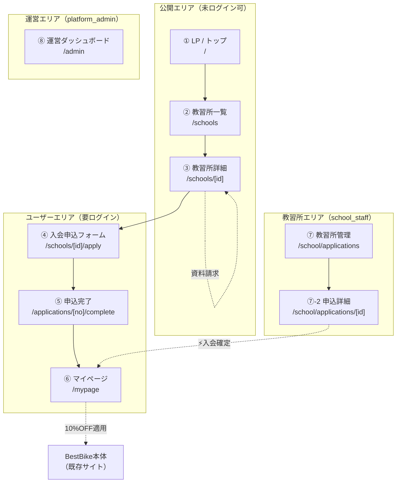
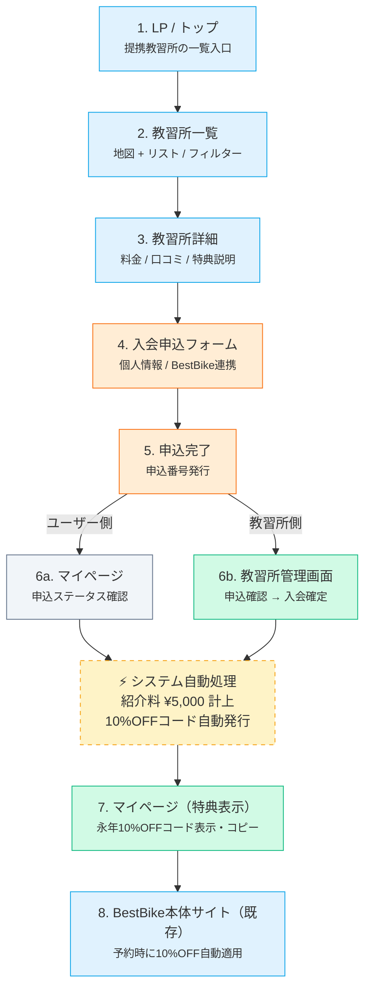
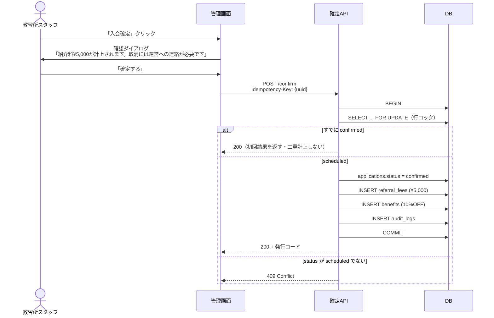

# 画面仕様書 — BestBike × 教習所マッチング

版数 v1.0 ／ 2026-08-04

> 本書は動作プロトタイプ（`src/App.js` / `prototype/index.html`）を仕様化したもの。
> 実装時は**プロトタイプを正**とし、本書で補えない細部は画面を参照すること。

---

## 1. サイトマップ

## 2. 画面遷移図（プロトタイプ 画面9 相当）

| 凡例 | フェーズ |
|---|---|
| 🟦 スカイ | 情報閲覧フェーズ |
| 🟧 オレンジ | 申込フェーズ |
| 🟩 エメラルド | 確定・特典フェーズ |
| ⬜ スレート | 待機・管理 |

---

## 3. 画面別仕様

### 3.1 ① LP / トップ — `/`

| 項目 | 内容 |
|---|---|
| ロール | 全員（未ログイン可） |
| 目的 | 「免許取得 → 永年10%OFF」の価値を伝え、一覧へ送る |

**構成**

| # | セクション | 要素 |
|---|---|---|
| 1 | ヘッダー | ロゴ / ナビ（教習所を探す・特典内容・ご利用の流れ）/ ログイン / 新規登録。`sticky top-0` |
| 2 | ヒーロー | バッジ「BestBike会員限定 / 特別提携」 見出し「免許取得も、バイクライフも、ここから。」 説明「BestBike提携教習所で免許取得 → 以降ずっと、BestBikeが永年10%OFF」 CTA「教習所を探す」（primary）/「特典を確認する」（ghost） |
| 3 | 特典カード（ヒーロー右） | ① 永年割引 BestBike 10%OFF ② 標準付帯 立ちゴケ安心制度 ※確認事項D ③ BestBike提携 厳選教習所のみ掲載 |
| 4 | 3ステップ | 01 教習所を選ぶ／02 BestBike経由で申込／03 割引コード発行 |
| 5 | CTA | 「いま、免許を取るなら。」→ 教習所一覧を見る |

**受入基準**

- AC-LP-1: ヒーローCTA・最下部CTAの双方から `/schools` に遷移する
- AC-LP-2: 未ログインでも全セクションが閲覧できる
- AC-LP-3: モバイル幅（375px）でヒーローが1カラムに落ち、CTAが折り返さない

---

### 3.2 ② 教習所一覧 — `/schools`

| 項目 | 内容 |
|---|---|
| ロール | 全員（未ログイン可） |
| 目的 | 通える教習所を絞り込ませる |

**構成**

| # | 領域 | 要素 |
|---|---|---|
| 1 | 検索バー | フリーワード入力（エリア・駅名）/ 絞り込みボタン / 地図⇔リスト切替トグル |
| 2 | 見出し | 「提携教習所 N件」/ サブ「現在地から近い順に表示」/ 並び替え（距離順・価格順・評価順） |
| 3 | 地図（左 2/5） | 提携校ピン（クリックで詳細へ）/ ホバーで校名ツールチップ / 現在地マーカー（パルス）/ 凡例 |
| 4 | リスト（右 3/5、リストビュー時は全幅2カラム） | 教習所カード |

**教習所カード**

| 要素 | 例 | 出所 |
|---|---|---|
| サムネイル | グラデーション（実装時は写真） | `schools.hero_image_url` |
| 校名 | 湘南台自動車学校 | `schools.name` |
| エリア / 距離 | 神奈川県藤沢市 / 1.2km | `schools.area` / 現在地からの算出 |
| 評価 / レビュー数 | ★4.7 (342) | `schools.rating` ※確認事項J |
| 残り枠 | 残り枠 8名 | `schools.capacity_note` |
| タグ | 普通二輪 / 大型二輪 / AT限定 | `school_courses` から導出 |
| バッジ | BestBike推薦 / 送迎バスあり / 女性講師在籍 / 最短2週間 | `schools.badge` |
| 価格 | 普通二輪 ¥98,000〜 | `school_courses` の最小額 |

**絞り込み条件**

| 条件 | 型 |
|---|---|
| 車種区分 | 普通二輪MT / 普通二輪AT限定 / 大型二輪 / 原付講習（複数選択） |
| 価格帯 | 〜10万 / 10〜12万 / 12万〜 |
| 特徴 | 送迎バスあり / 女性講師在籍 / 夜間営業 / 短期集中 |
| エリア | 都道府県 → 市区町村 |

**受入基準**

- AC-LI-1: 地図ピンとリストカードのどちらからでも同じ詳細画面に遷移する
- AC-LI-2: 絞り込み・並び替えの状態がURLクエリに反映され、リロード・共有で再現できる
- AC-LI-3: 検索結果0件のとき、空状態と近隣エリアの提案を表示する
- AC-LI-4: `schools.status != 'active'` の教習所は表示されない
- AC-LI-5: 20件を超える場合はページング（または無限スクロール）される

> **実装メモ**：プロトタイプの地図はSVGのプレースホルダ。実装は
> Google Maps JavaScript API または MapLibre GL を用いる（`05_nonfunctional.md` §1.3）。

---

### 3.3 ③ 教習所詳細 — `/schools/[id]`

| 項目 | 内容 |
|---|---|
| ロール | 全員（未ログイン可） |
| 目的 | 申込の意思決定に必要な情報を出し切り、申込へ送る |

**構成**

| # | 領域 | 要素 |
|---|---|---|
| 1 | ヒーロー画像 | h-64 / お気に入り・共有ボタン / バッジ |
| 2 | タイトル | 校名 / 評価・レビュー件数 / エリア / タグ |
| 3 | **特典バナー** | 「BestBike経由入会の特典」：入会確定時に永年10%OFFコードを発行 |
| 4 | 料金プラン | コース名 / 目安期間 / 税込価格（普通二輪MT ¥98,000 / AT限定 ¥92,000 / 大型二輪 ¥135,000） |
| 5 | アクセス・営業時間 | 住所・最寄駅 / 営業時間 / 電話番号 |
| 6 | 申込カード（右・sticky） | 代表コース名 / 価格 / BestBike経由のメリット3点 / 「この教習所に申し込む」/ 「資料請求」/ 注記「申込み時点では課金されません」 |

**受入基準**

- AC-D-1: 「この教習所に申し込む」で `/schools/[id]/apply` に遷移し、教習所が引き継がれる
- AC-D-2: 未ログインで申込を押した場合、ログイン後に申込フォームへ戻る
- AC-D-3: 料金は税込で、コースごとに表示する
- AC-D-4: 存在しない・掲載停止中のIDは404を返す
- AC-D-5: 申込カードは1024px未満でsticky解除し、画面下部固定CTAに切り替わる

---

### 3.4 ④ 入会申込フォーム — `/schools/[id]/apply`

| 項目 | 内容 |
|---|---|
| ロール | `user`（要ログイン） |
| 目的 | 申込レコードの生成に必要な情報と同意を取得する |

**ステップインジケータ**：`情報入力 → 確認 → 完了`（3ステップ）

**入力項目**

| # | 項目 | 必須 | 型 / 制約 | 備考 |
|---|---|:---:|---|---|
| 1 | 希望コース | ● | select（当該校の `school_courses`） | 価格を併記 |
| 2 | 姓 | ● | text / 1〜32文字 | |
| 3 | 名 | ● | text / 1〜32文字 | |
| 4 | 生年月日 | ● | date | **年齢下限チェック**（普通二輪16歳／大型二輪18歳）|
| 5 | メールアドレス | ● | email | BestBike会員と連携 |
| 6 | 電話番号 | ● | 日本の電話番号形式 | 教習所からの連絡先 |
| 7 | 希望入校日 | — | date / 翌日以降 | 注記「教習所側で調整後、正式な入校日が確定」 |
| 8 | BestBike会員として登録・連携する | — | checkbox（既定ON） | |

**同意項目（すべて必須）**

| # | 同意 | 記録 |
|---|---|---|
| 1 | 教習所の規約・キャンセルポリシーに同意する | 版数・日時 |
| 2 | BestBikeのプライバシーポリシーに同意する | 版数・日時 |
| 3 | **氏名・生年月日・連絡先を当該教習所に提供することに同意する** | 版数・日時・提供先school_id |

> ③はプロトタイプに存在しない。**個人情報保護法 第27条の要請により追加**（`01_requirements.md` BR-8）。

**バリデーション**

| タイミング | 動作 |
|---|---|
| blur時 | 項目単位でエラー表示 |
| 送信時 | 全項目を再検証。1件でもNGなら送信せず、最初のエラー項目へフォーカス |
| サーバ側 | クライアントと同一ルールで再検証（クライアント検証は防御ではない） |

**受入基準**

- AC-F-1: 必須未入力・形式不正で送信できない
- AC-F-2: 同意3件すべてにチェックがなければ送信ボタンが無効
- AC-F-3: 年齢が受講要件を満たさないコースは選択時に警告する
- AC-F-4: 二重送信（連打）で申込が2件作られない
- AC-F-5: 同一ユーザー×同一教習所の未完了申込があるとき、重複エラーを返す
- AC-F-6: 送信中はボタンをローディング状態にし、再クリックを受け付けない

---

### 3.5 ⑤ 申込完了 — `/applications/[no]/complete`

| 項目 | 内容 |
|---|---|
| ロール | `user` |
| 目的 | 受付を確定的に伝え、次に何が起きるかを示す |

**構成**

| # | 要素 | 内容 |
|---|---|---|
| 1 | 成功アイコン + 見出し | 「申込を受け付けました」 |
| 2 | 説明 | 「〇〇自動車学校に入会申込を送信しました。教習所側で内容を確認後、ご登録のメールアドレスに連絡が届きます。」 |
| 3 | 申込番号 | `BB-EDU-2026-04221138`（等幅フォント） |
| 4 | 次のステップ | ① 教習所が申込を確認（通常1〜2営業日） ② 入校日調整・初回連絡が入る ③ 教習所側で**入会確定** → BestBike 10%OFFコードが自動発行 |
| 5 | CTA | 「マイページで状況を確認」/「トップに戻る」 |

**受入基準**

- AC-C-1: 申込番号が画面・メールで一致する
- AC-C-2: 他人の申込番号でこの画面を開けない（本人のみ）
- AC-C-3: リロードしても申込が再生成されない（POST-Redirect-GET）

---

### 3.6 ⑥ マイページ — `/mypage`

| 項目 | 内容 |
|---|---|
| ロール | `user` |
| 目的 | 申込ステータスの確認と、確定後の特典受け取り |

#### 3.6.1 申込状況ブロック

| 要素 | 内容 |
|---|---|
| 教習所名 + ステータスバッジ | 確認中（amber）/ 入会確定（emerald）/ キャンセル（slate） |
| コース・価格 | 普通二輪MT / ¥98,000 |
| 申込番号 | BB-EDU-2026-04221138 |
| **ステータスタイムライン** | 申込受付 → 教習所による確認 → 入校日確定 → 入会確定・特典発行（各に実日時） |

#### 3.6.2 特典カード（`status = confirmed` のときのみ）

| 要素 | 内容 |
|---|---|
| ラベル | 「教習所入会特典 取得済」 |
| 特典名 | BestBike 永年10%OFF |
| 説明 | 次回以降のレンタル料金から自動で10%OFF |
| クーポンコード | 等幅・大きく表示 + コピーボタン |
| 注記 | 「BestBikeアカウント（{email}）に自動適用済。次回予約時から有効。」 |

> **セキュリティ要件**：`status != confirmed` のとき、特典情報は
> **APIレスポンスに含めない**。CSSで隠すだけの実装は不可（`05_nonfunctional.md` §2.1）。

#### 3.6.3 BestBikeレンタル導線

「10%OFFコード適用済。いつでも予約可能。」→ BestBike本体の予約ページへ

**受入基準**

- AC-M-1: `confirmed` 以外のとき、特典カードはDOMにもAPIレスポンスにも存在しない
- AC-M-2: タイムラインの各ステップに、DBに記録された実日時が表示される
- AC-M-3: コピーボタンでクーポンコードがクリップボードに入り、成功トーストが出る
- AC-M-4: 申込が複数ある場合、すべてがカードとして並ぶ

---

### 3.7 ⑦ 教習所管理画面 — `/school/applications`

| 項目 | 内容 |
|---|---|
| ロール | `school_staff`（MFA必須） |
| 目的 | 自校宛の申込を処理し、入会を確定させる |

#### 3.7.1 サマリーカード

| # | 指標 | 集計範囲 |
|---|---|---|
| 1 | 今月の新規申込 | 当月 `applied_at` |
| 2 | 承認待ち | `status IN (submitted, under_review)` |
| 3 | 入会確定 | 当月 `confirmed_at` |
| 4 | BestBikeへの紹介料 | 当月 `referral_fees` 合計 |

#### 3.7.2 申込一覧テーブル

| 列 | 内容 |
|---|---|
| 申込番号 | 等幅 |
| 氏名 | |
| コース | |
| 申込日 | MM/DD |
| ステータス | 確認中 / 入会確定 / キャンセル |
| アクション | `pending` 時：「入会確定」「詳細」／それ以外：「詳細」 |

フィルタ：すべて / 承認待ち / 入会確定

#### 3.7.3 ⚡ 入会確定フロー（最重要）

**確認ダイアログの必須文言**

> この申込を「入会確定」にします。
> - BestBikeへの紹介料 **¥5,000** が計上されます
> - 申込者に **BestBike永年10%OFFコード** が自動発行されます
> - **確定後の取消しには、BestBike運営への連絡が必要です**

**受入基準**

- AC-SA-1: 自校の申込のみが一覧・詳細・APIすべてで取得できる
- AC-SA-2: 他校の `application_id` を直接指定しても404
- AC-SA-3: 「入会確定」は確認ダイアログを必ず経由する
- AC-SA-4: 連打・再送で紹介料が2件計上されない
- AC-SA-5: `scheduled` 以外のステータスから確定できない（`01_requirements.md` BR-4）
- AC-SA-6: 確定後、教習所側UIに取消ボタンが存在しない
- AC-SA-7: 操作者・IP・日時が `audit_logs` に残る

---

### 3.8 ⑧ 運営ダッシュボード — `/admin`（Phase 2）

| 項目 | 内容 |
|---|---|
| ロール | `platform_admin`（MFA必須） |

| # | 領域 | 内容 |
|---|---|---|
| 1 | KPIカード ×4 | 今月の入会確定（件・前月比）/ 紹介料売上（円・前月比）/ 発行済特典コード（件）/ 提携教習所（校・増減） |
| 2 | グラフ | 月次の入会確定数推移（直近7ヶ月・棒グラフ） |
| 3 | ランキング | 提携教習所別 確定数（当月・上位） |
| 4 | 最近の入会確定 | 確定日時 / 教習所 / ユーザー（**マスク**）/ 発行コード / 紹介料 |

**受入基準**

- AC-BA-1: ユーザーのメールは `ta***@gmail.com` 形式でマスクされる
- AC-BA-2: すべての数値がDBの実データから算出される（ハードコードされた値を持たない）
- AC-BA-3: 教習所管理画面の紹介料合計と、運営画面の当該校の値が一致する

---

## 4. デザイントークン

プロトタイプで実際に使用されている値を正とする。

### 4.1 カラー（Tailwind パレット）

| 用途 | トークン | 値 |
|---|---|---|
| プライマリ | `sky-600` | `#0284c7` |
| プライマリ濃 | `sky-700` | `#0369a1` |
| アクセント（CTA） | `orange-500` | `#f97316` |
| 成功・確定 | `emerald-600` | `#059669` |
| 警告・承認待ち | `amber-400/500` | `#fbbf24` / `#f59e0b` |
| テキスト主 | `slate-900` | `#0f172a` |
| テキスト副 | `slate-500/600` | `#64748b` / `#475569` |
| 罫線 | `slate-200` | `#e2e8f0` |
| 背景 | `white` / `slate-50` / `slate-100` | |
| ダークヘッダー | `slate-900` → `blue-900` グラデーション | |

### 4.2 タイポグラフィ

| 用途 | クラス |
|---|---|
| フォント | `-apple-system, BlinkMacSystemFont, "Hiragino Sans", "Noto Sans JP", sans-serif` |
| 画面見出し(h1) | `text-3xl font-black` |
| セクション見出し(h2) | `text-lg 〜 text-xl font-bold` |
| 本文 | `text-sm` |
| 補足 | `text-xs text-slate-500` |
| 数値・コード | `font-mono` |

### 4.3 コンポーネント

| 名称 | 仕様 |
|---|---|
| `BrandLogo` | sky-500→blue-700 グラデの角丸アイコン + 「Best**Bike**」+ 「×教習所」 |
| `Pill` | `rounded-full px-2.5 py-0.5 text-xs font-semibold border`。色: sky / orange / emerald / slate / amber |
| カード | `rounded-2xl border border-slate-200`、ホバーで `shadow-xl` |
| ボタン(primary) | `bg-sky-600 hover:bg-sky-700 text-white font-bold rounded-lg` |
| ボタン(CTA) | `bg-orange-500 hover:bg-orange-600 text-white font-bold rounded-xl` |
| ボタン(secondary) | `border border-slate-300 hover:bg-slate-50 rounded-xl` |
| 入力 | `border border-slate-300 rounded-lg px-3 py-2.5 text-sm focus:border-sky-500` |

### 4.4 ブレークポイント

| 名称 | 幅 | 主な変化 |
|---|---|---|
| モバイル | 〜767px | 1カラム。地図は上、リストは下。申込カードは画面下部固定 |
| タブレット | 768〜1023px | 2カラム |
| デスクトップ | 1024px〜 | 一覧は 2:3 の地図/リスト。詳細は 2:1 の本文/申込カード |

---

## 5. アクセシビリティ要件

| # | 要件 | 判定 |
|---|---|---|
| A11Y-1 | 本文テキストのコントラスト比 4.5:1 以上 | axe / Lighthouse |
| A11Y-2 | すべてのフォーム入力に `<label>` が紐づく | 手動 + axe |
| A11Y-3 | キーボードのみで申込完了まで到達できる | 手動 |
| A11Y-4 | フォーカスリングを消さない（`outline-none` 単独使用の禁止） | コードレビュー |
| A11Y-5 | 地図ピンに代替となるリスト表示が常に存在する | 手動 |
| A11Y-6 | ステータスバッジを色のみで区別しない（文言を併記） | 手動 |
| A11Y-7 | エラーメッセージが `aria-describedby` で入力に紐づく | axe |
| A11Y-8 | 「入会確定」ダイアログがフォーカストラップを持つ | 手動 |

> プロトタイプは `outline-none` を入力に使用している（A11Y-4 違反）。
> 実装時は `focus-visible:ring-2 focus-visible:ring-sky-500` に置き換えること。

---

## 6. 空状態・エラー状態

| 画面 | 状態 | 表示 |
|---|---|---|
| 一覧 | 検索結果0件 | 「該当する教習所が見つかりませんでした」+ 条件クリア + 近隣エリア提案 |
| 一覧 | 読込中 | カードのスケルトン ×4 |
| 詳細 | 存在しない/掲載停止 | 404ページ + 一覧へ戻る |
| フォーム | 送信失敗 | インラインのエラーバナー。入力値は保持する |
| マイページ | 申込なし | 「まだ申込がありません」+ 教習所を探すCTA |
| 教習所管理 | 申込なし | 「新しい申込はありません」 |
| 全画面 | サーバエラー | 500ページ + 問い合わせ先 |
