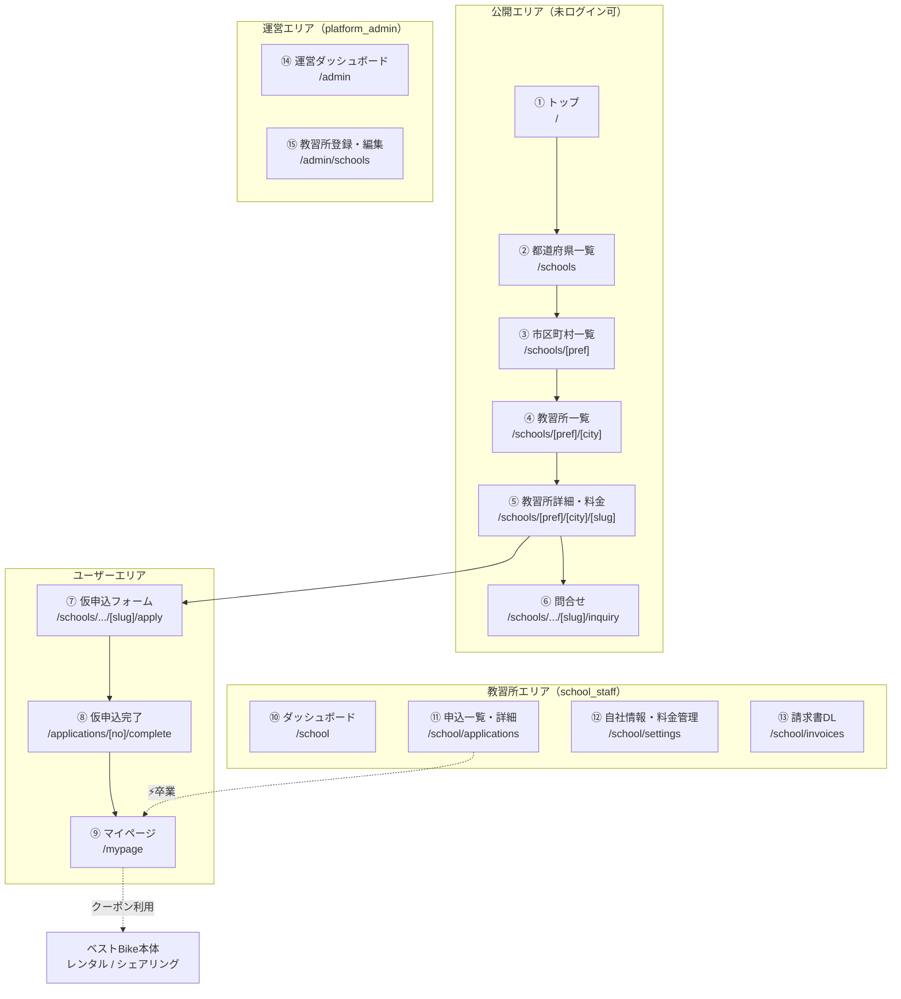
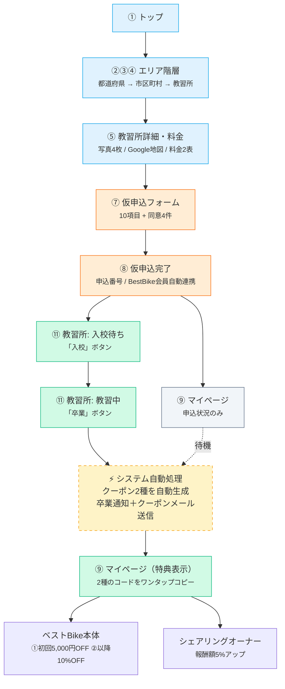
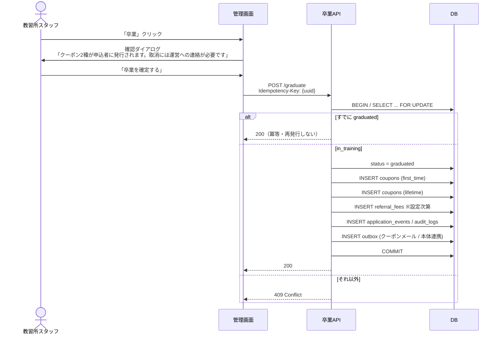

# 画面仕様書 — BestBike × 教習所マッチング

版数 **v1.1** ／ 2026-08-04

> **v1.0 からの主な変更**
> ① 一覧を「現在地＋地図」から **SUUMO型のエリア階層** に変更（P-1 §1）
> ② 料金表示を **教習費用 ＋ 別途費用の2テーブル** に変更（P-1 §2 / P-2 §3）
> ③ 仮申込フォームの項目を P-1 §3 に合わせて全面差し替え
> ④ **問合せフォーム**・**卒業フロー**・**教習所セルフ管理** を追加
> ⑤ 特典表示を「入会確定時に1種」から **「卒業時に2種」** に変更
> ⑥ 口コミ・評価・残り枠・現在地を削除（PDFに記載なし）
> 差分の全量は [`09_pdf-reconciliation.md`](09_pdf-reconciliation.md)。

---

## 1. サイトマップ



## 2. 画面遷移図



---

## 3. 画面別仕様

### 3.1 ① トップ — `/`

| 項目 | 内容 |
|---|---|
| ロール | 全員（未ログイン可） |
| 目的 | 「教習所を探す → 卒業で特典」の価値を伝え、エリア選択へ送る |

| # | セクション | 要素 |
|---|---|---|
| 1 | ヘッダー | ロゴ / 教習所を探す / 特典について / ログイン / 新規登録 |
| 2 | ヒーロー | 見出し・説明・CTA「教習所を探す」 |
| 3 | 特典カード | ① 卒業で **初回5,000円OFF**<br>② 2回目以降 **永久10%OFF**<br>③ シェアリングオーナーで **報酬額5%アップ** |
| 4 | 3ステップ | 01 教習所を選ぶ／02 仮申込（BestBike会員に自動連携）／03 **卒業でクーポン2種** |
| 5 | エリアから探す | 主要都道府県へのショートカット |

**受入基準**

- AC-T-1: CTAから `/schools`（都道府県一覧）へ遷移する
- AC-T-2: 特典が**卒業時に受け取れる**ものだと明記されている
- AC-T-3: 未ログインで全セクションが閲覧できる
- AC-T-4: 375px幅でレイアウトが崩れない

> **注意**：特典の受取条件は「卒業」である。「申込で」「入校で」もらえるような表現は
> 景品表示法上の有利誤認にあたる。文言に必ず「卒業時に」を入れること。

---

### 3.2 ②③④ エリア階層 — `/schools` → `/schools/[pref]` → `/schools/[pref]/[city]`

> P-1 §1：「県外の教習所に通う確率は低いので、都道府県ごとの表示（可能であれば市区町村）で
> 分けられると。→**SUUMO等の不動産HPに近い表示**」
> 「地図に関しては『現在地』から拾う必要はないと思っています、**電車等で見ることを想定**」

#### ② 都道府県一覧 `/schools`

| 要素 | 内容 |
|---|---|
| 表示 | 地方ブロック（関東・関西…）ごとに都道府県をグリッド表示 |
| 各項目 | 都道府県名 ＋ **掲載件数** |
| 掲載0件 | グレーアウトし、クリックできない |

#### ③ 市区町村一覧 `/schools/[pref]`

| 要素 | 内容 |
|---|---|
| パンくず | ホーム > 東京都 |
| 表示 | 市区町村をリスト表示。50音 or 行政区順 |
| 各項目 | 市区町村名 ＋ 掲載件数 |
| 補助 | 「東京都のすべての教習所を見る」リンク |

#### ④ 教習所一覧 `/schools/[pref]/[city]`

| 要素 | 内容 |
|---|---|
| パンくず | ホーム > 東京都 > 世田谷区 |
| 見出し | 「世田谷区の教習所 N件」 |
| 絞り込み | 希望免許（6種）/ 現在お持ちの免許 / 価格帯 / 特色 |
| 並び替え | 価格が安い順 / 新着順 |
| **地図** | **置かない** |

**教習所カード**（P-1 §1 の掲載例をそのまま構造化）

```
┌────────────────────────────────────────────────────┐
│ [写真]  せたがや自動車学校                          │
│         東京都世田谷区粕谷1-14-14                   │
│         TEL: 03-3302-3141                          │
│         HP:  setakyo1960.com                       │
│         特色：女性教官が多数在籍で女性も安心です     │
│                                                    │
│         普通2輪MT（普通免許所持）                    │
│         152,750円（税込）                           │
└────────────────────────────────────────────────────┘
```

| 要素 | データ |
|---|---|
| 写真 | `school_photos.sort_order = 0` |
| 名称 | `schools.name` |
| 所在地 | `schools.address` |
| 電話番号 | `schools.phone`（モバイルでは `tel:` リンク） |
| HP | `schools.website_url`（別タブ） |
| 特色 | `schools.features` |
| 価格例 | `school_tuition_fees` の代表1行。**希望免許・保有免許の条件・税込税別を併記** |

> **表示しないもの**：評価・レビュー数・残り枠・現在地からの距離。
> いずれも PDF に記載がなく、プロトタイプのダミー由来（`09_pdf-reconciliation.md` §4.2）。

**受入基準**

- AC-L-1: 都道府県 → 市区町村 → 教習所 の3階層で遷移できる
- AC-L-2: 各階層に掲載件数が表示される
- AC-L-3: **位置情報の取得を一切要求しない**（`navigator.geolocation` を呼ばない）
- AC-L-4: 価格例に「希望免許・保有免許・税込/税別」が必ず併記される
- AC-L-5: 「現在お持ちの免許」で絞り込むと、価格例がその条件の料金に切り替わる
- AC-L-6: 電話番号がモバイルでタップ発信できる
- AC-L-7: `status != 'active'` の教習所が表示されない
- AC-L-8: 絞り込み・並び替えがURLクエリに反映される
- AC-L-9: 0件のとき、隣接する市区町村を提案する

---

### 3.3 ⑤ 教習所詳細 — `/schools/[pref]/[city]/[slug]`

P-1 §2：「名称、所在地、電話番号、メールアドレス、HP、特色、備考、自由記入欄、
写真4枚、Google地図表示、問合せボタン、仮申込ボタン」

| # | 領域 | 要素 |
|---|---|---|
| 1 | 写真ギャラリー | **最大4枚**。0枚のときプレースホルダ |
| 2 | 基本情報 | 名称 / 所在地 / 電話番号 / メールアドレス / HP |
| 3 | 特色 | `schools.features` |
| 4 | 備考 | `schools.notes` |
| 5 | 自由記入欄 | `schools.free_description`。改行を保持して表示 |
| 6 | **料金表**（§3.4） | 教習費用 ＋ 別途費用 |
| 7 | **Google地図** | 教習所の位置にマーカー |
| 8 | 特典バナー | 「この教習所を**卒業する**と、ベストBikeのクーポン2種を発行」 |
| 9 | アクションバー（sticky） | **「仮申込をする」**（primary）／**「問合せる」**（secondary） |

**受入基準**

- AC-D-1: 「仮申込をする」で申込フォームへ遷移し、教習所が引き継がれる
- AC-D-2: 写真が最大4枚まで表示され、5枚目以降は登録できない
- AC-D-3: Google地図に正しい位置のマーカーが表示される
- AC-D-4: 自由記入欄の改行が保持される
- AC-D-5: **自由記入欄・特色・備考がHTMLとして解釈されない**（必ずエスケープ）
- AC-D-6: 存在しない／掲載停止中は404
- AC-D-7: 未ログインで仮申込を押すとログインへ飛び、ログイン後に申込画面へ戻る
- AC-D-8: 特典の説明に「卒業時に」が明記されている
- AC-D-9: 1024px未満でアクションバーが画面下部固定に切り替わる
- AC-D-10: 構造化データ（LocalBusiness）が出力される

---

### 3.4 料金表示【重要】

P-1 §2 / **P-2 §3**（Excel自由入力を否定し、固定項目＋行追加型を推奨）

#### ① 教習費用

| 希望免許 | 現在お持ちの免許 | 料金 | 備考 |
|---|---|---:|---|
| 普通二輪MT | なし | 178,200円（税込） | — |
| 普通二輪MT | 普通自動車 | 152,750円（税込） | 学科免除 |
| 普通二輪AT | 普通自動車 | 142,000円（税込） | — |
| 大型二輪MT | 普通二輪 | 98,000円（税込） | — |

- 列は **希望免許 / 現在お持ちの免許 / 料金 / 備考** の4つ（P-1 §2）
- 税込・税別は行ごとに明示
- 備考がない行がある

#### ② 別途費用

| 詳細 | 費用 | 備考 |
|---|---:|---|
| 入学金 | 22,000円（税込） | — |
| 卒業検定料 | 5,500円（税込） | 再検定は別途 |
| 教材費 | 3,300円（税込） | — |

- 列は **詳細 / 費用 / 備考** の3つ（P-1 §2）

#### UI

| 要件 | 内容 |
|---|---|
| 絞り込み連動 | 「現在お持ちの免許」を選ぶと、該当行がハイライトされ、他行は薄く表示される |
| モバイル | 表は横スクロール。ページ全体は横スクロールしない |
| 合計の目安 | 「教習費用 ＋ 別途費用の合計目安」を表示（※注記つき） |

**受入基準**

- AC-P-1: 同じ希望免許でも保有免許が違えば別行として表示される
- AC-P-2: 税込／税別が行ごとに明示される
- AC-P-3: 希望免許が6種（普通二輪MT/AT・大型二輪MT/AT・小型二輪MT/AT）で表示される
- AC-P-4: 教習費用が0行の教習所は一覧に掲載されない
- AC-P-5: スマホ幅で表が横スクロールし、ページ本体は横スクロールしない
- AC-P-6: 合計目安に「実際の費用は教習所にご確認ください」の注記がある

---

### 3.5 ⑦ 仮申込フォーム — `/schools/.../[slug]/apply`

P-1 §3 の項目を**過不足なく**実装する。

**冒頭文言**（P-1 §3 原文）

> 一度で登録完了！ベストBikeでの無料会員に自動連携致します！

**入力項目**

| # | 項目 | 必須 | 型 / 制約 |
|---|---|:---:|---|
| 1 | 氏名 | ● | text / 1〜64文字 |
| 2 | 郵便番号 | ● | 7桁。入力で住所を自動補完 |
| 3 | 住所 | ● | text |
| 4 | 生年月日 | ● | date。**受講年齢を検証** |
| 5 | 電話番号 | ● | 日本の電話番号形式 |
| 6 | メールアドレス | ● | email |
| 7 | 所持免許 | ● | **プルダウン**：なし / 原付 / 小型二輪 / 普通二輪 / 大型二輪 / 普通自動車 / その他 |
| 8 | 希望免許 | ● | **プルダウン**：6種 |
| 9 | 教習所からのご案内方法 | ● | **プルダウン**：電話 / メール / その他 |
| 10 | 教習所への連絡事項等 | — | 自由記入欄（textarea） |

**料金の確認表示**

`所持免許 × 希望免許` が確定した時点で、その組合せの料金を画面に表示する。

```
選択中のコース
  普通二輪MT（普通自動車免許をお持ちの方）
  152,750円（税込）
  ＋ 別途費用 30,800円（税込）
```

**同意項目（すべて必須）**

| # | 同意 | 根拠 |
|---|---|---|
| 1 | 利用規約・キャンセルポリシーに同意する | — |
| 2 | プライバシーポリシーに同意する | — |
| 3 | 氏名・住所・生年月日・連絡先を当該教習所に提供することに同意する | 個人情報保護法 第27条 |
| 4 | **ベストBikeの無料会員として登録されることに同意する** | **P-2 §4** |

**送信ボタン**：「**規約に同意して仮申込をする**」（P-1 §3 原文）

**受入基準**

- AC-F-1: 必須未入力・形式不正で送信できず、項目単位でエラーが出る
- AC-F-2: 同意4件すべてにチェックがなければ送信ボタンが無効
- AC-F-3: 郵便番号入力で住所が自動補完される
- AC-F-4: 受講年齢を満たさない希望免許を選ぶと警告が出る（普通・小型16歳／大型18歳）
- AC-F-5: 所持免許×希望免許に対応する料金が画面に表示される
- AC-F-6: 対応する料金行がない組合せは、その旨を表示して送信できない
- AC-F-7: 同一 `Idempotency-Key` の二重送信で申込が2件作られない
- AC-F-8: 送信中はボタンが disabled になり、連打で2件作られない
- AC-F-9: 同一ユーザー×同一教習所の進行中申込があると 409 になる
- AC-F-10: クライアント検証を無効化して不正値を直接POSTしても、サーバ側で弾かれる
- AC-F-11: 冒頭文言と送信ボタン文言が P-1 の原文どおり
- AC-F-12: この時点で特典は一切発行されない

---

### 3.6 ⑥ 問合せフォーム — `/schools/.../[slug]/inquiry`

P-1 §3 / **P-2 §7**

| # | 項目 | 必須 |
|---|---|:---:|
| 1 | 問合せの種類 | ● プルダウン：教習全般 / 料金や支払方法 / 教習車 / 施設や駐車場 / その他 |
| 2 | 氏名 | ● |
| 3 | 電話番号 | △ **電話番号かメールアドレスの一方は必須** |
| 4 | メールアドレス | △ 同上 |
| 5 | 問合せ内容 | ● 自由記入欄 |

**送信先**（P-2 §7 の推奨を採用）

| 宛先 | 送るか |
|---|---|
| 教習所（通知先メール最大2件） | **送る** |
| ユーザー（送信控え） | **送る** |
| 運営 | **メールは送らない。管理画面に履歴だけ残す** |

**受入基準**

- AC-Q-1: 電話番号・メールアドレスの両方が空だと送信できない
- AC-Q-2: 教習所の通知先2アドレス両方に届く
- AC-Q-3: 運営にメールが飛ばない
- AC-Q-4: 運営の管理画面に問合せ履歴が残る
- AC-Q-5: ユーザーに送信控えが届く（メールアドレスを入力した場合）
- AC-Q-6: 未ログインでも送信できる（確認事項F）
- AC-Q-7: スパム対策（reCAPTCHA 等）が有効

---

### 3.7 ⑨ マイページ — `/mypage`

> P-1 §4：「基本的に**１回しか経由しないHP**なので、**極端に平易で良い**と思います。」

**設計方針**：1スクロールに収める。装飾を足さない。

#### 3.7.1 申込状況（P-1 §4）

| ステータス | 表示 |
|---|---|
| なし | 「まだ申込がありません」＋「教習所を探す」 |
| 仮申込 / 入校確認中 | 教習所名・希望免許・申込日・申込番号<br>「教習所からのご連絡をお待ちください」 |
| 入校確定 / 教習中 | 教習所名・入校日<br>「ご卒業までもうすこしです」 |
| **卒業** | **特典コード2種（§3.7.2）** |
| キャンセル | 「この申込はキャンセルされました」 |

#### 3.7.2 特典コード（`graduated` のときのみ）

P-1 §4「特典コード→メールにて送信 クーポンは自動生成」
「初回 5,000円OFF クーポン／2回目 永久クーポン（**ワンタップでコピーのボタン**）」

```
🎉 ご卒業おめでとうございます！

┌──────────────────────────────────┐
│ 初回 5,000円OFF                   │
│ BB5000-7K2M9QVB      [コピー]     │
│ 有効期限 2027/08/04 / 未使用       │
└──────────────────────────────────┘
┌──────────────────────────────────┐
│ 2回目以降 永久10%OFF               │
│ BB10PC-4XN8DTRW      [コピー]     │
│ 有効期限なし / 利用回数 0回        │
└──────────────────────────────────┘

さらに、バイクを所有してシェアリングオーナーになると
報酬額5%アップ！
[ ベストBikeシェアリングHPを見る → ]
```

| 要素 | 内容 |
|---|---|
| コード | 等幅・大きく表示 |
| コピー | **ワンタップでコピー**（P-1 §4） |
| 有効期限 | 初回クーポンのみ表示 |
| 使用状況 | 未使用 / 使用済 / 利用回数 |
| シェアリング導線 | P-1 §10 の文言とリンク |

#### 3.7.3 第2段階：免許証アップロード

P-1 §4：「卒業 免許証アップロードボタン表示(ベストBike会員連携)」
P-2 §5：MVPから外すことも検討 → **第2段階**とする。

**受入基準**

- AC-M-1: `status != 'graduated'` のとき、**APIレスポンスに特典情報のキーが存在しない**
- AC-M-2: レスポンス全文に `BB5000` / `BB10PC` の文字列が現れない（未卒業時）
- AC-M-3: コピーボタンでコードがクリップボードに入り、成功表示が出る
- AC-M-4: 有効期限・使用回数・使用済み状態が表示される
- AC-M-5: シェアリングHPへのリンクが表示される
- AC-M-6: 主要導線が1スクロールに収まる
- AC-M-7: 申込が複数あるとき全件が並ぶ

---

### 3.8 ⑩⑪ 教習所ダッシュボード — `/school`

P-1 §5・§6

#### 3.8.1 サマリー

| 指標 | 集計 |
|---|---|
| 入校待ち | `provisional` + `entry_review` |
| 教習中 | `entry_confirmed` + `in_training` |
| 今月の卒業者 | 当月 `graduated_at` |
| 今月の紹介料 | `referral_fees` 当月合計 |

#### 3.8.2 申込一覧

| 列 | 内容 |
|---|---|
| 申込番号 | 等幅 |
| 氏名 | |
| 希望免許 / 所持免許 | |
| 料金 | 申込時点のスナップショット |
| ご案内方法 | 電話 / メール / その他 |
| 申込日 | |
| ステータス | 仮申込 / 入校確認中 / 入校確定 / 教習中 / 卒業 / キャンセル |
| アクション | §3.8.3・§3.8.4 |

タブ：**入校待ち / 教習中 / 卒業者 / キャンセル / すべて**

#### 3.8.3 申込詳細と「入校」ボタン

| 要素 | 内容 |
|---|---|
| 申込者情報 | 仮申込フォームの全項目 |
| 連絡事項 | ユーザーが入力した自由記入欄 |
| **メーラー起動** | 通知先メールを選び、宛先・件名・申込番号を埋めた状態でメーラーを開く（P-1 §5） |
| **備考欄** | 教習所の運用メモ。編集履歴を残す（P-1 §5） |
| 入校予定日 | 入力 |
| **「入校」ボタン** | `entry_review → entry_confirmed` |

**確認ダイアログ（入校）**

> この申込を「入校確定」にします。
> - 申込者に入校確定の通知が送られます
> - ステータスが「教習中」に進みます
> ※ 紹介料の発生時点は運営設定に従います（確認事項A）

#### 3.8.4 ⚡「卒業」ボタン【最重要】



**確認ダイアログの必須文言**

> この申込を「卒業」にします。
> - 申込者に **ベストBikeのクーポン2種**（初回5,000円OFF／永久10%OFF）が**自動発行**されます
> - 卒業おめでとうメールが申込者に送信されます
> - **取消しには、運営への連絡が必要です**

**受入基準**

- AC-S-1: 自校の申込のみが一覧・詳細・APIすべてで取得できる
- AC-S-2: 他校の申込IDを直接指定しても404
- AC-S-3: 「入校」「卒業」はいずれも確認ダイアログを経由する
- AC-S-4: 「卒業」ダイアログにクーポン発行と不可逆性が明示される
- AC-S-5: 連打・再送でクーポンが重複発行されない
- AC-S-6: `in_training` 以外から卒業できない（409）
- AC-S-7: 卒業後、教習所側UIに取消ボタンがない
- AC-S-8: 操作者・IP・UAが `audit_logs` に残る
- AC-S-9: **APIレスポンスにクーポンコードが含まれない**（教習所に見せない）
- AC-S-10: メーラー起動で宛先・件名・申込番号が埋まる
- AC-S-11: ダイアログがフォーカストラップを持ち、Escで閉じる

---

### 3.9 ⑫ 自社情報・料金管理 — `/school/settings`

P-1 §5「自社情報管理→２の教習所詳細や料金設定」 → **MVP必須**

| # | セクション | 編集項目 |
|---|---|---|
| 1 | 基本情報 | 名称 / 所在地 / 電話番号 / メールアドレス / HP / 特色 / 備考 / 自由記入欄 |
| 2 | 写真 | 最大4枚。並べ替え・削除 |
| 3 | **教習費用** | 行の追加・編集・削除・並べ替え（希望免許 / 保有免許 / 料金 / 税込税別 / 備考） |
| 4 | **別途費用** | 行の追加・編集・削除・並べ替え（詳細 / 費用 / 備考） |
| 5 | **通知方法設定** | 通知先メールを**最大2件**。仮申込と問合せの両方が届く |

**受入基準**

- AC-C-1: 教習費用の行を追加・削除・並べ替えできる
- AC-C-2: 「希望免許 × 保有免許」が重複する行を作れない
- AC-C-3: 希望免許は6種の固定選択肢で、自由入力できない
- AC-C-4: 写真を5枚目以降アップロードできない
- AC-C-5: 通知先メールを3件目以降登録できない
- AC-C-6: 保存すると公開ページに即座に反映される
- AC-C-7: 料金の変更前後が `school_fee_revisions` に記録される
- AC-C-8: 他校の設定画面にアクセスできない（404）

---

### 3.10 ⑬ 請求書DL — `/school/invoices`

P-1 §5「請求書DLページ」

| 列 | 内容 |
|---|---|
| 請求月 | 2026-04 |
| 卒業者数 | |
| 請求額（税別・税込） | |
| ステータス | 未請求 / 請求済 / 入金済 |
| ダウンロード | PDF |

> 確認事項A（締め日・請求書発行日・税込税別）の回答が必要。
> インボイス制度の適格請求書要件（登録番号・税率区分・税額）を満たすこと。

---

### 3.11 ⑭⑮ 運営ダッシュボード — `/admin`

P-1 §7・§8

| # | 領域 | 内容 |
|---|---|---|
| 1 | 一覧 | **教習所一覧 / 申込者一覧 / 入校待ち / 教習中 / 卒業者** の5タブ |
| 2 | 売上 | **日次 / 月次 / 年次** の切替 |
| 3 | 売上テーブル | 教習所名 / 入校待ち人数 / 入校人数 / 卒業人数 / 請求額 |
| 4 | 集計単位 | **教習所個別と全体の両方** |
| 5 | 教習所登録・編集 | §3.9 に準ずる（運営が代行） |
| 6 | 会員情報の修正 | ユーザー情報の編集 |
| 7 | ステータスの進退 | 第2段階 |

**受入基準**

- AC-A-1: 5つの一覧すべてが表示される
- AC-A-2: 売上が日次・月次・年次で切り替わる
- AC-A-3: 教習所個別の合計と全体の値が一致する
- AC-A-4: ユーザーのメールアドレスがマスク表示される（`sh***@baller.inc`）
- AC-A-5: クーポンコードがマスク表示される
- AC-A-6: すべての数値がDBの実データから算出される（画面固定値を持たない）

---

## 4. デザイントークン

プロトタイプで使用している値を引き継ぐ。

### 4.1 カラー

| 用途 | トークン | 値 |
|---|---|---|
| プライマリ | `sky-600` | `#0284c7` |
| アクセント（CTA） | `orange-500` | `#f97316` |
| 成功・卒業 | `emerald-600` | `#059669` |
| 待機 | `amber-500` | `#f59e0b` |
| テキスト主 | `slate-900` | `#0f172a` |
| テキスト副 | `slate-500/600` | |
| 罫線 | `slate-200` | `#e2e8f0` |
| 背景 | `white` / `slate-50` | |

### 4.2 タイポグラフィ

| 用途 | クラス |
|---|---|
| フォント | `-apple-system, BlinkMacSystemFont, "Hiragino Sans", "Noto Sans JP", sans-serif` |
| 画面見出し | `text-3xl font-black` |
| セクション見出し | `text-lg 〜 text-xl font-bold` |
| 本文 | `text-sm` |
| 補足 | `text-xs text-slate-500` |
| 金額・コード | `font-mono` |

### 4.3 コンポーネント

| 名称 | 仕様 |
|---|---|
| `Pill` | `rounded-full px-2.5 py-0.5 text-xs font-semibold border` |
| カード | `rounded-2xl border border-slate-200` |
| ボタン(primary) | `bg-sky-600 hover:bg-sky-700 text-white font-bold rounded-lg` |
| ボタン(CTA) | `bg-orange-500 hover:bg-orange-600 text-white font-bold rounded-xl` |
| 入力 | `border border-slate-300 rounded-lg px-3 py-2.5 text-sm focus-visible:ring-2 focus-visible:ring-sky-500` |
| データテーブル | ヘッダ `bg-slate-50 text-xs text-slate-500`、行 `border-t border-slate-100` |

### 4.4 ブレークポイント

| 名称 | 幅 | 変化 |
|---|---|---|
| モバイル | 〜767px | 1カラム。料金表は横スクロール。アクションバーは下部固定 |
| タブレット | 768〜1023px | 2カラム |
| デスクトップ | 1024px〜 | 詳細は本文2:申込カード1 |

---

## 5. アクセシビリティ要件

| # | 要件 |
|---|---|
| A11Y-1 | 本文コントラスト比 4.5:1 以上 |
| A11Y-2 | すべてのフォーム入力に `<label>` が紐づく |
| A11Y-3 | キーボードのみで仮申込を完了できる |
| A11Y-4 | フォーカスリングを消さない（`outline-none` の単独使用を禁止） |
| A11Y-5 | ステータスを色のみで区別しない（文言を併記） |
| A11Y-6 | エラーが `aria-describedby` で入力に紐づく |
| A11Y-7 | 「入校」「卒業」ダイアログがフォーカストラップを持つ |
| A11Y-8 | 料金表が `<table>` として意味づけられ、`<th scope>` を持つ |
| A11Y-9 | 地図が読めなくても住所テキストから場所が分かる |

---

## 6. 空状態・エラー状態

| 画面 | 状態 | 表示 |
|---|---|---|
| 都道府県一覧 | 掲載0件の県 | グレーアウト・クリック不可 |
| 教習所一覧 | 0件 | 「該当する教習所が見つかりませんでした」＋条件クリア＋隣接市区町村の提案 |
| 教習所一覧 | 読込中 | カードのスケルトン ×4 |
| 詳細 | 写真0枚 | プレースホルダ画像 |
| 詳細 | 料金0行 | そもそも一覧に出さない（AC-P-4） |
| 申込フォーム | 送信失敗 | インラインのエラーバナー。入力値は保持 |
| マイページ | 申込なし | 「まだ申込がありません」＋教習所を探す |
| 教習所管理 | 申込なし | 「新しい申込はありません」 |
| 全画面 | サーバエラー | 500ページ＋問い合わせ先 |
