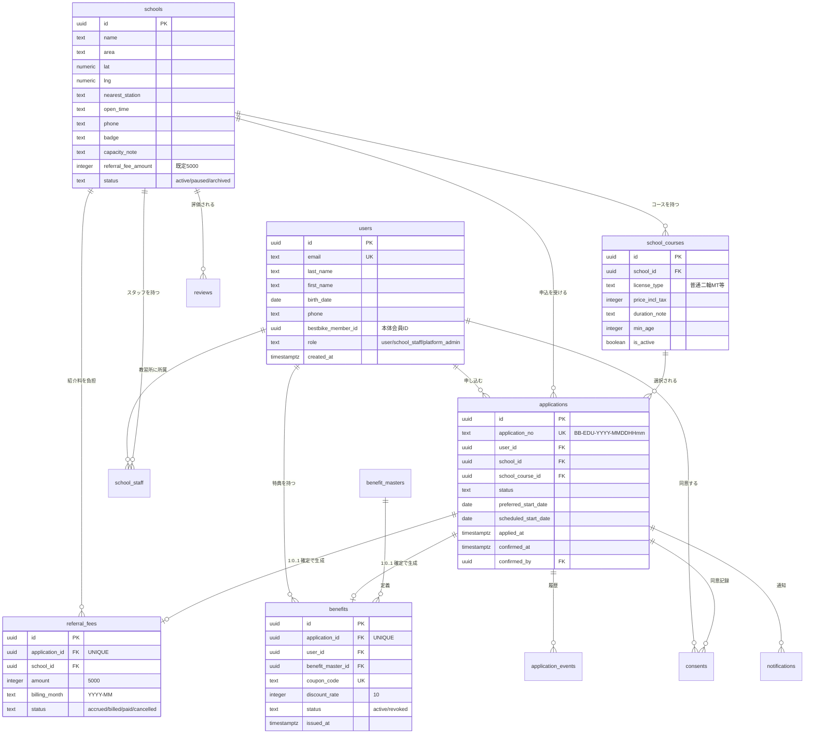

# データモデル設計書 — BestBike × 教習所マッチング

版数 v1.0 ／ 2026-08-04
前提DB：PostgreSQL 15（Supabase）／ 認証：Supabase Auth ／ 行レベルセキュリティ（RLS）有効

---

## 1. 設計方針

| # | 方針 | 理由 |
|---|---|---|
| D-1 | **金銭イベントは「1申込1レコード」をDB制約で保証する** | 二重計上はアプリのバグでは済まない。`UNIQUE(application_id)` で物理的に不可能にする |
| D-2 | ステータスは `applications.status` を単一の真実とし、履歴は `application_events` に追記する | 「いつ誰が何をしたか」を後から常に再現できる |
| D-3 | 個人情報は `applications` に持ち、教習所には**必要最小限のみ**をRLSで開示する | 個人情報保護法。他校の申込者情報が漏れる設計にしない |
| D-4 | 外部システム連携（BestBike本体・メール）は **Outboxパターン** | 連携先が落ちても入会確定は成立させる。後追いで再送する |
| D-5 | 金額は `integer`（円・税別）で保持。浮動小数点を使わない | 丸め誤差の排除 |
| D-6 | 論理削除は使わず、`status` で表現する | 削除フラグの見落としによる情報漏洩を避ける |
| D-7 | すべてのテーブルで RLS を有効化し、明示的に許可した行だけを返す | アプリ層のバグが即座に漏洩にならないための最終防衛線 |

---

## 2. ER図



---

## 3. テーブル定義

### 3.1 `users` — ユーザー

Supabase Auth の `auth.users` と 1:1 で対応するプロファイル。

| 列 | 型 | NULL | 既定 | 説明 |
|---|---|:---:|---|---|
| `id` | `uuid` PK | ✗ | — | `auth.users.id` と同一 |
| `email` | `text` UNIQUE | ✗ | — | ログインID。BestBike会員との突合キー |
| `last_name` | `text` | ✓ | — | 姓 |
| `first_name` | `text` | ✓ | — | 名 |
| `birth_date` | `date` | ✓ | — | 生年月日。受講年齢の判定に使う |
| `phone` | `text` | ✓ | — | 電話番号（E.164 正規化して保持） |
| `bestbike_member_id` | `uuid` | ✓ | — | BestBike本体の会員ID（連携済のとき） |
| `bestbike_linked_at` | `timestamptz` | ✓ | — | 連携日時 |
| `role` | `text` | ✗ | `'user'` | `user` / `school_staff` / `platform_admin` |
| `created_at` | `timestamptz` | ✗ | `now()` | |
| `updated_at` | `timestamptz` | ✗ | `now()` | |

```sql
CREATE TYPE user_role AS ENUM ('user', 'school_staff', 'platform_admin');

CREATE TABLE users (
  id                  uuid PRIMARY KEY REFERENCES auth.users(id) ON DELETE CASCADE,
  email               text NOT NULL UNIQUE,
  last_name           text,
  first_name          text,
  birth_date          date,
  phone               text,
  bestbike_member_id  uuid,
  bestbike_linked_at  timestamptz,
  role                user_role NOT NULL DEFAULT 'user',
  created_at          timestamptz NOT NULL DEFAULT now(),
  updated_at          timestamptz NOT NULL DEFAULT now()
);
CREATE INDEX idx_users_bestbike_member ON users(bestbike_member_id)
  WHERE bestbike_member_id IS NOT NULL;
```

---

### 3.2 `schools` — 提携教習所

| 列 | 型 | NULL | 既定 | 説明 |
|---|---|:---:|---|---|
| `id` | `uuid` PK | ✗ | `gen_random_uuid()` | |
| `slug` | `text` UNIQUE | ✗ | — | URL用（`shonandai-ds`） |
| `name` | `text` | ✗ | — | 校名 |
| `area` | `text` | ✗ | — | 表示用エリア（`神奈川県藤沢市`） |
| `prefecture` | `text` | ✗ | — | 絞り込み用 |
| `city` | `text` | ✗ | — | 絞り込み用 |
| `address` | `text` | ✗ | — | 住所 |
| `lat` | `numeric(9,6)` | ✗ | — | 緯度 |
| `lng` | `numeric(9,6)` | ✗ | — | 経度 |
| `nearest_station` | `text` | ✓ | — | `湘南台駅 徒歩5分` |
| `open_time` | `text` | ✓ | — | `9:00 - 21:00` |
| `phone` | `text` | ✓ | — | |
| `hero_image_url` | `text` | ✓ | — | |
| `badge` | `text` | ✓ | — | `BestBike推薦` 等（1つ） |
| `features` | `text[]` | ✗ | `'{}'` | `送迎バスあり`, `女性講師在籍` 等 |
| `capacity_note` | `text` | ✓ | — | `残り枠 8名`（目安表示・手動更新） |
| `rating` | `numeric(2,1)` | ✓ | — | 平均評価。`reviews` から更新 |
| `review_count` | `integer` | ✗ | `0` | |
| `referral_fee_amount` | `integer` | ✗ | `5000` | 校ごとの紹介料（税別・確認事項A） |
| `status` | `school_status` | ✗ | `'active'` | `active` / `paused` / `archived` |
| `published_at` | `timestamptz` | ✓ | — | |
| `created_at` / `updated_at` | `timestamptz` | ✗ | `now()` | |

```sql
CREATE TYPE school_status AS ENUM ('active', 'paused', 'archived');

CREATE TABLE schools (
  id                  uuid PRIMARY KEY DEFAULT gen_random_uuid(),
  slug                text NOT NULL UNIQUE,
  name                text NOT NULL,
  area                text NOT NULL,
  prefecture          text NOT NULL,
  city                text NOT NULL,
  address             text NOT NULL,
  lat                 numeric(9,6) NOT NULL,
  lng                 numeric(9,6) NOT NULL,
  nearest_station     text,
  open_time           text,
  phone               text,
  hero_image_url      text,
  badge               text,
  features            text[] NOT NULL DEFAULT '{}',
  capacity_note       text,
  rating              numeric(2,1) CHECK (rating BETWEEN 0 AND 5),
  review_count        integer NOT NULL DEFAULT 0,
  referral_fee_amount integer NOT NULL DEFAULT 5000 CHECK (referral_fee_amount >= 0),
  status              school_status NOT NULL DEFAULT 'active',
  published_at        timestamptz,
  created_at          timestamptz NOT NULL DEFAULT now(),
  updated_at          timestamptz NOT NULL DEFAULT now()
);
CREATE INDEX idx_schools_active     ON schools(status) WHERE status = 'active';
CREATE INDEX idx_schools_geo        ON schools(lat, lng);
CREATE INDEX idx_schools_prefecture ON schools(prefecture, city);
```

> **距離検索**：MVPは緯度経度のバウンディングボックス + Haversine で足りる。
> 提携校が1,000件を超えたら PostGIS（`geography` 型 + GiST インデックス）へ移行する。

---

### 3.3 `school_courses` — コース・料金

| 列 | 型 | NULL | 説明 |
|---|---|:---:|---|
| `id` | `uuid` PK | ✗ | |
| `school_id` | `uuid` FK→schools | ✗ | |
| `license_type` | `license_type` | ✗ | `moto_mt` / `moto_at` / `large_moto` / `moped` |
| `display_name` | `text` | ✗ | `普通二輪MT` |
| `price_incl_tax` | `integer` | ✗ | 税込価格（円） |
| `duration_note` | `text` | ✓ | `約3週間` |
| `min_age` | `integer` | ✗ | 受講可能年齢（普通二輪16 / 大型二輪18） |
| `sort_order` | `integer` | ✗ | 表示順 |
| `is_active` | `boolean` | ✗ | |

```sql
CREATE TYPE license_type AS ENUM ('moto_mt', 'moto_at', 'large_moto', 'moped');

CREATE TABLE school_courses (
  id              uuid PRIMARY KEY DEFAULT gen_random_uuid(),
  school_id       uuid NOT NULL REFERENCES schools(id) ON DELETE CASCADE,
  license_type    license_type NOT NULL,
  display_name    text NOT NULL,
  price_incl_tax  integer NOT NULL CHECK (price_incl_tax > 0),
  duration_note   text,
  min_age         integer NOT NULL DEFAULT 16 CHECK (min_age BETWEEN 0 AND 100),
  sort_order      integer NOT NULL DEFAULT 0,
  is_active       boolean NOT NULL DEFAULT true,
  created_at      timestamptz NOT NULL DEFAULT now(),
  updated_at      timestamptz NOT NULL DEFAULT now(),
  UNIQUE (school_id, license_type)
);
CREATE INDEX idx_courses_school ON school_courses(school_id) WHERE is_active;
```

---

### 3.4 `school_staff` — 教習所スタッフ

| 列 | 型 | NULL | 説明 |
|---|---|:---:|---|
| `id` | `uuid` PK | ✗ | |
| `school_id` | `uuid` FK→schools | ✗ | |
| `user_id` | `uuid` FK→users | ✗ | |
| `can_confirm` | `boolean` | ✗ | **入会確定の実行権限**。既定 `true` |
| `is_active` | `boolean` | ✗ | 退職時に `false` |

```sql
CREATE TABLE school_staff (
  id          uuid PRIMARY KEY DEFAULT gen_random_uuid(),
  school_id   uuid NOT NULL REFERENCES schools(id) ON DELETE CASCADE,
  user_id     uuid NOT NULL REFERENCES users(id)   ON DELETE CASCADE,
  can_confirm boolean NOT NULL DEFAULT true,
  is_active   boolean NOT NULL DEFAULT true,
  created_at  timestamptz NOT NULL DEFAULT now(),
  UNIQUE (school_id, user_id)
);
CREATE INDEX idx_staff_user ON school_staff(user_id) WHERE is_active;
```

> 1人のスタッフが複数校を担当しうるため多対多にする（フランチャイズ運営を想定）。

---

### 3.5 `applications` — 入会申込 【中核】

| 列 | 型 | NULL | 説明 |
|---|---|:---:|---|
| `id` | `uuid` PK | ✗ | 内部ID |
| `application_no` | `text` UNIQUE | ✗ | ユーザー向け番号 `BB-EDU-2026-04221138` |
| `user_id` | `uuid` FK→users | ✗ | |
| `school_id` | `uuid` FK→schools | ✗ | |
| `school_course_id` | `uuid` FK→school_courses | ✗ | |
| `status` | `application_status` | ✗ | `01_requirements.md` §4.2 |
| `applicant_last_name` | `text` | ✗ | **申込時点の値を凍結**（`users` の変更に追随させない） |
| `applicant_first_name` | `text` | ✗ | 同上 |
| `applicant_birth_date` | `date` | ✗ | 同上 |
| `applicant_email` | `text` | ✗ | 同上 |
| `applicant_phone` | `text` | ✗ | 同上 |
| `preferred_start_date` | `date` | ✓ | 希望入校日 |
| `scheduled_start_date` | `date` | ✓ | 教習所が確定した入校日 |
| `link_bestbike_member` | `boolean` | ✗ | 会員連携の希望 |
| `price_snapshot` | `integer` | ✗ | **申込時のコース価格を凍結**（景表法・後日の証跡） |
| `applied_at` | `timestamptz` | ✗ | |
| `reviewed_at` | `timestamptz` | ✓ | `under_review` 遷移時 |
| `scheduled_at` | `timestamptz` | ✓ | `scheduled` 遷移時 |
| `confirmed_at` | `timestamptz` | ✓ | **`confirmed` 遷移時（課金トリガー）** |
| `confirmed_by` | `uuid` FK→users | ✓ | 確定操作をしたスタッフ |
| `closed_at` | `timestamptz` | ✓ | `rejected`/`withdrawn`/`revoked` 遷移時 |
| `close_reason` | `text` | ✓ | 終了理由 |

```sql
CREATE TYPE application_status AS ENUM (
  'submitted', 'under_review', 'scheduled',
  'confirmed', 'rejected', 'withdrawn', 'revoked'
);

CREATE TABLE applications (
  id                    uuid PRIMARY KEY DEFAULT gen_random_uuid(),
  application_no        text NOT NULL UNIQUE,
  user_id               uuid NOT NULL REFERENCES users(id),
  school_id             uuid NOT NULL REFERENCES schools(id),
  school_course_id      uuid NOT NULL REFERENCES school_courses(id),
  status                application_status NOT NULL DEFAULT 'submitted',

  applicant_last_name   text NOT NULL,
  applicant_first_name  text NOT NULL,
  applicant_birth_date  date NOT NULL,
  applicant_email       text NOT NULL,
  applicant_phone       text NOT NULL,

  preferred_start_date  date,
  scheduled_start_date  date,
  link_bestbike_member  boolean NOT NULL DEFAULT true,
  price_snapshot        integer NOT NULL CHECK (price_snapshot > 0),

  applied_at            timestamptz NOT NULL DEFAULT now(),
  reviewed_at           timestamptz,
  scheduled_at          timestamptz,
  confirmed_at          timestamptz,
  confirmed_by          uuid REFERENCES users(id),
  closed_at             timestamptz,
  close_reason          text,

  created_at            timestamptz NOT NULL DEFAULT now(),
  updated_at            timestamptz NOT NULL DEFAULT now(),

  -- confirmed なら必ず確定日時と操作者が入る
  CONSTRAINT chk_confirmed_fields CHECK (
    (status <> 'confirmed') OR (confirmed_at IS NOT NULL AND confirmed_by IS NOT NULL)
  ),
  -- 入校日は希望日以降
  CONSTRAINT chk_schedule_order CHECK (
    scheduled_start_date IS NULL OR preferred_start_date IS NULL
    OR scheduled_start_date >= preferred_start_date - INTERVAL '0 day'
  )
);

CREATE INDEX idx_app_school_status ON applications(school_id, status, applied_at DESC);
CREATE INDEX idx_app_user          ON applications(user_id, applied_at DESC);
CREATE INDEX idx_app_confirmed     ON applications(confirmed_at DESC) WHERE status = 'confirmed';

-- 【重要】同一ユーザー×同一教習所で、進行中の申込は1件のみ
CREATE UNIQUE INDEX uq_app_active_per_user_school
  ON applications(user_id, school_id)
  WHERE status IN ('submitted', 'under_review', 'scheduled');
```

> **`applicant_*` を別途持つ理由**：`users` の氏名をあとで変更しても、
> 教習所に提供済みの申込内容は変わってはならない。申込は契約前段の意思表示であり、
> 当時の内容を凍結して保存する。

---

### 3.6 `application_events` — ステータス履歴

マイページのタイムライン表示と、監査の両方に使う。

```sql
CREATE TABLE application_events (
  id             bigserial PRIMARY KEY,
  application_id uuid NOT NULL REFERENCES applications(id) ON DELETE CASCADE,
  from_status    application_status,
  to_status      application_status NOT NULL,
  actor_user_id  uuid REFERENCES users(id),
  actor_role     user_role,
  note           text,
  occurred_at    timestamptz NOT NULL DEFAULT now()
);
CREATE INDEX idx_events_app ON application_events(application_id, occurred_at);
```

---

### 3.7 `consents` — 同意記録

個人情報保護法 第27条の第三者提供同意を、後から立証できる形で保存する。

```sql
CREATE TYPE consent_kind AS ENUM (
  'school_terms',            -- 教習所の規約・キャンセルポリシー
  'privacy_policy',          -- BestBikeプライバシーポリシー
  'third_party_provision'    -- 個人情報の当該教習所への提供
);

CREATE TABLE consents (
  id              uuid PRIMARY KEY DEFAULT gen_random_uuid(),
  user_id         uuid NOT NULL REFERENCES users(id),
  application_id  uuid REFERENCES applications(id) ON DELETE CASCADE,
  kind            consent_kind NOT NULL,
  document_version text NOT NULL,          -- 同意した文書の版数
  target_school_id uuid REFERENCES schools(id), -- third_party_provision のとき必須
  agreed_at       timestamptz NOT NULL DEFAULT now(),
  ip_address      inet,
  user_agent      text,
  CONSTRAINT chk_third_party_target CHECK (
    kind <> 'third_party_provision' OR target_school_id IS NOT NULL
  )
);
CREATE INDEX idx_consents_app ON consents(application_id);
```

---

### 3.8 `referral_fees` — 紹介料 【金銭】

```sql
CREATE TYPE referral_fee_status AS ENUM ('accrued', 'billed', 'paid', 'cancelled');

CREATE TABLE referral_fees (
  id              uuid PRIMARY KEY DEFAULT gen_random_uuid(),
  application_id  uuid NOT NULL REFERENCES applications(id),
  school_id       uuid NOT NULL REFERENCES schools(id),
  amount          integer NOT NULL CHECK (amount >= 0),   -- 税別・円
  tax_rate        numeric(4,3) NOT NULL DEFAULT 0.100,
  billing_month   text NOT NULL CHECK (billing_month ~ '^\d{4}-\d{2}$'),
  status          referral_fee_status NOT NULL DEFAULT 'accrued',
  accrued_at      timestamptz NOT NULL DEFAULT now(),
  billed_at       timestamptz,
  paid_at         timestamptz,
  cancelled_at    timestamptz,
  cancel_reason   text,

  -- 【最重要】1申込につき紹介料は1件のみ。二重計上を物理的に不可能にする
  CONSTRAINT uq_referral_per_application UNIQUE (application_id)
);
CREATE INDEX idx_fees_school_month ON referral_fees(school_id, billing_month, status);
```

> **`UNIQUE (application_id)` がこのシステムで最も重要な制約**。
> アプリ層のバグ・リトライ・並行リクエストのいずれでも二重計上が起きない。

---

### 3.9 `benefit_masters` / `benefits` — 特典

```sql
CREATE TABLE benefit_masters (
  id             uuid PRIMARY KEY DEFAULT gen_random_uuid(),
  code           text NOT NULL UNIQUE,          -- 'EDU_LIFETIME_10'
  name           text NOT NULL,                 -- 'BestBike 永年10%OFF'
  discount_rate  integer NOT NULL CHECK (discount_rate BETWEEN 1 AND 100),
  description    text,
  terms_version  text NOT NULL,                 -- 適用規約の版数
  is_active      boolean NOT NULL DEFAULT true
);

CREATE TYPE benefit_status AS ENUM ('active', 'revoked', 'expired');

CREATE TABLE benefits (
  id                uuid PRIMARY KEY DEFAULT gen_random_uuid(),
  application_id    uuid NOT NULL REFERENCES applications(id),
  user_id           uuid NOT NULL REFERENCES users(id),
  benefit_master_id uuid NOT NULL REFERENCES benefit_masters(id),
  coupon_code       text NOT NULL UNIQUE,
  discount_rate     integer NOT NULL,           -- 発行時点の率を凍結
  status            benefit_status NOT NULL DEFAULT 'active',
  issued_at         timestamptz NOT NULL DEFAULT now(),
  revoked_at        timestamptz,
  revoke_reason     text,
  synced_to_bestbike_at timestamptz,            -- 本体への反映完了時刻

  -- 【重要】1申込につき特典は1件のみ
  CONSTRAINT uq_benefit_per_application UNIQUE (application_id)
);
CREATE INDEX idx_benefits_user ON benefits(user_id) WHERE status = 'active';
```

**クーポンコードの採番（`01_requirements.md` BR-5）**

プロトタイプの `EDU10-SHO-2026` は **氏名＋西暦から推測可能**であり、そのまま実装してはならない。

```
形式: EDU10-XXXXXXXX
       └ 8文字。Crockford Base32（I/L/O/U を除外）を
         cryptographically secure な乱数から生成する
例:   EDU10-7K2M9QVB
```

衝突時は再生成（`UNIQUE` 違反を最大3回までリトライ）。

---

### 3.10 `outbox_events` — 外部連携キュー（Outboxパターン）

BestBike本体への連携・メール送信は、入会確定と**同一トランザクションでキューに積む**だけにする。
実際の送信はワーカーが非同期に行う。これにより、外部が落ちていても入会確定は成立する。

```sql
CREATE TYPE outbox_status AS ENUM ('pending', 'processing', 'succeeded', 'failed', 'dead');

CREATE TABLE outbox_events (
  id            bigserial PRIMARY KEY,
  event_type    text NOT NULL,        -- 'benefit.issued' / 'application.confirmed' / 'email.send'
  payload       jsonb NOT NULL,
  status        outbox_status NOT NULL DEFAULT 'pending',
  attempts      integer NOT NULL DEFAULT 0,
  last_error    text,
  next_retry_at timestamptz NOT NULL DEFAULT now(),
  created_at    timestamptz NOT NULL DEFAULT now(),
  completed_at  timestamptz
);
CREATE INDEX idx_outbox_pending ON outbox_events(next_retry_at)
  WHERE status IN ('pending', 'failed');
```

リトライ間隔：1分 → 5分 → 30分 → 2時間 → 12時間（5回失敗で `dead`、運営へアラート）

---

### 3.11 `idempotency_keys` — 冪等キー

```sql
CREATE TABLE idempotency_keys (
  key             text PRIMARY KEY,
  user_id         uuid NOT NULL REFERENCES users(id),
  endpoint        text NOT NULL,
  request_hash    text NOT NULL,      -- リクエストボディのSHA-256
  response_status integer,
  response_body   jsonb,
  created_at      timestamptz NOT NULL DEFAULT now(),
  expires_at      timestamptz NOT NULL DEFAULT now() + INTERVAL '24 hours'
);
CREATE INDEX idx_idem_expiry ON idempotency_keys(expires_at);
```

同一キー・同一 `request_hash` の再送 → 保存済レスポンスを返す。
同一キー・異なる `request_hash` → `422 Unprocessable Entity`。

---

### 3.12 `audit_logs` — 監査ログ

```sql
CREATE TABLE audit_logs (
  id           bigserial PRIMARY KEY,
  actor_user_id uuid REFERENCES users(id),
  actor_role   user_role,
  action       text NOT NULL,        -- 'application.confirm' / 'application.revoke' 等
  target_type  text NOT NULL,        -- 'application'
  target_id    uuid NOT NULL,
  before_state jsonb,
  after_state  jsonb,
  ip_address   inet,
  user_agent   text,
  occurred_at  timestamptz NOT NULL DEFAULT now()
);
CREATE INDEX idx_audit_target ON audit_logs(target_type, target_id, occurred_at DESC);
CREATE INDEX idx_audit_actor  ON audit_logs(actor_user_id, occurred_at DESC);
```

`audit_logs` は **INSERT のみ許可**。UPDATE / DELETE は誰にも許可しない（§4.3）。

---

### 3.13 `notifications` — 通知ログ

```sql
CREATE TABLE notifications (
  id             uuid PRIMARY KEY DEFAULT gen_random_uuid(),
  application_id uuid REFERENCES applications(id) ON DELETE CASCADE,
  recipient_type text NOT NULL,   -- 'user' / 'school'
  recipient_email text NOT NULL,
  template       text NOT NULL,   -- 'application_received' 等
  sent_at        timestamptz,
  provider_message_id text,
  status         text NOT NULL DEFAULT 'queued',
  created_at     timestamptz NOT NULL DEFAULT now()
);
```

### 3.14 `reviews` — 口コミ（Phase 2）

```sql
CREATE TABLE reviews (
  id             uuid PRIMARY KEY DEFAULT gen_random_uuid(),
  school_id      uuid NOT NULL REFERENCES schools(id) ON DELETE CASCADE,
  user_id        uuid NOT NULL REFERENCES users(id),
  application_id uuid NOT NULL REFERENCES applications(id),
  rating         integer NOT NULL CHECK (rating BETWEEN 1 AND 5),
  title          text,
  body           text,
  status         text NOT NULL DEFAULT 'pending',  -- pending/published/rejected
  published_at   timestamptz,
  created_at     timestamptz NOT NULL DEFAULT now(),
  -- 実際に入会確定した人だけが1件投稿できる
  CONSTRAINT uq_review_per_application UNIQUE (application_id)
);
```

> 口コミは `confirmed` の申込を持つユーザーのみ投稿可（サクラ排除）。
> プロトタイプの評価値（4.7 / 342件）はダミー。実データがない間は非表示にする（確認事項J）。

---

## 4. 行レベルセキュリティ（RLS）

### 4.1 補助関数

```sql
CREATE OR REPLACE FUNCTION auth_role() RETURNS user_role
LANGUAGE sql STABLE SECURITY DEFINER AS $$
  SELECT role FROM users WHERE id = auth.uid()
$$;

CREATE OR REPLACE FUNCTION is_staff_of(target_school uuid) RETURNS boolean
LANGUAGE sql STABLE SECURITY DEFINER AS $$
  SELECT EXISTS (
    SELECT 1 FROM school_staff
    WHERE user_id = auth.uid() AND school_id = target_school AND is_active
  )
$$;
```

### 4.2 主要ポリシー

```sql
ALTER TABLE applications ENABLE ROW LEVEL SECURITY;

-- 本人は自分の申込を読める
CREATE POLICY app_select_own ON applications FOR SELECT
  USING (user_id = auth.uid());

-- 教習所スタッフは「自校宛の申込のみ」読める
CREATE POLICY app_select_school ON applications FOR SELECT
  USING (is_staff_of(school_id));

-- 運営は全件読める
CREATE POLICY app_select_admin ON applications FOR SELECT
  USING (auth_role() = 'platform_admin');

-- 本人だけが自分名義で作成できる
CREATE POLICY app_insert_own ON applications FOR INSERT
  WITH CHECK (user_id = auth.uid());

-- UPDATE はアプリのサーバ側（service_role）経由のみ。
-- 一般ロールには UPDATE ポリシーを一切作らない = 更新不可
```

```sql
ALTER TABLE benefits ENABLE ROW LEVEL SECURITY;

-- 特典は本人のみ。かつ有効なもののみ
CREATE POLICY benefit_select_own ON benefits FOR SELECT
  USING (user_id = auth.uid() AND status = 'active');

CREATE POLICY benefit_select_admin ON benefits FOR SELECT
  USING (auth_role() = 'platform_admin');
-- 教習所スタッフには SELECT ポリシーを作らない = クーポンコードは見えない
```

```sql
ALTER TABLE referral_fees ENABLE ROW LEVEL SECURITY;

CREATE POLICY fee_select_school ON referral_fees FOR SELECT
  USING (is_staff_of(school_id));

CREATE POLICY fee_select_admin ON referral_fees FOR SELECT
  USING (auth_role() = 'platform_admin');
-- ユーザーには紹介料が一切見えない
```

```sql
ALTER TABLE schools        ENABLE ROW LEVEL SECURITY;
ALTER TABLE school_courses ENABLE ROW LEVEL SECURITY;

CREATE POLICY school_public_read ON schools FOR SELECT
  USING (status = 'active' OR is_staff_of(id) OR auth_role() = 'platform_admin');

CREATE POLICY course_public_read ON school_courses FOR SELECT
  USING (is_active OR is_staff_of(school_id) OR auth_role() = 'platform_admin');
```

### 4.3 監査ログの不変性

```sql
ALTER TABLE audit_logs ENABLE ROW LEVEL SECURITY;

CREATE POLICY audit_select_admin ON audit_logs FOR SELECT
  USING (auth_role() = 'platform_admin');

-- UPDATE / DELETE のポリシーを一切作らない。
-- service_role でも改ざんできないよう、DBロールから権限を剥奪する
REVOKE UPDATE, DELETE ON audit_logs FROM PUBLIC, authenticated, service_role;
```

### 4.4 権限マトリクス

| テーブル | user | school_staff | platform_admin |
|---|---|---|---|
| `schools` | R（active のみ） | R（自校＋active） | RW |
| `school_courses` | R（active のみ） | R（自校）/ W（自校・Phase2） | RW |
| `applications` | R（自分）/ C（自分） | R（自校）/ U（自校・API経由） | R / U（API経由） |
| `application_events` | R（自分の申込） | R（自校の申込） | R |
| `consents` | R（自分） | — | R |
| `referral_fees` | — | R（自校） | RW |
| `benefits` | R（自分・active のみ） | **—** | R |
| `audit_logs` | — | — | **R のみ** |
| `outbox_events` | — | — | R |

> `benefits` が `school_staff` から見えないのは意図的。
> 教習所がクーポンコードを閲覧できると、コードの横流しが可能になる。

---

## 5. 初期データ（シード）

プロトタイプの4校をそのまま投入する。

| slug | 校名 | エリア | バッジ | 最安 |
|---|---|---|---|---|
| `shonandai-ds` | 湘南台自動車学校 | 神奈川県藤沢市 | BestBike推薦 | ¥98,000 |
| `century-yokohama` | センチュリーモータースクール横浜 | 神奈川県横浜市西区 | 送迎バスあり | ¥105,000 |
| `green-machida` | グリーン自動車学校 | 東京都町田市 | 女性講師在籍 | ¥112,000 |
| `fuchu-ds` | 府中ドライビングスクール | 東京都府中市 | 最短2週間 | ¥108,000 |

```sql
INSERT INTO benefit_masters (code, name, discount_rate, description, terms_version)
VALUES ('EDU_LIFETIME_10', 'BestBike 永年10%OFF', 10,
        '提携教習所への入会確定により付与される、BestBikeレンタル料金の永年割引',
        'v1.0');
```

> 緯度経度は実住所からジオコーディングして投入する。プロトタイプの地図ピンは
> 相対位置のプレースホルダであり、実座標ではない。

---

## 6. マイグレーション方針

| # | 方針 |
|---|---|
| M-1 | Supabase CLI の migration ファイルで管理し、SQLをリポジトリにコミットする |
| M-2 | 1マイグレーション1目的。ロールバックSQLを併記する |
| M-3 | 本番適用は必ずステージングで先に実行し、実データ件数での所要時間を計測する |
| M-4 | `applications` / `referral_fees` / `benefits` への破壊的変更は禁止。列追加とバックフィルで対応する |
| M-5 | RLSポリシーの変更は、`07_test-plan.md` §4 のセキュリティテストを再実行してからマージする |
