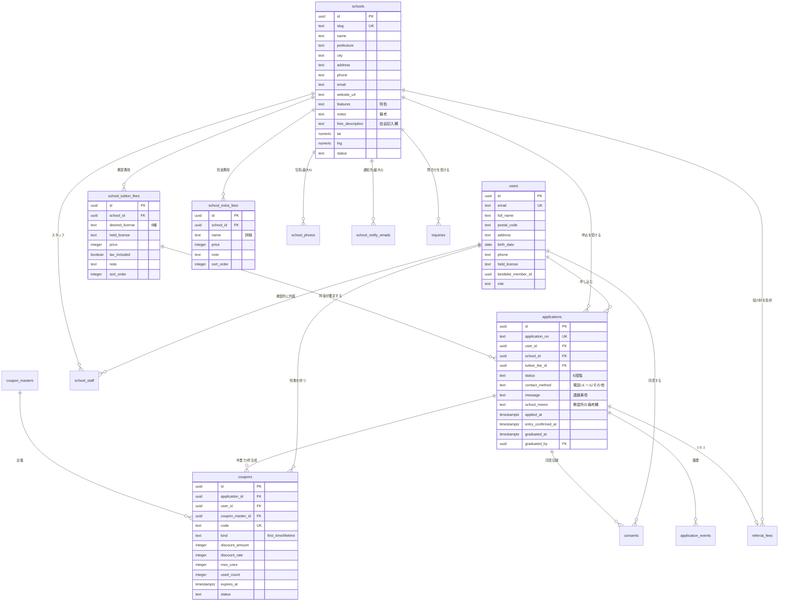

# データモデル設計書 — BestBike × 教習所マッチング

版数 **v1.1** ／ 2026-08-04
前提DB：PostgreSQL 15（Supabase）／ 認証：Supabase Auth ／ 行レベルセキュリティ（RLS）有効

> **v1.0 からの主な変更**
> ① 料金を「希望免許 × 現在保有免許」の2テーブル構成に変更（v1.0 は保有免許の軸がなく、料金表を表現できなかった）
> ② ステータスを5段階＋キャンセルに変更
> ③ クーポンを2種（初回5,000円OFF・永久10%OFF）に変更し、**卒業**トリガーへ移動
> ④ クーポンに使用回数・有効期限・使用済み状態を追加（P-2 §6）
> ⑤ 問合せ・写真・教習所通知先を追加
> 差分の全量は [`09_pdf-reconciliation.md`](09_pdf-reconciliation.md)。

---

## 1. 設計方針

| # | 方針 | 理由 |
|---|---|---|
| D-1 | **金銭・特典イベントは「1申込1レコード」をDB制約で保証する** | 二重発行はアプリのバグでは済まない。`UNIQUE` で物理的に不可能にする |
| D-2 | ステータスは `applications.status` を単一の真実とし、履歴は `application_events` に追記する | 「いつ誰が何をしたか」を後から常に再現できる |
| D-3 | **料金は「希望免許 × 現在保有免許」を主キーに持つ** | P-1 §2。同じ免許でも保有免許で料金が変わる |
| D-4 | 料金表は固定項目＋行追加型。自由形式（Excel貼付け等）は持たない | **P-2 §3** |
| D-5 | 個人情報は `applications` に持ち、教習所には自校分のみをRLSで開示する | 個人情報保護法 |
| D-6 | 外部連携（BestBike本体・メール）は **Outboxパターン** | **P-2 §4**「連携に失敗した場合の処理」への回答 |
| D-7 | 金額は `integer`（円）で保持。浮動小数点を使わない | 丸め誤差の排除 |
| D-8 | 論理削除は使わず `status` で表現する | 削除フラグの見落としによる情報漏洩を避ける |
| D-9 | 全テーブルで RLS を有効化する | アプリ層のバグが即座に漏洩にならない最終防衛線 |

---

## 2. ER図



---

## 3. テーブル定義

### 3.1 ENUM型

```sql
CREATE TYPE user_role AS ENUM ('user', 'school_staff', 'platform_admin');

CREATE TYPE school_status AS ENUM ('active', 'paused', 'archived');

-- P-1 §2：免許種類は6種。原付は含まない
CREATE TYPE desired_license AS ENUM (
  'moto_mt',        -- 普通二輪MT
  'moto_at',        -- 普通二輪AT
  'large_moto_mt',  -- 大型二輪MT
  'large_moto_at',  -- 大型二輪AT
  'small_moto_mt',  -- 小型二輪MT
  'small_moto_at'   -- 小型二輪AT
);

-- 「現在お持ちの免許」プルダウン
CREATE TYPE held_license AS ENUM (
  'none',           -- なし
  'moped',          -- 原付
  'small_moto',     -- 小型二輪
  'moto',           -- 普通二輪
  'large_moto',     -- 大型二輪
  'car',            -- 普通自動車
  'other'           -- その他
);

-- P-2 §1 の推奨：仮申込 → 入校確認中 → 入校確定 → 教習中 → 卒業（＋キャンセル）
CREATE TYPE application_status AS ENUM (
  'provisional',      -- 仮申込
  'entry_review',     -- 入校確認中
  'entry_confirmed',  -- 入校確定
  'in_training',      -- 教習中
  'graduated',        -- 卒業
  'cancelled'         -- キャンセル
);

CREATE TYPE contact_method AS ENUM ('phone', 'email', 'other');

CREATE TYPE coupon_kind AS ENUM ('first_time', 'lifetime');
CREATE TYPE coupon_status AS ENUM ('active', 'used_up', 'expired', 'revoked');

CREATE TYPE referral_fee_status AS ENUM ('accrued', 'billed', 'paid', 'cancelled');

CREATE TYPE consent_kind AS ENUM (
  'terms',                    -- 利用規約・キャンセルポリシー
  'privacy_policy',           -- プライバシーポリシー
  'third_party_provision',    -- 個人情報の教習所への提供
  'bestbike_auto_signup'      -- BestBike無料会員への自動登録（P-2 §4）
);

CREATE TYPE inquiry_category AS ENUM (
  'general',    -- 教習全般
  'pricing',    -- 料金や支払方法
  'vehicle',    -- 教習車
  'facility',   -- 施設や駐車場
  'other'       -- その他
);

CREATE TYPE outbox_status AS ENUM ('pending', 'processing', 'succeeded', 'failed', 'dead');
```

---

### 3.2 `users` — ユーザー

仮申込フォーム（P-1 §3）の項目をそのまま保持する。

```sql
CREATE TABLE users (
  id                  uuid PRIMARY KEY REFERENCES auth.users(id) ON DELETE CASCADE,
  email               text NOT NULL UNIQUE,
  full_name           text,
  postal_code         text,          -- 郵便番号（7桁・ハイフンなしで正規化）
  address             text,
  birth_date          date,
  phone               text,
  held_license        held_license,  -- 所持免許
  bestbike_member_id  uuid,          -- BestBike本体の会員ID
  bestbike_linked_at  timestamptz,
  role                user_role NOT NULL DEFAULT 'user',
  created_at          timestamptz NOT NULL DEFAULT now(),
  updated_at          timestamptz NOT NULL DEFAULT now()
);
CREATE INDEX idx_users_bestbike ON users(bestbike_member_id) WHERE bestbike_member_id IS NOT NULL;
```

> **氏名は `full_name` の1カラム**。P-1 §3 の項目は「氏名」であり、姓名の分割指定はない。
> 分割が必要なら確認事項として提起する。

---

### 3.3 `schools` — 提携教習所

P-1 §2 の詳細項目をすべて保持する。

```sql
CREATE TABLE schools (
  id                uuid PRIMARY KEY DEFAULT gen_random_uuid(),
  slug              text NOT NULL UNIQUE,
  name              text NOT NULL,                 -- 名称
  prefecture        text NOT NULL,                 -- 都道府県（エリア階層の第1層）
  city              text NOT NULL,                 -- 市区町村（第2層）
  address           text NOT NULL,                 -- 所在地
  phone             text,                          -- 電話番号
  email             text,                          -- メールアドレス（公開用）
  website_url       text,                          -- HP
  features          text,                          -- 特色
  notes             text,                          -- 備考
  free_description  text,                          -- 自由記入欄
  lat               numeric(9,6),                  -- Google地図表示用
  lng               numeric(9,6),
  status            school_status NOT NULL DEFAULT 'active',
  referral_fee_amount integer,                     -- 紹介料。NULL なら全体設定を使う（確認事項A）
  published_at      timestamptz,
  created_at        timestamptz NOT NULL DEFAULT now(),
  updated_at        timestamptz NOT NULL DEFAULT now()
);
CREATE INDEX idx_schools_area   ON schools(prefecture, city) WHERE status = 'active';
CREATE INDEX idx_schools_active ON schools(status) WHERE status = 'active';
```

> `features` / `notes` / `free_description` は**教習所が自由入力する текстフィールド**。
> 表示時は必ずエスケープする（AC-2-6）。HTMLとして解釈してはならない。

---

### 3.4 `school_photos` — 写真（最大4枚）

```sql
CREATE TABLE school_photos (
  id         uuid PRIMARY KEY DEFAULT gen_random_uuid(),
  school_id  uuid NOT NULL REFERENCES schools(id) ON DELETE CASCADE,
  url        text NOT NULL,
  alt_text   text,
  sort_order integer NOT NULL DEFAULT 0 CHECK (sort_order BETWEEN 0 AND 3),
  created_at timestamptz NOT NULL DEFAULT now(),
  UNIQUE (school_id, sort_order)
);
```

> `sort_order` を 0〜3 に制約することで、**4枚を超えて登録できない**（P-1 §2「写真4枚」）。

---

### 3.5 `school_notify_emails` — 通知先（最大2件）

P-1 §5：「最大２つまで通知可能（メール見落としや未着を防ぐために予備アドレスがほしい）」

```sql
CREATE TABLE school_notify_emails (
  id         uuid PRIMARY KEY DEFAULT gen_random_uuid(),
  school_id  uuid NOT NULL REFERENCES schools(id) ON DELETE CASCADE,
  email      text NOT NULL,
  slot       smallint NOT NULL CHECK (slot IN (1, 2)),
  is_active  boolean NOT NULL DEFAULT true,
  created_at timestamptz NOT NULL DEFAULT now(),
  UNIQUE (school_id, slot)
);
```

> `slot` を 1/2 に制約することで、**3件目を登録できない**。
> 仮申込と問合せの両方がここに届く。

---

### 3.6 `school_tuition_fees` — 教習費用【重要】

P-1 §2：最上列項目は「希望免許」「現在お持ちの免許」「料金」「備考」の4つ。
P-2 §3：固定項目で「行を追加できる表」にする。

```sql
CREATE TABLE school_tuition_fees (
  id              uuid PRIMARY KEY DEFAULT gen_random_uuid(),
  school_id       uuid NOT NULL REFERENCES schools(id) ON DELETE CASCADE,
  desired_license desired_license NOT NULL,   -- 希望免許（6種）
  held_license    held_license    NOT NULL,   -- 現在お持ちの免許
  price           integer NOT NULL CHECK (price > 0),
  tax_included    boolean NOT NULL DEFAULT true,   -- 税込 / 税別
  note            text,                            -- 備考（ない場合もある）
  sort_order      integer NOT NULL DEFAULT 0,
  is_active       boolean NOT NULL DEFAULT true,
  created_at      timestamptz NOT NULL DEFAULT now(),
  updated_at      timestamptz NOT NULL DEFAULT now(),

  -- 同一校で「希望免許 × 保有免許」の組は一意（BR-12）
  CONSTRAINT uq_tuition_per_combo UNIQUE (school_id, desired_license, held_license)
);
CREATE INDEX idx_tuition_school ON school_tuition_fees(school_id) WHERE is_active;
CREATE INDEX idx_tuition_search ON school_tuition_fees(desired_license, held_license, price)
  WHERE is_active;
```

**掲載例との対応**（P-1 §1）

```
普通2輪MT (普通免許所持)  152,750円(税込)
 ↓
desired_license = 'moto_mt'
held_license    = 'car'
price           = 152750
tax_included    = true
```

> **v1.0 の致命的な誤り**：`school_courses(license_type, price)` は保有免許の軸を持たず、
> 同じ「普通二輪MT」でも保有免許で料金が変わる実態を表現できなかった。

---

### 3.7 `school_extra_fees` — 別途費用

P-1 §2：最上列項目は「詳細」「費用」「備考」の3つ。

```sql
CREATE TABLE school_extra_fees (
  id           uuid PRIMARY KEY DEFAULT gen_random_uuid(),
  school_id    uuid NOT NULL REFERENCES schools(id) ON DELETE CASCADE,
  name         text NOT NULL,                     -- 詳細（例：卒業検定料）
  price        integer NOT NULL CHECK (price >= 0),
  tax_included boolean NOT NULL DEFAULT true,
  note         text,                              -- 備考（ない場合もある）
  sort_order   integer NOT NULL DEFAULT 0,
  is_active    boolean NOT NULL DEFAULT true,
  created_at   timestamptz NOT NULL DEFAULT now(),
  updated_at   timestamptz NOT NULL DEFAULT now()
);
CREATE INDEX idx_extra_school ON school_extra_fees(school_id) WHERE is_active;
```

---

### 3.8 `school_fee_revisions` — 料金の更新履歴

景品表示法上の表示根拠（BR-11）。教習所が料金を変更したとき、変更前の値を残す。

```sql
CREATE TABLE school_fee_revisions (
  id            bigserial PRIMARY KEY,
  school_id     uuid NOT NULL REFERENCES schools(id) ON DELETE CASCADE,
  table_name    text NOT NULL,      -- 'school_tuition_fees' / 'school_extra_fees'
  row_id        uuid NOT NULL,
  before_state  jsonb,
  after_state   jsonb,
  changed_by    uuid REFERENCES users(id),
  changed_at    timestamptz NOT NULL DEFAULT now()
);
CREATE INDEX idx_fee_rev_school ON school_fee_revisions(school_id, changed_at DESC);
```

---

### 3.9 `school_staff` — 教習所スタッフ

```sql
CREATE TABLE school_staff (
  id            uuid PRIMARY KEY DEFAULT gen_random_uuid(),
  school_id     uuid NOT NULL REFERENCES schools(id) ON DELETE CASCADE,
  user_id       uuid NOT NULL REFERENCES users(id)   ON DELETE CASCADE,
  can_confirm   boolean NOT NULL DEFAULT true,   -- 「入校」実行権限
  can_graduate  boolean NOT NULL DEFAULT true,   -- 「卒業」実行権限（特典発行）
  is_active     boolean NOT NULL DEFAULT true,
  created_at    timestamptz NOT NULL DEFAULT now(),
  UNIQUE (school_id, user_id)
);
CREATE INDEX idx_staff_user ON school_staff(user_id) WHERE is_active;
```

---

### 3.10 `applications` — 仮申込 【中核】

```sql
CREATE TABLE applications (
  id                  uuid PRIMARY KEY DEFAULT gen_random_uuid(),
  application_no      text NOT NULL UNIQUE,          -- BB-EDU-YYYY-MMDDHHmm
  user_id             uuid NOT NULL REFERENCES users(id),
  school_id           uuid NOT NULL REFERENCES schools(id),
  tuition_fee_id      uuid NOT NULL REFERENCES school_tuition_fees(id),
  status              application_status NOT NULL DEFAULT 'provisional',

  -- 申込時点の値を凍結する（users の変更に追随させない）
  applicant_name        text NOT NULL,
  applicant_postal_code text NOT NULL,
  applicant_address     text NOT NULL,
  applicant_birth_date  date NOT NULL,
  applicant_email       text NOT NULL,
  applicant_phone       text NOT NULL,
  applicant_held_license   held_license    NOT NULL,
  applicant_desired_license desired_license NOT NULL,
  contact_method      contact_method NOT NULL,       -- 教習所からのご案内方法
  message             text,                          -- 教習所への連絡事項等

  -- 申込時点の料金を凍結（景表法・後日の証跡）
  price_snapshot      integer NOT NULL CHECK (price_snapshot > 0),
  tax_included_snapshot boolean NOT NULL,

  -- 教習所側の運用メモ（P-1 §5「備考欄がほしい」）
  school_memo         text,

  entry_scheduled_date date,                         -- 入校予定日

  applied_at          timestamptz NOT NULL DEFAULT now(),
  reviewed_at         timestamptz,
  entry_confirmed_at  timestamptz,
  entry_confirmed_by  uuid REFERENCES users(id),
  training_started_at timestamptz,
  graduated_at        timestamptz,
  graduated_by        uuid REFERENCES users(id),
  cancelled_at        timestamptz,
  cancel_reason       text,

  created_at          timestamptz NOT NULL DEFAULT now(),
  updated_at          timestamptz NOT NULL DEFAULT now(),

  -- 入校確定なら日時と操作者が必ず入る
  CONSTRAINT chk_entry_fields CHECK (
    status NOT IN ('entry_confirmed','in_training','graduated')
    OR (entry_confirmed_at IS NOT NULL AND entry_confirmed_by IS NOT NULL)
  ),
  -- 卒業なら日時と操作者が必ず入る
  CONSTRAINT chk_graduated_fields CHECK (
    status <> 'graduated' OR (graduated_at IS NOT NULL AND graduated_by IS NOT NULL)
  ),
  -- キャンセルなら理由が必ず入る
  CONSTRAINT chk_cancelled_fields CHECK (
    status <> 'cancelled' OR (cancelled_at IS NOT NULL AND cancel_reason IS NOT NULL)
  )
);

CREATE INDEX idx_app_school_status ON applications(school_id, status, applied_at DESC);
CREATE INDEX idx_app_user          ON applications(user_id, applied_at DESC);
CREATE INDEX idx_app_graduated     ON applications(graduated_at DESC) WHERE status = 'graduated';

-- 同一ユーザー×同一教習所で、進行中の申込は1件のみ
CREATE UNIQUE INDEX uq_app_active_per_user_school
  ON applications(user_id, school_id)
  WHERE status IN ('provisional','entry_review','entry_confirmed','in_training');
```

---

### 3.11 `application_events` — ステータス履歴

```sql
CREATE TABLE application_events (
  id             bigserial PRIMARY KEY,
  application_id uuid NOT NULL REFERENCES applications(id) ON DELETE CASCADE,
  from_status    application_status,
  to_status      application_status NOT NULL,
  actor_user_id  uuid REFERENCES users(id),
  actor_role     user_role,
  note           text,
  occurred_at    timestamptz NOT NULL DEFAULT now()
);
CREATE INDEX idx_events_app ON application_events(application_id, occurred_at);
```

---

### 3.12 `consents` — 同意記録

```sql
CREATE TABLE consents (
  id               uuid PRIMARY KEY DEFAULT gen_random_uuid(),
  user_id          uuid NOT NULL REFERENCES users(id),
  application_id   uuid REFERENCES applications(id) ON DELETE CASCADE,
  kind             consent_kind NOT NULL,
  document_version text NOT NULL,
  target_school_id uuid REFERENCES schools(id),
  agreed_at        timestamptz NOT NULL DEFAULT now(),
  ip_address       inet,
  user_agent       text,
  CONSTRAINT chk_third_party_target CHECK (
    kind <> 'third_party_provision' OR target_school_id IS NOT NULL
  )
);
CREATE INDEX idx_consents_app ON consents(application_id);
```

> 仮申込時に **4種すべて**（`terms` / `privacy_policy` / `third_party_provision` / `bestbike_auto_signup`）を記録する。

---

### 3.13 `coupon_masters` / `coupons` — 特典【卒業トリガー】

```sql
CREATE TABLE coupon_masters (
  id              uuid PRIMARY KEY DEFAULT gen_random_uuid(),
  kind            coupon_kind NOT NULL UNIQUE,
  name            text NOT NULL,
  discount_amount integer,          -- 定額割引（円）。first_time で使う
  discount_rate   integer,          -- 定率割引（%）。lifetime で使う
  max_uses        integer,          -- NULL = 無制限
  valid_days      integer,          -- 発行から何日有効か。NULL = 無期限
  terms_version   text NOT NULL,
  is_active       boolean NOT NULL DEFAULT true,
  CONSTRAINT chk_discount_one_of CHECK (
    (discount_amount IS NOT NULL) <> (discount_rate IS NOT NULL)
  )
);
```

**初期データ**（P-1 §10）

```sql
INSERT INTO coupon_masters (kind, name, discount_amount, discount_rate, max_uses, valid_days, terms_version)
VALUES
  ('first_time', 'ベストBike 初回5,000円OFF', 5000, NULL, 1,    365, 'v1.0'),
  ('lifetime',   'ベストBike 永久10%OFF',     NULL, 10,   NULL, NULL, 'v1.0');
```

> `valid_days = 365` は暫定（確認事項H）。`max_uses = 1` により初回クーポンは1回限り。

```sql
CREATE TABLE coupons (
  id                uuid PRIMARY KEY DEFAULT gen_random_uuid(),
  application_id    uuid NOT NULL REFERENCES applications(id),
  user_id           uuid NOT NULL REFERENCES users(id),
  coupon_master_id  uuid NOT NULL REFERENCES coupon_masters(id),
  kind              coupon_kind NOT NULL,
  code              text NOT NULL UNIQUE,

  -- 発行時点の条件を凍結する
  discount_amount   integer,
  discount_rate     integer,

  -- P-2 §6 が要求する管理項目
  max_uses          integer,                              -- 使用可能回数（NULL=無制限）
  used_count        integer NOT NULL DEFAULT 0 CHECK (used_count >= 0),
  expires_at        timestamptz,                          -- 有効期限（NULL=無期限）
  first_used_at     timestamptz,
  last_used_at      timestamptz,

  status            coupon_status NOT NULL DEFAULT 'active',
  issued_at         timestamptz NOT NULL DEFAULT now(),
  revoked_at        timestamptz,
  revoke_reason     text,
  synced_to_bestbike_at timestamptz,

  -- 【最重要】1申込につき、各種のクーポンは1件のみ（BR-3）
  CONSTRAINT uq_coupon_per_application_kind UNIQUE (application_id, kind),
  -- 使用回数が上限を超えない
  CONSTRAINT chk_used_within_max CHECK (max_uses IS NULL OR used_count <= max_uses)
);
CREATE INDEX idx_coupons_user ON coupons(user_id) WHERE status = 'active';
CREATE INDEX idx_coupons_code ON coupons(code);
```

**コードの採番（BR-4 / P-2 §6）**

```
形式:  BB5000-XXXXXXXX   （初回5,000円OFF）
       BB10PC-XXXXXXXX   （永久10%OFF）

XXXXXXXX = 8文字。Crockford Base32 から I / L / O / U を除外した
           文字集合を、crypto の暗号論的乱数から生成する。
```

> P-1 §10 の代替案「5000円オフはメアドのローカルパート、永久は生年月日+ローカルパート」は
> **採用しない**。P-2 §6 が「推測されやすく、個人情報も含むため危険」と明確に否定している。

---

### 3.14 `coupon_redemptions` — クーポン利用履歴

「使用回数」「使用済み状態」を検証可能な形で持つ（P-2 §6）。

```sql
CREATE TABLE coupon_redemptions (
  id             bigserial PRIMARY KEY,
  coupon_id      uuid NOT NULL REFERENCES coupons(id),
  bestbike_order_id text,             -- 本体側の注文ID
  redeemed_at    timestamptz NOT NULL DEFAULT now(),
  amount_discounted integer,
  UNIQUE (coupon_id, bestbike_order_id)
);
```

---

### 3.15 `referral_fees` — 紹介料

> **確認事項A が未回答**のため、発生時点・金額・課金方式を切り替えられる形にしておく。

```sql
CREATE TABLE referral_fees (
  id              uuid PRIMARY KEY DEFAULT gen_random_uuid(),
  application_id  uuid NOT NULL REFERENCES applications(id),
  school_id       uuid NOT NULL REFERENCES schools(id),
  amount          integer NOT NULL CHECK (amount >= 0),
  tax_rate        numeric(4,3) NOT NULL DEFAULT 0.100,
  tax_included    boolean NOT NULL DEFAULT false,
  trigger_status  application_status NOT NULL,   -- 'entry_confirmed' or 'graduated'
  billing_month   text NOT NULL CHECK (billing_month ~ '^\d{4}-\d{2}$'),
  status          referral_fee_status NOT NULL DEFAULT 'accrued',
  accrued_at      timestamptz NOT NULL DEFAULT now(),
  billed_at       timestamptz,
  paid_at         timestamptz,
  cancelled_at    timestamptz,
  cancel_reason   text,

  -- 1申込につき紹介料は1件のみ。二重計上を物理的に不可能にする
  CONSTRAINT uq_referral_per_application UNIQUE (application_id)
);
CREATE INDEX idx_fees_school_month ON referral_fees(school_id, billing_month, status);
```

**設定テーブル**（確認事項A の回答を反映する場所）

```sql
CREATE TABLE referral_fee_settings (
  id                 smallint PRIMARY KEY DEFAULT 1 CHECK (id = 1),
  trigger_status     application_status NOT NULL DEFAULT 'graduated',
  calculation_type   text NOT NULL DEFAULT 'fixed' CHECK (calculation_type IN ('fixed','rate')),
  fixed_amount       integer,          -- calculation_type='fixed' のとき
  rate_percent       numeric(5,2),     -- calculation_type='rate' のとき（教習料金に対する%）
  cancel_policy      text NOT NULL DEFAULT 'cancel_fee',
  closing_day        smallint NOT NULL DEFAULT 31,
  tax_included       boolean NOT NULL DEFAULT false,
  requires_school_ack boolean NOT NULL DEFAULT false,
  updated_at         timestamptz NOT NULL DEFAULT now()
);
```

> 確認事項A の7項目が、そのままこのテーブルの列になっている。
> **回答が来たらデータを入れるだけで、コードを書き直さずに済む。**

---

### 3.16 `inquiries` — 問合せ

```sql
CREATE TABLE inquiries (
  id           uuid PRIMARY KEY DEFAULT gen_random_uuid(),
  school_id    uuid NOT NULL REFERENCES schools(id) ON DELETE CASCADE,
  user_id      uuid REFERENCES users(id),        -- 未ログインなら NULL
  category     inquiry_category NOT NULL,
  name         text NOT NULL,
  phone        text,
  email        text,
  body         text NOT NULL,
  sent_at      timestamptz,
  created_at   timestamptz NOT NULL DEFAULT now(),
  -- 電話番号かメールアドレスの少なくとも一方が必要（AC-5-1）
  CONSTRAINT chk_contact_present CHECK (phone IS NOT NULL OR email IS NOT NULL)
);
CREATE INDEX idx_inquiries_school ON inquiries(school_id, created_at DESC);
```

> **問合せメールは教習所にのみ送る。運営にはこのテーブルの履歴だけが残る**（BR-13 / P-2 §7）。

---

### 3.17 `outbox_events` — 外部連携キュー

```sql
CREATE TABLE outbox_events (
  id            bigserial PRIMARY KEY,
  event_type    text NOT NULL,   -- 'coupon.issued' / 'email.graduated' / 'bestbike.signup' 等
  payload       jsonb NOT NULL,
  status        outbox_status NOT NULL DEFAULT 'pending',
  attempts      integer NOT NULL DEFAULT 0,
  last_error    text,
  next_retry_at timestamptz NOT NULL DEFAULT now(),
  created_at    timestamptz NOT NULL DEFAULT now(),
  completed_at  timestamptz
);
CREATE INDEX idx_outbox_pending ON outbox_events(next_retry_at)
  WHERE status IN ('pending','failed');
```

リトライ：1分 → 5分 → 30分 → 2時間 → 12時間（5回失敗で `dead`、運営へアラート）

---

### 3.18 `idempotency_keys` / `audit_logs` / `notifications`

```sql
CREATE TABLE idempotency_keys (
  key             text PRIMARY KEY,
  user_id         uuid NOT NULL REFERENCES users(id),
  endpoint        text NOT NULL,
  request_hash    text NOT NULL,
  response_status integer,
  response_body   jsonb,
  created_at      timestamptz NOT NULL DEFAULT now(),
  expires_at      timestamptz NOT NULL DEFAULT now() + INTERVAL '24 hours'
);

CREATE TABLE audit_logs (
  id            bigserial PRIMARY KEY,
  actor_user_id uuid REFERENCES users(id),
  actor_role    user_role,
  action        text NOT NULL,   -- 'application.entry_confirm' / 'application.graduate' 等
  target_type   text NOT NULL,
  target_id     uuid NOT NULL,
  before_state  jsonb,
  after_state   jsonb,
  ip_address    inet,
  user_agent    text,
  occurred_at   timestamptz NOT NULL DEFAULT now()
);
CREATE INDEX idx_audit_target ON audit_logs(target_type, target_id, occurred_at DESC);

CREATE TABLE notifications (
  id             uuid PRIMARY KEY DEFAULT gen_random_uuid(),
  application_id uuid REFERENCES applications(id) ON DELETE CASCADE,
  inquiry_id     uuid REFERENCES inquiries(id)    ON DELETE CASCADE,
  recipient_type text NOT NULL,      -- 'user' / 'school'
  recipient_email text NOT NULL,
  template       text NOT NULL,
  sent_at        timestamptz,
  provider_message_id text,
  status         text NOT NULL DEFAULT 'queued',
  created_at     timestamptz NOT NULL DEFAULT now()
);
```

---

## 4. 行レベルセキュリティ（RLS）

### 4.1 補助関数

```sql
CREATE OR REPLACE FUNCTION auth_role() RETURNS user_role
LANGUAGE sql STABLE SECURITY DEFINER AS $$
  SELECT role FROM users WHERE id = auth.uid()
$$;

CREATE OR REPLACE FUNCTION is_staff_of(target_school uuid) RETURNS boolean
LANGUAGE sql STABLE SECURITY DEFINER AS $$
  SELECT EXISTS (
    SELECT 1 FROM school_staff
    WHERE user_id = auth.uid() AND school_id = target_school AND is_active
  )
$$;
```

### 4.2 主要ポリシー

```sql
ALTER TABLE applications ENABLE ROW LEVEL SECURITY;

CREATE POLICY app_select_own    ON applications FOR SELECT USING (user_id = auth.uid());
CREATE POLICY app_select_school ON applications FOR SELECT USING (is_staff_of(school_id));
CREATE POLICY app_select_admin  ON applications FOR SELECT USING (auth_role() = 'platform_admin');
CREATE POLICY app_insert_own    ON applications FOR INSERT WITH CHECK (user_id = auth.uid());
-- UPDATE はサーバ側（service_role）経由のみ。一般ロールにポリシーを作らない
```

```sql
ALTER TABLE coupons ENABLE ROW LEVEL SECURITY;

-- 特典は本人のみ。かつ有効なもののみ
CREATE POLICY coupon_select_own   ON coupons FOR SELECT
  USING (user_id = auth.uid() AND status = 'active');
CREATE POLICY coupon_select_admin ON coupons FOR SELECT
  USING (auth_role() = 'platform_admin');
-- school_staff には SELECT ポリシーを作らない = クーポンコードは教習所から見えない
```

```sql
ALTER TABLE referral_fees ENABLE ROW LEVEL SECURITY;
CREATE POLICY fee_select_school ON referral_fees FOR SELECT USING (is_staff_of(school_id));
CREATE POLICY fee_select_admin  ON referral_fees FOR SELECT USING (auth_role() = 'platform_admin');
-- ユーザーには紹介料が一切見えない
```

```sql
ALTER TABLE schools              ENABLE ROW LEVEL SECURITY;
ALTER TABLE school_tuition_fees  ENABLE ROW LEVEL SECURITY;
ALTER TABLE school_extra_fees    ENABLE ROW LEVEL SECURITY;
ALTER TABLE school_photos        ENABLE ROW LEVEL SECURITY;

CREATE POLICY school_public_read ON schools FOR SELECT
  USING (status = 'active' OR is_staff_of(id) OR auth_role() = 'platform_admin');

-- 教習所は自校の料金を編集できる（P-1 §5：自社情報管理）
CREATE POLICY tuition_public_read ON school_tuition_fees FOR SELECT
  USING (is_active OR is_staff_of(school_id) OR auth_role() = 'platform_admin');
CREATE POLICY tuition_school_write ON school_tuition_fees FOR ALL
  USING (is_staff_of(school_id)) WITH CHECK (is_staff_of(school_id));
```

```sql
ALTER TABLE school_notify_emails ENABLE ROW LEVEL SECURITY;
CREATE POLICY notify_school ON school_notify_emails FOR ALL
  USING (is_staff_of(school_id)) WITH CHECK (is_staff_of(school_id));
```

```sql
ALTER TABLE inquiries ENABLE ROW LEVEL SECURITY;
CREATE POLICY inquiry_select_school ON inquiries FOR SELECT USING (is_staff_of(school_id));
CREATE POLICY inquiry_select_admin  ON inquiries FOR SELECT USING (auth_role() = 'platform_admin');
```

### 4.3 監査ログの不変性

```sql
ALTER TABLE audit_logs ENABLE ROW LEVEL SECURITY;
CREATE POLICY audit_select_admin ON audit_logs FOR SELECT
  USING (auth_role() = 'platform_admin');
REVOKE UPDATE, DELETE ON audit_logs FROM PUBLIC, authenticated, service_role;
```

### 4.4 権限マトリクス

| テーブル | user | school_staff | platform_admin |
|---|---|---|---|
| `schools` | R（active） | R/**W（自校）** | RW |
| `school_tuition_fees` | R（active） | R/**W（自校）** | RW |
| `school_extra_fees` | R（active） | R/**W（自校）** | RW |
| `school_photos` | R（active） | R/**W（自校）** | RW |
| `school_notify_emails` | — | RW（自校） | RW |
| `applications` | R/C（自分） | R（自校）/ U（自校・API経由） | R / U（API経由） |
| `application_events` | R（自分の申込） | R（自校の申込） | R |
| `consents` | R（自分） | — | R |
| `referral_fees` | — | R（自校） | RW |
| **`coupons`** | R（自分・active） | **—** | R |
| `coupon_redemptions` | R（自分） | — | R |
| `inquiries` | C | R（自校） | R |
| `audit_logs` | — | — | **R のみ** |

> `coupons` が `school_staff` から見えないのは意図的。
> 教習所がクーポンコードを閲覧できると、コードの横流しが可能になる。

---

## 5. 初期データ（シード）

P-1 §1 の掲載例をそのまま投入する。

```sql
INSERT INTO schools (slug, name, prefecture, city, address, phone, website_url, features, lat, lng)
VALUES ('setakyo', 'せたがや自動車学校', '東京都', '世田谷区',
        '東京都世田谷区粕谷1-14-14', '03-3302-3141',
        'https://setakyo1960.com/motorbike/',
        '女性教官が多数在籍で女性も安心です', 35.6580, 139.6000);

INSERT INTO school_tuition_fees (school_id, desired_license, held_license, price, tax_included)
SELECT id, 'moto_mt', 'car', 152750, true FROM schools WHERE slug = 'setakyo';
```

> 残りの教習所・料金は、提携が確定した実データを投入する。
> プロトタイプの4校（湘南台・センチュリー横浜・グリーン町田・府中）はダミーであり、
> **料金・評価ともに実在の値ではない**ため、シードには使わない。

---

## 6. マイグレーション方針

| # | 方針 |
|---|---|
| M-1 | Supabase CLI の migration ファイルで管理し、SQLをリポジトリにコミットする |
| M-2 | 1マイグレーション1目的。ロールバックSQLを併記する |
| M-3 | 本番適用は必ずステージングで先に実行する |
| M-4 | `applications` / `coupons` / `referral_fees` への破壊的変更は禁止。列追加とバックフィルで対応する |
| M-5 | RLSポリシーの変更は、`07_test-plan.md` §4 のセキュリティテストを再実行してからマージする |
| M-6 | **確認事項A の回答は `referral_fee_settings` のデータ更新で反映する**。スキーマ変更を伴わせない |
