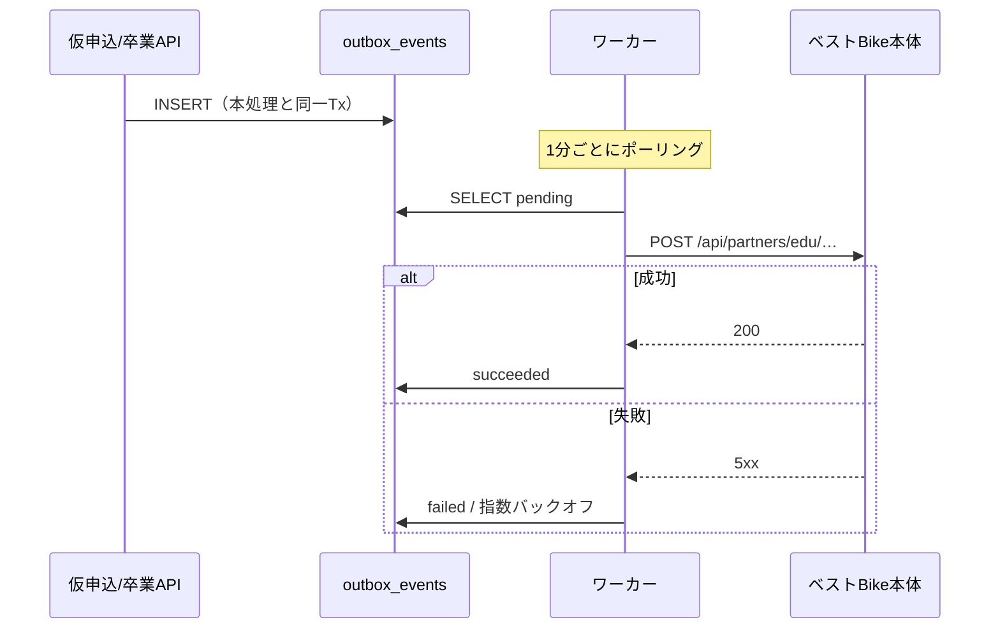

# API仕様書 — BestBike × 教習所マッチング

版数 **v1.1** ／ 2026-08-04
前提：Next.js App Router の Route Handlers ／ 認証は Supabase Auth（JWT）

> **v1.0 からの主な変更**
> ① エリア階層API（`GET /api/areas`）を追加
> ② 料金を「希望免許 × 保有免許」で返す構造に変更
> ③ **入校確定API と 卒業API を分離**。特典発行は**卒業API**へ移動
> ④ 問合せAPI・教習所セルフ管理APIを追加
> ⑤ 紹介料の発生時点を設定で切り替えられる構造に変更（確認事項A）

---

## 1. 共通仕様

### 1.1 ベース

| 項目 | 値 |
|---|---|
| ベースURL | `https://{domain}/api` |
| 形式 | JSON（UTF-8） |
| 日時 | ISO 8601 / UTC |
| 金額 | 整数（円）＋ `tax_included` フラグ |
| 認証 | `Authorization: Bearer {token}`（Cookieセッションも可） |

### 1.2 共通レスポンス

```json
{ "data": { } }
{ "data": [ ], "meta": { "total": 24, "page": 1, "per_page": 20 } }
{ "error": { "code": "…", "message": "…", "details": [ ] } }
```

### 1.3 エラーコード

| HTTP | code | 意味 |
|---:|---|---|
| 400 | `VALIDATION_ERROR` | 入力値の形式・必須違反 |
| 400 | `CONSENT_REQUIRED` | 同意4件がそろっていない |
| 400 | `AGE_REQUIREMENT_NOT_MET` | 希望免許の受講年齢に達しない |
| 400 | `TUITION_COMBINATION_NOT_FOUND` | 希望免許×保有免許に対応する料金行がない |
| 400 | `IDEMPOTENCY_KEY_REQUIRED` | 冪等キーの欠落 |
| 401 | `UNAUTHENTICATED` | 未ログイン／トークン失効 |
| 403 | `FORBIDDEN` | ロール不足 |
| 403 | `MFA_REQUIRED` | 金銭・特典操作にMFAが必要 |
| 403 | `OPERATION_NOT_PERMITTED` | `can_confirm` / `can_graduate` が false |
| 404 | `NOT_FOUND` | 存在しない、または**閲覧権限がない**（存在を秘匿） |
| 409 | `DUPLICATE_APPLICATION` | 同一教習所への進行中申込が既に存在 |
| 409 | `INVALID_STATUS_TRANSITION` | 現在のステータスから遷移できない |
| 409 | `MONTH_ALREADY_CLOSED` | 締め済月の再締め |
| 422 | `IDEMPOTENCY_KEY_REUSED` | 同一キーで異なるリクエストボディ |
| 429 | `RATE_LIMITED` | レート制限超過 |
| 500 | `INTERNAL_ERROR` | サーバ内部エラー |

> **404 の使い方**：権限のないリソースには 403 ではなく **404** を返す。
> 403 は「そこに何かが存在する」ことを教えてしまう。

### 1.4 レート制限

| エンドポイント | 制限 |
|---|---|
| `POST /api/applications` | 5 req / 10分 / ユーザー |
| `POST /api/inquiries` | 5 req / 10分 / IP |
| `POST /api/school/applications/:id/graduate` | 30 req / 分 / スタッフ |
| `GET /api/schools` | 60 req / 分 / IP |
| 認証系 | 10 req / 分 / IP |

### 1.5 認可マトリクス

| エンドポイント | 未認証 | user | school_staff | platform_admin |
|---|:---:|:---:|:---:|:---:|
| `GET /api/areas` | ● | ● | ● | ● |
| `GET /api/schools` | ● | ● | ● | ● |
| `GET /api/schools/:slug` | ● | ● | ● | ● |
| `POST /api/inquiries` | ● | ● | ● | ● |
| `POST /api/applications` | ✗ | ● | ● | ● |
| `GET /api/me/applications` | ✗ | ●(自分) | ●(自分) | ●(自分) |
| `GET /api/me/coupons` | ✗ | ●(自分) | ●(自分) | ●(自分) |
| `GET /api/school/applications` | ✗ | ✗ | ●(自校) | ✗ |
| `PATCH /api/school/applications/:id` | ✗ | ✗ | ●(自校) | ✗ |
| **`POST …/:id/entry-confirm`** | ✗ | ✗ | ●(自校・MFA) | ✗ |
| **`POST …/:id/graduate`** | ✗ | ✗ | ●(自校・MFA) | ✗ |
| `POST …/:id/cancel` | ✗ | ✗ | ●(自校) | ● |
| `GET/PUT /api/school/settings` | ✗ | ✗ | ●(自校) | ✗ |
| `GET/POST/PATCH/DELETE /api/school/fees/**` | ✗ | ✗ | ●(自校) | ✗ |
| `GET /api/school/invoices` | ✗ | ✗ | ●(自校) | ✗ |
| `GET /api/admin/**` | ✗ | ✗ | ✗ | ●(MFA) |
| `POST /api/admin/applications/:id/revert` | ✗ | ✗ | ✗ | ●(MFA) |

---

## 2. 公開API

### 2.1 `GET /api/areas` — エリア階層

SUUMO型のナビゲーション用（P-1 §1）。

**クエリ**：`prefecture`（指定時は市区町村を返す）

```json
{
  "data": {
    "level": "prefecture",
    "regions": [
      {
        "name": "関東",
        "prefectures": [
          { "code": "13", "name": "東京都",   "slug": "tokyo",    "school_count": 12 },
          { "code": "14", "name": "神奈川県", "slug": "kanagawa", "school_count": 8 },
          { "code": "11", "name": "埼玉県",   "slug": "saitama",  "school_count": 0 }
        ]
      }
    ]
  }
}
```

`?prefecture=tokyo`：

```json
{
  "data": {
    "level": "city",
    "prefecture": { "name": "東京都", "slug": "tokyo", "school_count": 12 },
    "cities": [
      { "name": "世田谷区", "slug": "setagaya", "school_count": 3 },
      { "name": "府中市",   "slug": "fuchu",    "school_count": 1 }
    ]
  }
}
```

- `school_count` は `status = 'active'` の件数
- 0件の都道府県も返す（UI側でグレーアウトするため）

---

### 2.2 `GET /api/schools` — 教習所一覧

**クエリパラメータ**

| 名前 | 型 | 説明 |
|---|---|---|
| `prefecture` | string | 都道府県 slug |
| `city` | string | 市区町村 slug |
| `desired_license` | string[] | `moto_mt` / `moto_at` / `large_moto_mt` / `large_moto_at` / `small_moto_mt` / `small_moto_at` |
| `held_license` | string | `none`/`moped`/`small_moto`/`moto`/`large_moto`/`car`/`other`。**価格例の算出条件になる** |
| `price_max` | integer | 上限価格 |
| `features` | string | 特色のフリーワード |
| `sort` | string | `price_asc`（既定）/ `newest` |
| `page` / `per_page` | integer | 既定 1 / 20（最大 50） |

> **位置情報のパラメータは存在しない**（P-1 §1「現在地から拾う必要はない」）。

**レスポンス 200**

```json
{
  "data": [
    {
      "id": "8f1c…",
      "slug": "setakyo",
      "name": "せたがや自動車学校",
      "prefecture": "東京都",
      "city": "世田谷区",
      "address": "東京都世田谷区粕谷1-14-14",
      "phone": "03-3302-3141",
      "website_url": "https://setakyo1960.com/motorbike/",
      "features": "女性教官が多数在籍で女性も安心です",
      "photo_url": "https://…/setakyo-1.jpg",
      "price_example": {
        "desired_license": "moto_mt",
        "desired_license_label": "普通二輪MT",
        "held_license": "car",
        "held_license_label": "普通自動車免許をお持ちの方",
        "price": 152750,
        "tax_included": true
      },
      "available_licenses": ["moto_mt", "moto_at", "large_moto_mt"]
    }
  ],
  "meta": { "total": 3, "page": 1, "per_page": 20 }
}
```

**`price_example` の決定ルール**

1. `held_license` がクエリで指定されていれば、その条件の最安行
2. 指定がなければ、その教習所の**最安行**
3. 該当行がなければ `null`（ただし教習費用0行の教習所はそもそも返さない）

---

### 2.3 `GET /api/schools/:slug` — 教習所詳細

```json
{
  "data": {
    "id": "8f1c…",
    "slug": "setakyo",
    "name": "せたがや自動車学校",
    "prefecture": "東京都",
    "city": "世田谷区",
    "address": "東京都世田谷区粕谷1-14-14",
    "phone": "03-3302-3141",
    "email": "info@setakyo1960.com",
    "website_url": "https://setakyo1960.com/motorbike/",
    "features": "女性教官が多数在籍で女性も安心です",
    "notes": "駐輪場あり",
    "free_description": "当校は1960年創業…\n二輪教習に力を入れています。",
    "lat": 35.658, "lng": 139.600,
    "photos": [
      { "url": "https://…/1.jpg", "alt_text": "校舎外観", "sort_order": 0 }
    ],
    "tuition_fees": [
      { "id": "t1", "desired_license": "moto_mt", "desired_license_label": "普通二輪MT",
        "held_license": "none", "held_license_label": "免許をお持ちでない方",
        "price": 178200, "tax_included": true, "note": null },
      { "id": "t2", "desired_license": "moto_mt", "desired_license_label": "普通二輪MT",
        "held_license": "car", "held_license_label": "普通自動車免許をお持ちの方",
        "price": 152750, "tax_included": true, "note": "学科免除" }
    ],
    "extra_fees": [
      { "id": "e1", "name": "入学金",     "price": 22000, "tax_included": true, "note": null },
      { "id": "e2", "name": "卒業検定料", "price": 5500,  "tax_included": true, "note": "再検定は別途" }
    ],
    "benefit": {
      "trigger": "graduation",
      "description": "この教習所を卒業すると、ベストBikeのクーポン2種を発行します",
      "coupons": [
        { "kind": "first_time", "name": "初回5,000円OFF",  "discount_amount": 5000 },
        { "kind": "lifetime",   "name": "2回目以降 永久10%OFF", "discount_rate": 10 }
      ]
    }
  }
}
```

- `free_description` / `features` / `notes` は**プレーンテキスト**として返す。HTMLを含めない
- `benefit.trigger` が `"graduation"` であることが、特典の受取条件を機械可読にする

**エラー**：`404 NOT_FOUND`（存在しない／`status != 'active'`）

---

### 2.4 `POST /api/inquiries` — 問合せ

**リクエスト**

```json
{
  "school_id": "8f1c…",
  "category": "pricing",
  "name": "佐藤 翔",
  "phone": "090-1234-5678",
  "email": "sho@example.com",
  "body": "分割払いは可能でしょうか。",
  "recaptcha_token": "…"
}
```

| 検証 | 内容 |
|---|---|
| `category` | `general`/`pricing`/`vehicle`/`facility`/`other` |
| `phone` / `email` | **少なくとも一方が必須**（AC-Q-1） |
| `body` | 1〜2000文字 |

**レスポンス 201**

```json
{ "data": { "id": "q1…", "created_at": "2026-08-04T05:00:00Z" } }
```

**サーバ処理**

1. `inquiries` に INSERT
2. `outbox_events` に `email.inquiry_to_school` を積む
   → 宛先は `school_notify_emails` の**有効な最大2件すべて**
3. `email` が入力されていれば `email.inquiry_receipt`（ユーザー控え）を積む
4. **運営宛のメールは積まない**（BR-13 / P-2 §7）

---

## 3. ユーザーAPI

### 3.1 `POST /api/applications` — 仮申込

**ヘッダー**：`Authorization` ● / `Idempotency-Key` ●（UUID v4）

**リクエスト**（P-1 §3 の項目に一致）

```json
{
  "school_id": "8f1c…",
  "tuition_fee_id": "t2",
  "applicant": {
    "name": "佐藤 翔",
    "postal_code": "1570063",
    "address": "東京都世田谷区粕谷1-2-3",
    "birth_date": "1992-09-22",
    "phone": "090-1234-5678",
    "email": "sho@baller.inc",
    "held_license": "car",
    "desired_license": "moto_mt"
  },
  "contact_method": "email",
  "message": "平日夜に通いたいです。",
  "consents": [
    { "kind": "terms",                 "document_version": "v1.0" },
    { "kind": "privacy_policy",        "document_version": "v1.0" },
    { "kind": "third_party_provision", "document_version": "v1.0" },
    { "kind": "bestbike_auto_signup",  "document_version": "v1.0" }
  ]
}
```

**バリデーション**

| 項目 | ルール |
|---|---|
| `school_id` | 存在し `status = 'active'` |
| `tuition_fee_id` | 当該校に属し `is_active`。**かつ `held_license` / `desired_license` と一致すること** |
| `name` | 1〜64文字 |
| `postal_code` | 7桁の数字 |
| `address` | 1〜255文字 |
| `birth_date` | 過去日。**希望免許の受講年齢を満たす**（普通・小型16歳 / 大型18歳） |
| `phone` | 日本の電話番号形式 |
| `email` | RFC 5322 |
| `held_license` / `desired_license` | ENUM |
| `contact_method` | `phone` / `email` / `other` |
| `consents` | **4種すべて**が含まれること |

**レスポンス 201**

```json
{
  "data": {
    "id": "a7d3…",
    "application_no": "BB-EDU-2026-08041438",
    "status": "provisional",
    "school": { "name": "せたがや自動車学校" },
    "tuition": {
      "desired_license_label": "普通二輪MT",
      "held_license_label": "普通自動車免許をお持ちの方",
      "price": 152750, "tax_included": true
    },
    "extra_fees_total": 30800,
    "applied_at": "2026-08-04T05:38:00Z",
    "bestbike_signup": "queued"
  }
}
```

**サーバ処理**

1. `Idempotency-Key` の確認。処理済なら保存済レスポンスを返す
2. バリデーション（クライアント検証は信用しない）
3. **単一トランザクション**：
   - `applications` INSERT（`applicant_*` と `price_snapshot` / `tax_included_snapshot` を凍結）
   - `consents` を **4件** INSERT（IP・UA を記録）
   - `application_events` に `null → provisional`
   - `outbox_events` に `email.application_received`（ユーザー宛）
   - `outbox_events` に `email.new_application`（教習所宛・通知先2件すべて）
   - `outbox_events` に **`bestbike.signup`**（無料会員として自動連携・権限 `user`）
4. `application_no` は `BB-EDU-{YYYY}-{MMDDHHmm}`。衝突時は連番サフィックス

> **BestBike会員登録は Outbox 経由**。連携が失敗しても仮申込は成立する（AC-4-9 / P-2 §4）。

---

### 3.2 `GET /api/me/applications` — 自分の申込

```json
{
  "data": [
    {
      "id": "a7d3…",
      "application_no": "BB-EDU-2026-08041438",
      "status": "graduated",
      "status_label": "卒業",
      "school": { "name": "せたがや自動車学校", "city": "世田谷区" },
      "tuition": { "desired_license_label": "普通二輪MT", "price": 152750, "tax_included": true },
      "timeline": [
        { "label": "仮申込",     "status": "provisional",     "occurred_at": "2026-04-22T02:38:00Z" },
        { "label": "入校確認中", "status": "entry_review",    "occurred_at": "2026-04-23T01:15:00Z" },
        { "label": "入校確定",   "status": "entry_confirmed", "occurred_at": "2026-04-24T05:00:00Z" },
        { "label": "教習中",     "status": "in_training",     "occurred_at": "2026-05-12T00:00:00Z" },
        { "label": "卒業",       "status": "graduated",       "occurred_at": "2026-06-08T00:00:00Z" }
      ],
      "coupons": [
        {
          "kind": "first_time", "name": "初回5,000円OFF",
          "code": "BB5000-7K2M9QVB", "discount_amount": 5000,
          "max_uses": 1, "used_count": 0,
          "expires_at": "2027-06-08T00:00:00Z", "status": "active"
        },
        {
          "kind": "lifetime", "name": "2回目以降 永久10%OFF",
          "code": "BB10PC-4XN8DTRW", "discount_rate": 10,
          "max_uses": null, "used_count": 0,
          "expires_at": null, "status": "active"
        }
      ],
      "sharing_owner_promo": {
        "text": "バイクを所有してシェアリングオーナーになると報酬額5%アップ！",
        "url": "https://bestbike.example.com/sharing"
      }
    }
  ]
}
```

> ### 【最重要】`coupons` / `sharing_owner_promo` は `status = 'graduated'` のときのみ存在する
>
> それ以外のステータスでは **キー自体をレスポンスに含めない**。
> `null` で返すのも不可。クライアントで隠す実装は不可。
> 詳細は [`05_nonfunctional.md` §2.1](05_nonfunctional.md)。

---

### 3.3 `GET /api/me/coupons` — 自分のクーポン

```json
{
  "data": [
    {
      "id": "c1…", "kind": "first_time", "name": "初回5,000円OFF",
      "code": "BB5000-7K2M9QVB", "discount_amount": 5000,
      "max_uses": 1, "used_count": 0, "expires_at": "2027-06-08T00:00:00Z",
      "status": "active", "synced_to_bestbike": true,
      "issued_at": "2026-06-08T00:00:00Z"
    }
  ]
}
```

### 3.4 `POST /api/me/applications/:id/withdraw` — 取下げ

- 許可：`provisional` / `entry_review` / `entry_confirmed`
- `in_training` / `graduated` は不可 → `409 INVALID_STATUS_TRANSITION`

---

## 4. 教習所API

すべて `school_staff` かつ当該校所属が条件。RLSとアプリ層で二重に担保する。

### 4.1 `GET /api/school/applications` — 自校の申込一覧

**クエリ**：`tab`（`waiting` / `training` / `graduated` / `cancelled` / `all`）、`page`、`per_page`

```json
{
  "data": [
    {
      "id": "a7d3…",
      "application_no": "BB-EDU-2026-08041438",
      "applicant": {
        "name": "佐藤 翔",
        "postal_code": "1570063",
        "address": "東京都世田谷区粕谷1-2-3",
        "birth_date": "1992-09-22",
        "phone": "090-1234-5678",
        "email": "sho@baller.inc",
        "held_license_label": "普通自動車免許",
        "desired_license_label": "普通二輪MT"
      },
      "contact_method": "email",
      "message": "平日夜に通いたいです。",
      "school_memo": "5/12入校で調整中",
      "price_snapshot": 152750,
      "status": "in_training",
      "entry_scheduled_date": "2026-05-12",
      "applied_at": "2026-04-22T02:38:00Z",
      "can_entry_confirm": false,
      "can_graduate": true
    }
  ],
  "meta": {
    "total": 12,
    "summary": {
      "waiting": 3, "training": 5, "graduated_this_month": 4,
      "referral_fee_this_month": { "amount": 20000, "tax_included": false }
    }
  }
}
```

- `can_entry_confirm` = `status = 'entry_review'` かつ `school_staff.can_confirm`
- `can_graduate` = `status = 'in_training'` かつ `school_staff.can_graduate`
- **他校の申込は1件も返らない**

---

### 4.2 `PATCH /api/school/applications/:id` — 確認開始・入校予定日・備考

```json
{ "status": "entry_review" }
{ "entry_scheduled_date": "2026-05-12" }
{ "school_memo": "書類受領済み" }
```

| 遷移 | 条件 |
|---|---|
| `provisional → entry_review` | — |

- `entry_confirmed` / `in_training` / `graduated` への遷移は**このAPIでは行えない**（専用APIに分離）
- `school_memo` の変更は `application_events` に記録する

---

### 4.3 `POST /api/school/applications/:id/entry-confirm` — 入校確定

**ヘッダー**：`Authorization`（**MFA済**）● / `Idempotency-Key` ●

```json
{ "entry_scheduled_date": "2026-05-12", "note": "書類受領済み" }
```

**レスポンス 200**

```json
{
  "data": {
    "application_id": "a7d3…",
    "status": "entry_confirmed",
    "entry_confirmed_at": "2026-04-24T05:00:00Z",
    "entry_scheduled_date": "2026-05-12",
    "referral_fee_accrued": false
  }
}
```

**サーバ処理（単一トランザクション）**

1. `SELECT … FOR UPDATE` で行ロック
2. 所属チェック（RLS＋アプリ層）
3. `status = 'entry_review'` でなければ `409`（すでに `entry_confirmed` 以降なら冪等に 200）
4. `status = 'entry_confirmed'`、`entry_confirmed_at`、`entry_confirmed_by` を記録
5. **`referral_fee_settings.trigger_status = 'entry_confirmed'` のときのみ** `referral_fees` を INSERT
6. `application_events` / `audit_logs`
7. `outbox_events` に `email.entry_confirmed`（ユーザー宛）

> **紹介料をここで計上するかは設定次第**（確認事項A）。
> `referral_fee_settings` を参照し、コードを書き換えずに切り替えられるようにする。

**`in_training` への遷移**：`entry_scheduled_date` 到来で日次バッチが自動遷移させる（確認事項E）。

---

### 4.4 ⚡ `POST /api/school/applications/:id/graduate` — 卒業 【最重要】

> このAPIが、ユーザーへの特典を発行する唯一の入口。
> 実装・レビュー・テストの厳格さを、他のどのエンドポイントとも同列に扱わない。

**ヘッダー**：`Authorization`（**MFA済**）● / `Idempotency-Key` ●（**必須**。欠落は 400）

```json
{ "note": "2026/06/08 卒業検定合格" }
```

**レスポンス 200**

```json
{
  "data": {
    "application_id": "a7d3…",
    "application_no": "BB-EDU-2026-08041438",
    "status": "graduated",
    "graduated_at": "2026-06-08T00:00:00Z",
    "coupons_issued": 2,
    "referral_fee": { "accrued": true, "amount": 5000, "tax_included": false, "billing_month": "2026-06" }
  }
}
```

> **レスポンスに `code`（クーポンコード）は含めない。**
> 教習所がクーポンコードを知る必要はなく、知れると横流しが可能になる（AC-S-9）。

**エラー**

| HTTP | code | 条件 |
|---:|---|---|
| 400 | `IDEMPOTENCY_KEY_REQUIRED` | ヘッダー欠落 |
| 403 | `MFA_REQUIRED` | MFA未完了 |
| 403 | `OPERATION_NOT_PERMITTED` | `school_staff.can_graduate = false` |
| 404 | `NOT_FOUND` | 他校の申込／存在しない |
| 409 | `INVALID_STATUS_TRANSITION` | `status != 'in_training'` |
| 422 | `IDEMPOTENCY_KEY_REUSED` | 同一キーで異なるボディ |

**サーバ処理（擬似コード）**

```ts
// 1) 冪等キー
const cached = await getIdempotentResponse(key, hash(body));
if (cached) return cached;

await db.transaction(async (tx) => {
  // 2) 行ロック
  const app = await tx.query(`SELECT * FROM applications WHERE id = $1 FOR UPDATE`, [id]);

  // 3) 所属チェック（RLSに加えてアプリ層でも検査）
  if (!await isStaffOf(actor, app.school_id)) throw NotFound();
  if (!actor.can_graduate) throw Forbidden('OPERATION_NOT_PERMITTED');

  // 4) 状態チェック（BR-5）
  if (app.status === 'graduated') return existingResult(app);      // 冪等
  if (app.status !== 'in_training') throw Conflict('INVALID_STATUS_TRANSITION');

  // 5) 本体更新
  await tx.update('applications', {
    status: 'graduated', graduated_at: now(), graduated_by: actor.id
  });

  // 6) クーポン2種を発行（UNIQUE(application_id, kind) が二重発行を物理的に防ぐ）
  for (const master of await tx.getActiveCouponMasters()) {   // first_time / lifetime
    await tx.insert('coupons', {
      application_id: app.id, user_id: app.user_id,
      coupon_master_id: master.id, kind: master.kind,
      code: generateSecureCouponCode(master.kind),   // BR-4：暗号論的乱数
      discount_amount: master.discount_amount,
      discount_rate:   master.discount_rate,
      max_uses:        master.max_uses,
      expires_at: master.valid_days ? addDays(now(), master.valid_days) : null,
      status: 'active'
    });
  }

  // 7) 紹介料（設定次第・確認事項A）
  const cfg = await tx.getReferralFeeSettings();
  if (cfg.trigger_status === 'graduated') {
    await tx.insert('referral_fees', {
      application_id: app.id, school_id: app.school_id,
      amount: calcReferralFee(cfg, app),      // fixed or rate
      tax_included: cfg.tax_included,
      trigger_status: 'graduated',
      billing_month: yyyymm(now()), status: 'accrued'
    });
  }

  // 8) 履歴・監査
  await tx.insert('application_events', { /* in_training → graduated */ });
  await tx.insert('audit_logs', { action: 'application.graduate', /* actor / ip / ua / before / after */ });

  // 9) 外部連携は Outbox に積むだけ
  await tx.insert('outbox_events', { event_type: 'email.graduated_with_coupons', payload: {…} });
  await tx.insert('outbox_events', { event_type: 'bestbike.coupon_sync',        payload: {…} });
});

await saveIdempotentResponse(key, hash(body), 200, result);
```

**この設計が守っていること**

| # | 守ること | 手段 |
|---|---|---|
| 1 | クーポンを二重発行しない | `Idempotency-Key` ＋ `FOR UPDATE` ＋ `UNIQUE(application_id, kind)` の**三重** |
| 2 | 部分適用が起きない | ステータス・クーポン・紹介料・監査を単一トランザクションに収める |
| 3 | 外部障害で卒業が失敗しない | メール／本体連携は Outbox に積むだけ |
| 4 | 実態のない卒業ができない | `in_training` からのみ遷移可（BR-5） |
| 5 | 誰が押したか必ず分かる | `graduated_by` ＋ `audit_logs`（改ざん不可） |
| 6 | 他校の申込を卒業できない | RLS ＋ アプリ層の所属チェック |
| 7 | 教習所にコードが渡らない | レスポンスに含めない ＋ `coupons` に school_staff の RLS ポリシーを作らない |
| 8 | 紹介料ルールの変更でコードを触らない | `referral_fee_settings` を参照（確認事項A） |

---

### 4.5 `POST /api/school/applications/:id/cancel` — キャンセル

```json
{ "reason": "定員に達したため" }
```

- 許可：`provisional` / `entry_review` / `entry_confirmed` / `in_training`
- **`graduated` からは不可** → `409`（教習所が特典を自力で取り消せてはならない・BR-7）
- `reason` は必須

---

### 4.6 教習所セルフ管理

| メソッド | パス | 内容 |
|---|---|---|
| `GET` / `PUT` | `/api/school/settings` | 基本情報（名称・所在地・電話・メール・HP・特色・備考・自由記入欄） |
| `GET` / `POST` / `DELETE` | `/api/school/photos` | 写真。**5枚目は 400** |
| `GET` / `POST` / `PATCH` / `DELETE` | `/api/school/fees/tuition` | 教習費用の行 |
| `GET` / `POST` / `PATCH` / `DELETE` | `/api/school/fees/extra` | 別途費用の行 |
| `PUT` | `/api/school/fees/tuition/reorder` | 並べ替え |
| `GET` / `PUT` | `/api/school/notify-emails` | 通知先メール。**3件目は 400** |

**教習費用の POST**

```json
{
  "desired_license": "moto_mt",
  "held_license": "car",
  "price": 152750,
  "tax_included": true,
  "note": "学科免除"
}
```

- `(school_id, desired_license, held_license)` の重複は `409`
- 変更時は `school_fee_revisions` に前後の状態を記録する（BR-11）

### 4.7 `GET /api/school/invoices` — 請求書

```json
{
  "data": [
    { "billing_month": "2026-06", "graduated_count": 4,
      "amount_excl_tax": 20000, "amount_incl_tax": 22000,
      "status": "billed", "pdf_url": "/api/school/invoices/2026-06.pdf" }
  ]
}
```

---

## 5. 運営API

### 5.1 `GET /api/admin/dashboard`

**クエリ**：`granularity`（`daily` / `monthly` / `yearly`）、`from`、`to`

```json
{
  "data": {
    "totals": {
      "waiting": 24, "training": 51, "graduated": 87,
      "revenue": { "amount": 435000, "tax_included": false }
    },
    "trend": [
      { "period": "2026-06", "graduated": 18, "revenue": 90000 }
    ],
    "by_school": [
      {
        "school_id": "…", "name": "せたがや自動車学校",
        "waiting": 3, "training": 5, "graduated": 12,
        "billing_amount": 60000
      }
    ]
  }
}
```

- `by_school` の合計が `totals` と一致すること（AC-A-3）
- P-1 §8 の「教習所名／入校待ち人数／入校人数／卒業人数／請求額」に対応

### 5.2 `GET /api/admin/applications` — 申込者一覧

```json
{
  "data": [
    {
      "application_no": "BB-EDU-2026-08041438",
      "school_name": "せたがや自動車学校",
      "applicant_name": "佐藤 翔",
      "applicant_email_masked": "sh***@baller.inc",
      "status": "graduated",
      "coupon_codes_masked": ["BB5000-****", "BB10PC-****"]
    }
  ]
}
```

- メール・クーポンコードは必ずマスク（AC-A-4 / AC-A-5）

### 5.3 `POST /api/admin/applications/:id/revert` — ステータスの差し戻し

P-1 §8「ステータスは仮申込⇄申込承諾⇄卒業者で進退できるように」

```json
{ "to_status": "in_training", "reason": "卒業の誤登録のため" }
```

**`graduated` からの差し戻し時の処理（単一トランザクション）**

1. `applications.status` を変更
2. 対応する `coupons` を **すべて `revoked`** にし、`revoke_reason` を記録
3. 対応する `referral_fees` を `cancelled` にし、`cancel_reason` を記録
4. `audit_logs` に記録
5. `outbox_events` に本体への失効連携・ユーザー通知を積む

- `reason` は**必須**。空文字は `400`
- `platform_admin` かつ MFA 必須
- **使用済みのクーポンがある場合は `409` を返し、運営が個別対応する**

### 5.4 `POST /api/admin/referral-fees/close-month` — 月次締め

```json
{ "billing_month": "2026-06" }
```

- `accrued` → `billed` に一括更新。締め済月の再締めは `409 MONTH_ALREADY_CLOSED`

### 5.5 `GET /api/admin/inquiries` — 問合せ履歴

BR-13 により、運営は**履歴のみ**参照できる（メールは届かない）。

---

## 6. BestBike本体との連携

> **確認事項B が未回答のため、本節は想定設計です。**

P-2 §4 が確認を求めている6項目に、設計として答える。

| # | P-2 の確認事項 | 本設計の回答 |
|---|---|---|
| 1 | 既存会員だった場合の処理 | `bestbike.signup` イベントで本体が「既存」を返したら、`users.bestbike_member_id` を紐付けるだけで新規作成しない |
| 2 | 同一人物の判定方法 | **メールアドレス**を第一キー。第二に「氏名＋生年月日＋電話番号」の一致を本体側で判定 |
| 3 | 連携用APIの有無 | **不明**。§6.3 のフォールバックを用意 |
| 4 | 連携に失敗した場合の処理 | Outbox で指数バックオフ再送（1分→5分→30分→2時間→12時間）。5回失敗で `dead` にし運営へアラート。**仮申込・卒業自体は成立させる** |
| 5 | 自動会員登録への同意文 | 仮申込フォームの同意項目④として独立取得（`consent_kind = 'bestbike_auto_signup'`） |
| 6 | パスワード設定方法 | パスワードレスで作成し、**初回ログイン時にマジックリンクで本人確認**してからパスワードを設定させる |

### 6.1 方式：Outbox → Webhook



### 6.2 本体側に依頼するエンドポイント

**① 会員の自動登録**

```
POST /api/partners/edu/members
X-Signature: HMAC-SHA256(body, shared_secret)
X-Timestamp: 1785000000
```

```json
{
  "event_id": "evt_01H…",
  "email": "sho@baller.inc",
  "name": "佐藤 翔",
  "postal_code": "1570063",
  "address": "東京都世田谷区粕谷1-2-3",
  "birth_date": "1992-09-22",
  "phone": "090-1234-5678",
  "role": "user"
}
```

レスポンスに `member_id` と `already_existed` を返してもらう。

**② クーポンの付与**

```
POST /api/partners/edu/coupons
```

```json
{
  "event_id": "evt_01H…",
  "member_email": "sho@baller.inc",
  "bestbike_member_id": "…",
  "coupons": [
    { "kind": "first_time", "code": "BB5000-7K2M9QVB",
      "discount_amount": 5000, "max_uses": 1, "expires_at": "2027-06-08T00:00:00Z" },
    { "kind": "lifetime",   "code": "BB10PC-4XN8DTRW",
      "discount_rate": 10, "max_uses": null, "expires_at": null }
  ]
}
```

| 要件 | 内容 |
|---|---|
| 認証 | HMAC-SHA256 署名 ＋ タイムスタンプ（5分以上のズレは拒否） |
| 冪等性 | `event_id` で本体側も重複排除 |
| 適用条件 | `first_time` は**初回利用のみ**、`lifetime` は**2回目以降**に適用（BR / AC-9-3・AC-9-4） |

### 6.3 本体が受け口を作れない場合のフォールバック

| 案 | 内容 | 評価 |
|---|---|---|
| **クーポンCSV運用** | 発行済コードを日次CSVで本体の既存クーポン機能に投入 | **MVPの現実解**。本体改修ゼロで開始できる |
| Pull型 | 本体が `GET /api/partners/edu/coupons?since=` を定期取得 | 本体改修が必要な点は同じ |
| DB共有 | 同一DBを参照 | 結合が強すぎる。非推奨 |

> **推奨**：MVPは「クーポンCSV運用」で開始し、Phase 2 で Webhook に移行する。
> ユーザー体験（メールとマイページにコードが出る）は初日から同じ。

### 6.4 クーポン利用の通知（本体 → 本プラットフォーム）

```
POST /api/webhooks/bestbike/coupon-redeemed
```

```json
{
  "event_id": "evt_…",
  "code": "BB5000-7K2M9QVB",
  "order_id": "ord_…",
  "amount_discounted": 5000,
  "redeemed_at": "2026-07-01T03:00:00Z"
}
```

処理：`coupon_redemptions` に INSERT、`coupons.used_count` を +1、
上限到達で `status = 'used_up'`。**HMAC署名の検証は `timingSafeEqual` を使う**。

---

## 7. OpenAPI

`docs/openapi.yaml` として別途出力し、以下に用いる。

| 用途 | 内容 |
|---|---|
| 型生成 | `openapi-typescript` でフロントの型を自動生成 |
| 契約テスト | `07_test-plan.md` §5 の統合テストで仕様と実装の一致を検証 |
| 対外仕様 | 将来の教習所基幹システム連携の公開仕様 |
