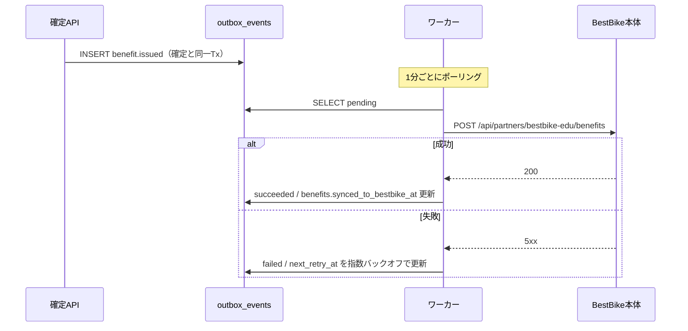

# API仕様書 — BestBike × 教習所マッチング

版数 v1.0 ／ 2026-08-04
前提：Next.js App Router の Route Handlers（`app/api/**/route.ts`）／ 認証は Supabase Auth（JWT）

---

## 1. 共通仕様

### 1.1 ベース

| 項目 | 値 |
|---|---|
| ベースURL | `https://{domain}/api` |
| 形式 | JSON（`Content-Type: application/json; charset=utf-8`） |
| 日時 | ISO 8601 / UTC（`2026-04-22T02:38:00Z`） |
| 金額 | 整数（円） |
| 認証 | `Authorization: Bearer {supabase_access_token}`（Cookieセッションも可） |

### 1.2 共通レスポンス

成功：

```json
{ "data": { ... } }
```

一覧：

```json
{ "data": [ ... ], "meta": { "total": 24, "page": 1, "per_page": 20 } }
```

エラー：

```json
{
  "error": {
    "code": "APPLICATION_NOT_CONFIRMABLE",
    "message": "入校日が確定していない申込は入会確定できません。",
    "details": [{ "field": "status", "reason": "expected 'scheduled', got 'submitted'" }]
  }
}
```

### 1.3 エラーコード一覧

| HTTP | code | 意味 |
|---:|---|---|
| 400 | `VALIDATION_ERROR` | 入力値の形式・必須違反 |
| 401 | `UNAUTHENTICATED` | 未ログイン／トークン失効 |
| 403 | `FORBIDDEN` | ロール不足 |
| 403 | `MFA_REQUIRED` | 金銭操作にMFAが必要 |
| 404 | `NOT_FOUND` | 存在しない、または**閲覧権限がない**（存在を秘匿する） |
| 409 | `DUPLICATE_APPLICATION` | 同一教習所への進行中申込が既に存在する |
| 409 | `APPLICATION_NOT_CONFIRMABLE` | ステータスが `scheduled` でない |
| 409 | `ALREADY_CONFIRMED` | 既に確定済（冪等再送でない場合） |
| 422 | `IDEMPOTENCY_KEY_REUSED` | 同一キーで異なるリクエストボディ |
| 429 | `RATE_LIMITED` | レート制限超過 |
| 500 | `INTERNAL_ERROR` | サーバ内部エラー |

> **404 の使い方**：権限のないリソースには 403 ではなく **404** を返す。
> 403 は「そこに何かが存在する」ことを教えてしまう（`02_screen-spec.md` AC-SA-2）。

### 1.4 レート制限

| エンドポイント | 制限 |
|---|---|
| `POST /api/applications` | 5 req / 10分 / ユーザー |
| `POST /api/school/applications/:id/confirm` | 30 req / 分 / スタッフ |
| `GET /api/schools` | 60 req / 分 / IP |
| 認証系 | 10 req / 分 / IP |

### 1.5 認可マトリクス

| エンドポイント | 未認証 | user | school_staff | platform_admin |
|---|:---:|:---:|:---:|:---:|
| `GET /api/schools` | ● | ● | ● | ● |
| `GET /api/schools/:id` | ● | ● | ● | ● |
| `POST /api/applications` | ✗ | ● | ● | ● |
| `GET /api/me/applications` | ✗ | ●(自分) | ●(自分) | ●(自分) |
| `GET /api/me/benefits` | ✗ | ●(自分) | ●(自分) | ●(自分) |
| `POST /api/me/applications/:id/withdraw` | ✗ | ●(自分) | — | — |
| `GET /api/school/applications` | ✗ | ✗ | ●(自校) | ✗ |
| `PATCH /api/school/applications/:id` | ✗ | ✗ | ●(自校) | ✗ |
| **`POST /api/school/applications/:id/confirm`** | ✗ | ✗ | ●(自校・MFA) | ✗ |
| `POST /api/school/applications/:id/reject` | ✗ | ✗ | ●(自校) | ✗ |
| `GET /api/school/referral-fees` | ✗ | ✗ | ●(自校) | ✗ |
| `GET /api/admin/dashboard` | ✗ | ✗ | ✗ | ●(MFA) |
| `POST /api/admin/applications/:id/revoke` | ✗ | ✗ | ✗ | ●(MFA) |
| `POST /api/admin/referral-fees/close-month` | ✗ | ✗ | ✗ | ●(MFA) |

---

## 2. 公開API

### 2.1 `GET /api/schools` — 教習所検索

**クエリパラメータ**

| 名前 | 型 | 必須 | 説明 |
|---|---|:---:|---|
| `q` | string | — | フリーワード（校名・エリア・駅名） |
| `prefecture` | string | — | 都道府県 |
| `city` | string | — | 市区町村 |
| `lat` / `lng` | number | — | 現在地。距離順ソートに使用 |
| `radius_km` | number | — | 既定 30、最大 100 |
| `license_type` | string[] | — | `moto_mt` / `moto_at` / `large_moto` / `moped` |
| `price_max` | integer | — | 上限価格（税込） |
| `features` | string[] | — | `送迎バスあり` 等 |
| `sort` | string | — | `distance`（既定）/ `price` / `rating` |
| `page` / `per_page` | integer | — | 既定 1 / 20（最大 50） |

**レスポンス 200**

```json
{
  "data": [
    {
      "id": "8f1c...",
      "slug": "shonandai-ds",
      "name": "湘南台自動車学校",
      "area": "神奈川県藤沢市",
      "distance_km": 1.2,
      "lat": 35.394, "lng": 139.466,
      "nearest_station": "湘南台駅 徒歩5分",
      "open_time": "9:00 - 21:00",
      "rating": 4.7,
      "review_count": 342,
      "badge": "BestBike推薦",
      "features": ["送迎バスあり"],
      "capacity_note": "残り枠 8名",
      "hero_image_url": null,
      "license_types": ["moto_mt", "large_moto", "moto_at"],
      "price_min_incl_tax": 98000
    }
  ],
  "meta": { "total": 24, "page": 1, "per_page": 20 }
}
```

**仕様**

- `status = 'active'` の教習所のみ返す
- `distance_km` は `lat`/`lng` 未指定のとき `null`。その場合 `sort=distance` は `rating` にフォールバック
- `price_min_incl_tax` は有効な `school_courses` の最小額

---

### 2.2 `GET /api/schools/:idOrSlug` — 教習所詳細

**レスポンス 200**

```json
{
  "data": {
    "id": "8f1c...",
    "slug": "shonandai-ds",
    "name": "湘南台自動車学校",
    "area": "神奈川県藤沢市",
    "address": "神奈川県藤沢市湘南台X-X-X",
    "lat": 35.394, "lng": 139.466,
    "nearest_station": "湘南台駅 徒歩5分",
    "open_time": "9:00 - 21:00",
    "phone": "0466-XX-XXXX",
    "rating": 4.7,
    "review_count": 342,
    "badge": "BestBike推薦",
    "features": ["送迎バスあり"],
    "capacity_note": "残り枠 8名",
    "courses": [
      { "id": "c1", "license_type": "moto_mt",    "display_name": "普通二輪MT",     "price_incl_tax": 98000,  "duration_note": "約3週間", "min_age": 16 },
      { "id": "c2", "license_type": "moto_at",    "display_name": "普通二輪AT限定", "price_incl_tax": 92000,  "duration_note": "約2週間", "min_age": 16 },
      { "id": "c3", "license_type": "large_moto", "display_name": "大型二輪",       "price_incl_tax": 135000, "duration_note": "約4週間", "min_age": 18 }
    ],
    "benefit": {
      "name": "BestBike 永年10%OFF",
      "discount_rate": 10,
      "description": "入会確定時にBestBikeレンタル永年10%OFFコードを発行"
    }
  }
}
```

**エラー**：`404 NOT_FOUND`（存在しない／`status != 'active'`）

---

## 3. ユーザーAPI

### 3.1 `POST /api/applications` — 入会申込

**ヘッダー**

| 名前 | 必須 | 説明 |
|---|:---:|---|
| `Authorization` | ● | Bearer トークン |
| `Idempotency-Key` | ● | UUID v4。二重送信の防止 |

**リクエスト**

```json
{
  "school_id": "8f1c...",
  "school_course_id": "c1",
  "applicant": {
    "last_name": "佐藤",
    "first_name": "翔",
    "birth_date": "1992-09-22",
    "email": "sho@baller.inc",
    "phone": "090-1234-5678"
  },
  "preferred_start_date": "2026-05-10",
  "link_bestbike_member": true,
  "consents": [
    { "kind": "school_terms",          "document_version": "v1.0" },
    { "kind": "privacy_policy",        "document_version": "v2.1" },
    { "kind": "third_party_provision", "document_version": "v1.0" }
  ]
}
```

**バリデーション**

| 項目 | ルール |
|---|---|
| `school_id` | 存在し `status = 'active'` |
| `school_course_id` | 当該校に属し `is_active` |
| `last_name` / `first_name` | 1〜32文字 |
| `birth_date` | 過去日。かつ**コースの `min_age` を満たす**（入校予定日基準） |
| `email` | RFC 5322。ログインユーザーと異なる場合も許容（本人の別アドレス） |
| `phone` | 日本の携帯・固定電話形式 |
| `preferred_start_date` | 翌日以降、1年以内 |
| `consents` | **3種すべて**が含まれること |

**レスポンス 201**

```json
{
  "data": {
    "id": "a7d3...",
    "application_no": "BB-EDU-2026-04221138",
    "status": "submitted",
    "school": { "id": "8f1c...", "name": "湘南台自動車学校" },
    "course": { "display_name": "普通二輪MT", "price_incl_tax": 98000 },
    "applied_at": "2026-04-22T02:38:00Z"
  }
}
```

**エラー**

| HTTP | code | 条件 |
|---:|---|---|
| 400 | `VALIDATION_ERROR` | 上記バリデーション違反 |
| 400 | `CONSENT_REQUIRED` | 同意が3種そろっていない |
| 400 | `AGE_REQUIREMENT_NOT_MET` | コースの受講年齢に達しない |
| 409 | `DUPLICATE_APPLICATION` | 同一教習所への進行中申込が存在 |

**サーバ処理**

1. `Idempotency-Key` を確認。処理済なら保存済レスポンスを返す
2. バリデーション（クライアント検証は信用しない）
3. トランザクション：
   - `applications` INSERT（`price_snapshot` にコース価格を凍結）
   - `consents` を3件 INSERT（IP・UA を記録）
   - `application_events` に `null → submitted` を INSERT
   - `outbox_events` に `email.application_received`（ユーザー宛）を INSERT
   - `outbox_events` に `email.new_application`（教習所宛）を INSERT
4. `application_no` は `BB-EDU-{YYYY}-{MMDDHHmm}`。衝突時は連番サフィックスを付与

---

### 3.2 `GET /api/me/applications` — 自分の申込一覧

**レスポンス 200**

```json
{
  "data": [
    {
      "id": "a7d3...",
      "application_no": "BB-EDU-2026-04221138",
      "status": "confirmed",
      "school": { "id": "8f1c...", "name": "湘南台自動車学校", "area": "神奈川県藤沢市" },
      "course": { "display_name": "普通二輪MT", "price_incl_tax": 98000 },
      "timeline": [
        { "label": "申込受付",           "status": "submitted",    "occurred_at": "2026-04-22T02:38:00Z" },
        { "label": "教習所による確認",   "status": "under_review", "occurred_at": "2026-04-23T01:15:00Z" },
        { "label": "入校日確定",         "status": "scheduled",    "occurred_at": "2026-04-24T05:00:00Z" },
        { "label": "入会確定・特典発行", "status": "confirmed",    "occurred_at": "2026-04-25T00:00:00Z" }
      ],
      "scheduled_start_date": "2026-05-12",
      "benefit": {
        "coupon_code": "EDU10-7K2M9QVB",
        "name": "BestBike 永年10%OFF",
        "discount_rate": 10,
        "issued_at": "2026-04-25T00:00:00Z",
        "applied_to_email": "sho@baller.inc"
      }
    }
  ]
}
```

> **`benefit` は `status = 'confirmed'` のときのみキー自体が存在する。**
> それ以外のとき `null` ですらなく、**レスポンスに含めない**。
> クライアントで隠す実装は不可（`05_nonfunctional.md` §2.1）。

---

### 3.3 `GET /api/me/benefits` — 自分の特典一覧

```json
{
  "data": [
    {
      "id": "b1...",
      "coupon_code": "EDU10-7K2M9QVB",
      "name": "BestBike 永年10%OFF",
      "discount_rate": 10,
      "status": "active",
      "issued_at": "2026-04-25T00:00:00Z",
      "synced_to_bestbike": true
    }
  ]
}
```

### 3.4 `POST /api/me/applications/:id/withdraw` — 申込の取下げ

- 許可ステータス：`submitted` / `under_review` / `scheduled`
- `confirmed` は取下げ不可 → `409 APPLICATION_NOT_WITHDRAWABLE`

---

## 4. 教習所API

すべて `school_staff` かつ当該校に所属していることが条件。RLSで二重に担保する。

### 4.1 `GET /api/school/applications` — 自校の申込一覧

**クエリ**：`status`（`all` / `pending` / `confirmed` / `closed`）、`page`、`per_page`

```json
{
  "data": [
    {
      "id": "a7d3...",
      "application_no": "BB-EDU-2026-04221138",
      "applicant_name": "佐藤 翔",
      "applicant_email": "sho@baller.inc",
      "applicant_phone": "090-1234-5678",
      "course": { "display_name": "普通二輪MT", "price_incl_tax": 98000 },
      "status": "scheduled",
      "applied_at": "2026-04-22T02:38:00Z",
      "preferred_start_date": "2026-05-10",
      "scheduled_start_date": "2026-05-12",
      "can_confirm": true
    }
  ],
  "meta": {
    "total": 12,
    "summary": {
      "new_this_month": 12,
      "pending": 3,
      "confirmed_this_month": 9,
      "referral_fee_this_month": 45000
    }
  }
}
```

- `can_confirm` は `status = 'scheduled'` かつ `school_staff.can_confirm = true` のとき `true`
- **他校の申込は1件も返らない**（RLS + アプリ層の二重チェック）

---

### 4.2 `PATCH /api/school/applications/:id` — 確認開始・入校日登録

```json
{ "status": "under_review" }
```

```json
{ "status": "scheduled", "scheduled_start_date": "2026-05-12" }
```

| 遷移 | 条件 |
|---|---|
| `submitted → under_review` | — |
| `under_review → scheduled` | `scheduled_start_date` 必須 |

`confirmed` への遷移は**このエンドポイントでは行えない**（専用APIに分離する）。

---

### 4.3 ⚡ `POST /api/school/applications/:id/confirm` — 入会確定 【最重要】

> このAPIが、システム全体で唯一お金を動かす。
> 実装・レビュー・テストの厳格さを、他のどのエンドポイントとも同列に扱わない。

**ヘッダー**

| 名前 | 必須 | 説明 |
|---|:---:|---|
| `Authorization` | ● | Bearer トークン（**MFA済セッション必須**） |
| `Idempotency-Key` | ● | UUID v4。**必須**。欠落時は `400` |

**リクエスト**

```json
{ "confirmed_note": "5/12入校で確定。書類受領済み。" }
```

**レスポンス 200**

```json
{
  "data": {
    "application_id": "a7d3...",
    "application_no": "BB-EDU-2026-04221138",
    "status": "confirmed",
    "confirmed_at": "2026-04-25T00:00:00Z",
    "referral_fee": { "amount": 5000, "tax_rate": 0.1, "billing_month": "2026-04" },
    "benefit_issued": true
  }
}
```

> レスポンスに `coupon_code` は**含めない**。教習所がクーポンコードを知る必要はない
> （`03_data-model.md` §4.4）。

**エラー**

| HTTP | code | 条件 |
|---:|---|---|
| 400 | `IDEMPOTENCY_KEY_REQUIRED` | ヘッダー欠落 |
| 403 | `MFA_REQUIRED` | MFA未完了セッション |
| 403 | `CONFIRM_NOT_PERMITTED` | `school_staff.can_confirm = false` |
| 404 | `NOT_FOUND` | 他校の申込／存在しない |
| 409 | `APPLICATION_NOT_CONFIRMABLE` | `status != 'scheduled'` |
| 422 | `IDEMPOTENCY_KEY_REUSED` | 同一キーで異なるボディ |

**サーバ処理（擬似コード）**

```ts
// 1) 冪等キーの確認
const cached = await getIdempotentResponse(key, hash(body));
if (cached) return cached;                       // 二重送信 → 初回結果を返す

await db.transaction(async (tx) => {
  // 2) 行ロック（並行リクエストを直列化）
  const app = await tx.query(
    `SELECT * FROM applications WHERE id = $1 FOR UPDATE`, [id]
  );

  // 3) 所属チェック（RLSに加えてアプリ層でも検査）
  if (!await isStaffOf(actor, app.school_id)) throw NotFound();

  // 4) 状態チェック（BR-4：入校日確定後のみ）
  if (app.status === 'confirmed') return existingResult(app);   // 冪等
  if (app.status !== 'scheduled') throw Conflict('APPLICATION_NOT_CONFIRMABLE');

  // 5) 本体更新
  await tx.update('applications', {
    status: 'confirmed', confirmed_at: now(), confirmed_by: actor.id
  });

  // 6) 紹介料の計上（UNIQUE(application_id) が二重計上を物理的に防ぐ）
  const school = await tx.get('schools', app.school_id);
  await tx.insert('referral_fees', {
    application_id: app.id, school_id: app.school_id,
    amount: school.referral_fee_amount,          // 既定 5000
    billing_month: yyyymm(now()), status: 'accrued'
  });

  // 7) 特典の発行（UNIQUE(application_id) / UNIQUE(coupon_code)）
  await tx.insert('benefits', {
    application_id: app.id, user_id: app.user_id,
    benefit_master_id: EDU_LIFETIME_10.id,
    coupon_code: generateSecureCouponCode(),     // BR-5：推測不能な採番
    discount_rate: 10, status: 'active'
  });

  // 8) 履歴・監査
  await tx.insert('application_events', {
    application_id: app.id, from_status: 'scheduled', to_status: 'confirmed',
    actor_user_id: actor.id, actor_role: 'school_staff'
  });
  await tx.insert('audit_logs', {
    actor_user_id: actor.id, action: 'application.confirm',
    target_type: 'application', target_id: app.id,
    before_state: { status: 'scheduled' }, after_state: { status: 'confirmed' },
    ip_address: req.ip, user_agent: req.ua
  });

  // 9) 外部連携は Outbox に積むだけ（同一トランザクション）
  await tx.insert('outbox_events', { event_type: 'benefit.issued',  payload: {...} });
  await tx.insert('outbox_events', { event_type: 'email.benefit_issued', payload: {...} });
});

await saveIdempotentResponse(key, hash(body), 200, result);
```

**この設計が守っていること**

| # | 守っていること | 手段 |
|---|---|---|
| 1 | 二重計上しない | `Idempotency-Key` ＋ `FOR UPDATE` ＋ `UNIQUE(application_id)` の**三重** |
| 2 | 部分適用が起きない | ステータス・紹介料・特典・監査を単一トランザクションに収める |
| 3 | 外部障害で確定が失敗しない | メール／本体連携は Outbox に積むだけ。送信は非同期 |
| 4 | 実態のない確定ができない | `scheduled` からのみ遷移可（BR-4） |
| 5 | 誰が押したか必ず分かる | `confirmed_by` ＋ `audit_logs`（改ざん不可） |
| 6 | 他校の申込を確定できない | RLS ＋ アプリ層の所属チェック（二重） |

---

### 4.4 `POST /api/school/applications/:id/reject` — 謝絶

```json
{ "reason": "定員に達したため" }
```

- 許可ステータス：`submitted` / `under_review` / `scheduled`
- **`confirmed` からは遷移不可** → `409`（教習所が紹介料を自力で取り消せてはならない・BR-6）

### 4.5 `GET /api/school/referral-fees` — 自校の紹介料

```json
{
  "data": [
    { "billing_month": "2026-04", "count": 9, "amount_excl_tax": 45000, "amount_incl_tax": 49500, "status": "accrued" },
    { "billing_month": "2026-03", "count": 7, "amount_excl_tax": 35000, "amount_incl_tax": 38500, "status": "paid" }
  ]
}
```

---

## 5. 運営API（Phase 2）

### 5.1 `GET /api/admin/dashboard`

```json
{
  "data": {
    "kpi": {
      "confirmed_this_month":  { "value": 87,     "prev_ratio": 0.23 },
      "referral_revenue":      { "value": 435000, "prev_ratio": 0.23 },
      "benefits_issued":       { "value": 87,     "prev_ratio": 0.23 },
      "active_schools":        { "value": 24,     "prev_diff": 3 }
    },
    "monthly_trend": [
      { "month": "2025-10", "confirmed": 30 }, { "month": "2026-04", "confirmed": 87 }
    ],
    "school_ranking": [
      { "school_id": "...", "name": "府中ドライビングスクール", "confirmed": 18 }
    ],
    "recent_confirmations": [
      {
        "confirmed_at": "2026-04-22T00:00:00Z",
        "school_name": "湘南台自動車学校",
        "user_email_masked": "sh***@baller.inc",
        "coupon_code_masked": "EDU10-****",
        "referral_fee": 5000
      }
    ]
  }
}
```

- メールは必ずマスク（AC-BA-1）／クーポンコードもマスク

### 5.2 `POST /api/admin/applications/:id/revoke` — 確定取消

```json
{ "reason": "教習所からの申告により、入校していないことを確認したため" }
```

処理（単一トランザクション）：

1. `applications.status = 'revoked'`、`closed_at` / `close_reason` を記録
2. 対応する `referral_fees.status = 'cancelled'`、`cancel_reason` を記録
3. 対応する `benefits.status = 'revoked'`、`revoke_reason` を記録
4. `audit_logs` に記録
5. `outbox_events` に本体への割引失効・ユーザーへの通知を積む

- `reason` は**必須**。空文字は `400`
- `platform_admin` かつ MFA 必須

### 5.3 `POST /api/admin/referral-fees/close-month` — 月次締め

```json
{ "billing_month": "2026-04" }
```

- `accrued` → `billed` に一括更新。締め済月の再締めは `409`

---

## 6. BestBike本体との連携

> **確認事項G/H が未回答のため、本節は想定設計です。**
> 本体側の実装状況によって方式が変わります。

### 6.1 方式：Outbox → Webhook（本体へのPush）



### 6.2 本体側に依頼するエンドポイント

```
POST /api/partners/bestbike-edu/benefits
X-Signature: HMAC-SHA256(body, shared_secret)
X-Timestamp: 1777000000
```

```json
{
  "event_id": "evt_01H...",
  "member_email": "sho@baller.inc",
  "bestbike_member_id": null,
  "benefit_code": "EDU_LIFETIME_10",
  "discount_rate": 10,
  "coupon_code": "EDU10-7K2M9QVB",
  "issued_at": "2026-04-25T00:00:00Z"
}
```

| 要件 | 内容 |
|---|---|
| 認証 | HMAC-SHA256 署名 ＋ タイムスタンプ（5分以上のズレは拒否） |
| 冪等性 | `event_id` で本体側も重複排除する |
| 会員特定 | `bestbike_member_id` があれば優先、なければ `member_email` で突合 |
| 未登録時 | 本体に該当会員がいない場合は保留し、会員登録時に適用する |

### 6.3 代替案（本体が受け口を作れない場合）

| 案 | 内容 | 評価 |
|---|---|---|
| Pull型 | 本体が `GET /api/partners/benefits?since=` を定期取得 | 本体の改修が必要な点は同じ |
| クーポンコード運用 | 本体の既存クーポン機能に、発行済コードをCSVで日次投入 | **MVPの現実解**。本体改修ゼロで始められる |
| DB共有 | 本体と同一DBを参照 | 結合が強すぎる。非推奨 |

> **推奨**：MVPは「クーポンコード運用」で開始し、Phase 2 で Webhook に移行する。
> ユーザー体験（マイページにコードが出る）は初日から同じで、本体改修を待たずにリリースできる。

---

## 7. Webhook 受信（本体 → 本プラットフォーム）

### 7.1 `POST /api/webhooks/bestbike/member-linked`

本体で会員登録・連携が完了したときに通知を受け、`users.bestbike_member_id` を更新する。

- HMAC 署名検証必須
- 冪等（`event_id` で重複排除）
- 検証失敗時は `401` を返し、ボディをログに残さない

---

## 8. OpenAPI

`docs/openapi.yaml` として別途出力し、以下に用いる。

| 用途 | 内容 |
|---|---|
| 型生成 | `openapi-typescript` でフロントの型を自動生成 |
| 契約テスト | `07_test-plan.md` §3 の API テストで仕様と実装の一致を検証 |
| 教習所向け | 将来の外部連携（教習所の基幹システム連携）の公開仕様 |
