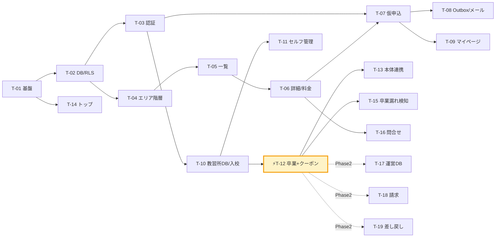
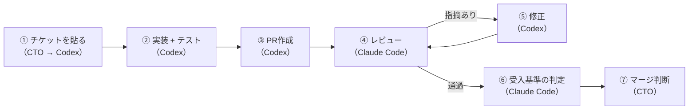

# 開発指示書（Codex向け） — BestBike × 教習所マッチング

版数 **v1.1** ／ 2026-08-04

> **v1.1 での変更**：企画資料（PDF）受領によりチケットを再構成した。
> 主な変更は ①T-10 を「入校確定」と「卒業」の2本に分割 ②料金2テーブルの実装を追加
> ③教習所セルフ管理を Phase 1 へ格上げ ④問合せ・エリア階層を追加。
> 差分は [`09_pdf-reconciliation.md`](09_pdf-reconciliation.md)。

> **本書の使い方**
> §1 の「共通コンテキスト」を最初に一度だけ Codex に渡す。
> 以降は §3 の各チケットのブロックを**そのままコピーして貼る**。
> 実装が返ってきたら §5 のレビューチェックリストを機械的に適用する。
>
> | 役割 | 担当 |
> |---|---|
> | 仕様作成・チケット分解・受入基準の定義 | プロジェクト責任者（CTO） |
> | 実装・テストコードの記述 | **Codex** |
> | コードレビュー・仕様突合・品質チェック | **Claude Code** |
> | マージ判断 | プロジェクト責任者 |

---

## 1. 共通コンテキスト（Codex に最初に渡す）

```
あなたは「ベストBike × 教習所マッチング」プラットフォームの実装担当エンジニアです。

## プロダクト概要
バイクレンタル／シェアリング事業「ベストBike」が運営する、バイク免許取得の教習所マッチングサイト。
ユーザーが提携教習所に本プラットフォーム経由で「仮申込」し、
教習所が「入校」→「卒業」と操作を進める。
⚡ 教習所が「卒業」ボタンを押した時点で、ユーザーに2種のクーポンが自動発行される。
  ① 初回 5,000円OFF
  ② 2回目以降 永久10%OFF
あわせて「シェアリングオーナーになると報酬額5%アップ」への導線を提示する。

## 用語（厳守）
- 教習所側の操作は「入校」。「入会」という語は使わない。
- ベストBikeへの登録だけを「会員登録」と呼ぶ。
- ステータスは次の6つ。これ以外を作らない。
  provisional(仮申込) / entry_review(入校確認中) / entry_confirmed(入校確定)
  / in_training(教習中) / graduated(卒業) / cancelled(キャンセル)

## 技術スタック（変更しないこと）
- Next.js 15 App Router / TypeScript strict / Tailwind CSS
- Supabase (PostgreSQL 15) — Auth + DB + RLS
- Zod（入力検証。型はスキーマから導出する）
- Vitest（単体・統合）/ Playwright（E2E）
- デプロイ: Vercel

## 絶対に守るルール
1. 認可はサーバ側で判定する。クライアントの表示制御は演出であって防御ではない。
2. 卒業していない申込に対して、クーポン情報を API レスポンスに含めない。
   キーごと存在させない。null で返すのも不可。
3. 特典が発行されるのは「卒業」のときだけ。仮申込・入校確定では一切発行しない。
4. 金銭・特典が動く処理は、冪等キー・行ロック・DBのUNIQUE制約の三重で二重発行を防ぐ。
5. 外部連携（メール・ベストBike本体）は outbox_events に積むだけにする。
   同期呼び出しにしない。外部が落ちても卒業は成立させる。
6. 権限のないリソースには 403 ではなく 404 を返す（存在を秘匿する）。
7. マジックナンバーを書かない。
   5000 は coupon_masters.discount_amount、10 は coupon_masters.discount_rate、
   紹介料は referral_fee_settings から取得する。
8. 位置情報（navigator.geolocation）を呼ばない。一覧は都道府県→市区町村の階層ナビ。
9. 料金は「希望免許 × 現在保有免許」の組で決まる。片方だけで料金を引かない。
10. 免許種別は6種のみ。moto_mt / moto_at / large_moto_mt / large_moto_at
    / small_moto_mt / small_moto_at。原付は含まない。
11. any を使わない。dangerouslySetInnerHTML を使わない。文字列連結のSQLを書かない。
12. SUPABASE_SERVICE_ROLE_KEY はサーバ側でのみ参照する。NEXT_PUBLIC_ を付けない。
13. 教習所が入力する自由記入欄はHTMLとして解釈しない。white-space:pre-wrap で表示する。

## 参照ドキュメント（リポジトリ内）
- docs/01_requirements.md  要件・業務ルール(BR-1〜BR-13)・受入基準(AC-*)・確認事項
- docs/02_screen-spec.md   画面仕様・デザイントークン・アクセシビリティ
- docs/03_data-model.md    テーブル定義・DDL・RLSポリシー
- docs/04_api-spec.md      エンドポイント・リクエスト/レスポンス・エラーコード
- docs/05_nonfunctional.md 技術方針・セキュリティ・法令対応
- docs/07_test-plan.md     テストケース・受入基準
- docs/09_pdf-reconciliation.md  企画資料との突合結果（なぜこの仕様なのか）

## 未確定事項（勝手に決めないこと）
docs/01_requirements.md §8 の確認事項 A〜L は未回答です。
- A: 紹介料の計算ルール → referral_fee_settings テーブルを参照する実装にする
- B: ベストBike本体との連携方法 → Adapter で差し替え可能にする
- C: ステータスの変更権限 → docs/01 §3.2 の表に従う
仕様に迷ったら実装を止め、質問してください。推測で決めないこと。

## 成果物の形式
- 1チケット1PR。差分は原則500行以内。
- PR本文に「実装した受入基準（AC-*）の一覧」と「未対応事項」を明記する。
- テストコードを同じPRに含める。テストのないPRはレビューを通さない。
```

---

## 2. チケット一覧

| # | チケット | Phase | 依存 | 規模 | 対応要件 |
|---|---|:---:|---|:---:|---|
| **T-01** | プロジェクト基盤セットアップ | 1 | — | S | — |
| **T-02** | DBスキーマ・マイグレーション・RLS | 1 | T-01 | **XL** | 03全体 |
| **T-03** | 認証と3ロールの認可基盤 | 1 | T-02 | M | FR-12 |
| **T-04** | エリア階層API + 都道府県/市区町村一覧 | 1 | T-02 | M | FR-1 |
| **T-05** | 教習所一覧（カード・絞り込み） | 1 | T-04 | M | FR-1 |
| **T-06** | 教習所詳細 + **料金2テーブル表示** | 1 | T-05 | **L** | FR-2, FR-3 |
| **T-07** | **仮申込フォーム + 申込API** | 1 | T-03,T-06 | **L** | FR-4 |
| **T-08** | 申込完了 + Outbox + メール基盤 | 1 | T-07 | M | FR-10 |
| **T-09** | マイページ | 1 | T-07 | M | FR-6 |
| **T-10** | 教習所ダッシュボード（一覧・詳細・**入校**） | 1 | T-03 | **L** | FR-7 |
| **T-11** | **教習所セルフ管理（自社情報・料金・通知先）** | 1 | T-10 | **L** | FR-7 |
| **T-12** | ⚡ **卒業トランザクション + クーポン2種発行** | 1 | T-10 | **XL** | **FR-8, FR-9** |
| **T-13** | ベストBike本体連携（会員登録・クーポン同期） | 1 | T-12 | M | FR-4, FR-9 |
| **T-14** | トップページ | 1 | T-01 | S | — |
| **T-15** | 卒業漏れ検知アラート（L-1〜L-3） | 1 | T-12 | S | 05 §3.1 |
| **T-16** | 問合せフォーム | 1.5 | T-06 | M | FR-5 |
| **T-17** | 運営ダッシュボード | 2 | T-12 | **L** | FR-11 |
| **T-18** | 紹介料の月次締め・請求書DL | 2 | T-12 | M | FR-11 |
| **T-19** | ステータスの差し戻し（運営承認） | 2 | T-12 | M | BR-7 |
| **T-20** | 免許証アップロード | 2 | T-09 | M | 05 §2.6 |

規模：S = 1〜2人日 / M = 3〜5人日 / L = 6〜10人日 / XL = 10〜14人日

### 依存関係



---

## 3. チケット詳細（そのまま Codex に貼る）

### T-01 プロジェクト基盤セットアップ

```
## T-01: プロジェクト基盤セットアップ

### やること
1. create-next-app で App Router / TypeScript / Tailwind / ESLint を有効にして初期化
2. tsconfig.json で strict: true, noUncheckedIndexedAccess: true
3. Prettier + eslint-config-prettier
4. Supabase クライアントを3種類作る
   - lib/supabase/client.ts … Client Component 用（anon key・RLS前提）
   - lib/supabase/server.ts … Server Component / Route Handler 用（Cookieセッション）
   - lib/supabase/admin.ts  … service_role 用。先頭に `import 'server-only'`
5. docs/05_nonfunctional.md §8.1 のディレクトリ構成を .gitkeep で作る
6. lib/constants/license.ts に免許種別の定義を1箇所で作る
   - DESIRED_LICENSES: 6種（moto_mt / moto_at / large_moto_mt / large_moto_at
     / small_moto_mt / small_moto_at）とラベル、最低年齢
   - HELD_LICENSES: none / moped / small_moto / moto / large_moto / car / other とラベル
7. .env.example（docs/05_nonfunctional.md §7.1 の変数一覧）
8. GitHub Actions: lint → typecheck → test → build
9. Vitest をセットアップ

### 受入基準
- [ ] `npm run dev` が起動する
- [ ] `npm run build` が型エラー0で通る
- [ ] `npm run lint` が警告0で通る
- [ ] `npm test` が通る
- [ ] lib/supabase/admin.ts を Client Component からインポートするとビルドエラーになる
- [ ] .env.example に実際のシークレット値が入っていない
- [ ] 免許種別のラベルが lib/constants/license.ts にのみ存在し、他所にハードコードがない
  （`grep -r "普通二輪MT" app/ components/` が0件であること）

### 注意
- 既存の src/App.js（旧プロトタイプ）は参照用。そこにコードを書かない。
  ただし旧プロトタイプは企画資料と異なる業務モデルで作られている。
  docs/09_pdf-reconciliation.md を読み、何が違うかを把握してから参照すること。
```

---

### T-02 DBスキーマ・マイグレーション・RLS

```
## T-02: DBスキーマ・マイグレーション・RLS

### やること
docs/03_data-model.md の全テーブル・制約・インデックス・RLSポリシーを実装する。

1. supabase/migrations/ に以下の順で作る
   - 0001_types.sql       … ENUM（docs/03 §3.1 の全型）
   - 0002_core.sql        … users, schools, school_photos, school_notify_emails, school_staff
   - 0003_fees.sql        … school_tuition_fees, school_extra_fees, school_fee_revisions
   - 0004_applications.sql… applications, application_events, consents
   - 0005_coupons.sql     … coupon_masters, coupons, coupon_redemptions
   - 0006_money.sql       … referral_fees, referral_fee_settings
   - 0007_infra.sql       … outbox_events, idempotency_keys, audit_logs, notifications, inquiries
   - 0008_rls.sql         … auth_role() / is_staff_of() と全RLSポリシー
   - 0009_seed_master.sql … coupon_masters と referral_fee_settings の初期行

2. docs/03_data-model.md §3 の DDL をそのまま使う。列名・型・制約を変えない
3. 以下の制約は必須。1つでも欠けたら不合格
   - coupons        に UNIQUE (application_id, kind)    ← 二重発行の防止
   - coupons.code   に UNIQUE
   - coupons        に CHECK (max_uses IS NULL OR used_count <= max_uses)
   - referral_fees  に UNIQUE (application_id)
   - school_tuition_fees に UNIQUE (school_id, desired_license, held_license)
   - school_photos       に CHECK (sort_order BETWEEN 0 AND 3) と UNIQUE (school_id, sort_order)
   - school_notify_emails に CHECK (slot IN (1,2)) と UNIQUE (school_id, slot)
   - applications   に部分ユニーク uq_app_active_per_user_school
   - applications   に chk_entry_fields / chk_graduated_fields / chk_cancelled_fields
   - inquiries      に CHECK (phone IS NOT NULL OR email IS NOT NULL)
   - audit_logs から UPDATE/DELETE を REVOKE

4. coupon_masters の初期データ（docs/03 §3.13）
   first_time: 5000円 / max_uses=1 / valid_days=365
   lifetime  : 10%    / max_uses=NULL / valid_days=NULL
5. referral_fee_settings に1行だけ初期値を入れる（trigger_status='graduated', fixed）
6. supabase/seed.sql に docs/03 §5 の「せたがや自動車学校」を投入
7. lib/db/types.ts に `supabase gen types typescript` の出力をコミット

### 受入基準（すべて自動テストで検証すること）
- [ ] `supabase db reset` がエラーなく完走する
- [ ] 全テーブルで RLS が ENABLE（rls_disabled が0件）
- [ ] 同一 (application_id, kind) で coupons を2回 INSERT → 2回目が制約違反
- [ ] 同一 application_id でも kind が違えば2件 INSERT できる（first_time と lifetime）
- [ ] 同一 application_id で referral_fees を2回 INSERT → 2回目が制約違反
- [ ] 同一 (school_id, desired_license, held_license) の教習費用を2行 → 2行目が制約違反
- [ ] school_photos に sort_order=4 を INSERT → CHECK 違反
- [ ] school_notify_emails に slot=3 を INSERT → CHECK 違反
- [ ] used_count > max_uses の coupons を INSERT → CHECK 違反
- [ ] status='graduated' かつ graduated_at IS NULL → CHECK 違反
- [ ] status='cancelled' かつ cancel_reason IS NULL → CHECK 違反
- [ ] inquiries に phone も email も NULL で INSERT → CHECK 違反
- [ ] audit_logs に対する UPDATE / DELETE が権限エラー
- [ ] 同一 (user_id, school_id) で進行中の applications を2件 → 2件目が制約違反
- [ ] 上記の1件目を cancelled にすると2件目が INSERT できる（再申込が可能）

### テスト
supabase/tests/ に Vitest + supabase-js でDB制約のテストを書く。
「2回目が制約違反になる」を実際にコードで検証すること。目視確認は不合格。
```

---

### T-03 認証と3ロールの認可基盤

```
## T-03: 認証と3ロールの認可基盤

### やること
1. 認証画面: /login, /signup, /logout, パスワードリセット
   ※ school_staff / platform_admin は画面から自己登録できないこと
2. auth.users → users への同期トリガー
3. lib/auth/session.ts
   - getSession() / requireUser() / requireRole(role)
   - requireSchoolStaff(schoolId) … 当該校のスタッフでなければ 404
   - requireMfa() … MFA未完了なら 403 MFA_REQUIRED
   - requireSchoolPermission(schoolId, 'can_confirm' | 'can_graduate')
4. MFA（TOTP）を Supabase Auth で実装。school_staff / platform_admin は初回ログイン時に強制
5. middleware.ts でルートグループをガード
   - /school/** → school_staff のみ / /admin/** → platform_admin のみ
   - /mypage/** → 認証済
   - /school/** と /admin/** に X-Robots-Tag: noindex

### 受入基準
- [ ] user で /school, /admin にアクセスすると404
- [ ] school_staff で /admin にアクセスすると404
- [ ] 未認証で /mypage → /login にリダイレクトし、ログイン後に /mypage へ戻る
- [ ] /signup のリクエストボディに role を入れても無視され、role='user' で作られる
- [ ] school_staff の初回ログインで MFA 登録に誘導される
- [ ] MFA未完了セッションで requireMfa() を通るAPIが 403
- [ ] can_graduate=false のスタッフが requireSchoolPermission を通らない
- [ ] JWT の role クレームを改ざんしても、DBの users.role が使われる
- [ ] middleware のガードはサーバ側判定で、JSを無効化してもバイパスできない

### テスト
- lib/auth/session.ts の単体テスト（各ロール・各権限の許可/拒否）
- e2e/auth.spec.ts でリダイレクト・404 を検証
```

---

### T-04 エリア階層API + 都道府県/市区町村一覧

```
## T-04: エリア階層API + 都道府県/市区町村一覧

### 背景
docs/09_pdf-reconciliation.md §4.3 のとおり、一覧は「現在地＋地図」ではなく
SUUMO型の「都道府県 → 市区町村」の階層ナビゲーションにする。
企画資料の原文：「県外の教習所に通う確率は低いので、都道府県ごとの表示
（可能であれば市区町村）で分けられると。→SUUMO等の不動産HPに近い表示」
「地図に関しては『現在地』から拾う必要はないと思っています、電車等で見ることを想定」

### やること
1. API: app/api/areas/route.ts（docs/04 §2.1）
   - クエリなし → 地方ブロックごとの都道府県 + school_count
   - ?prefecture=tokyo → 市区町村 + school_count
   - school_count は status='active' の件数。0件の都道府県も返す
2. lib/constants/area.ts に 47都道府県と地方ブロックの定義（slug 付き）
3. 画面: app/(public)/schools/page.tsx（都道府県一覧）
   - 地方ブロックごとにグリッド表示。件数を併記
   - 0件はグレーアウトしクリック不可
4. 画面: app/(public)/schools/[pref]/page.tsx（市区町村一覧）
   - パンくず。市区町村をリスト表示。件数を併記
   - 「〇〇のすべての教習所を見る」リンク

### 受入基準
- [ ] AC-L-1: 都道府県 → 市区町村 → 教習所 の3階層で遷移できる
- [ ] AC-L-2: 各階層に掲載件数が表示される
- [ ] AC-L-3: navigator.geolocation を一切呼ばない
      （`grep -r "geolocation" app/ components/ lib/` が0件）
- [ ] 0件の都道府県がクリックできない
- [ ] 存在しない pref slug で404
- [ ] Server Component でレンダリングされ、SEO上クロールできる

### テスト
- エリア集計クエリの単体テスト（0件・複数件）
- e2e/area-navigation.spec.ts: トップ → 都道府県 → 市区町村 → 教習所一覧
```

---

### T-05 教習所一覧

```
## T-05: 教習所一覧（カード・絞り込み）

### やること
1. API: app/api/schools/route.ts（docs/04 §2.2）
   - クエリ: prefecture, city, desired_license[], held_license, price_max,
             features, sort(price_asc|newest), page, per_page
   - ★ 位置情報のパラメータは作らない
   - price_example の決定ルール（docs/04 §2.2）:
     held_license 指定があればその条件の最安行、なければ全体の最安行
   - 教習費用が0行の教習所は返さない
   - per_page の最大は50。超過値は50に丸める（エラーにしない）

2. 画面: app/(public)/schools/[pref]/[city]/page.tsx
   - パンくず / 見出し「〇〇の教習所 N件」
   - 絞り込み（希望免許6種 / 現在お持ちの免許 / 価格帯 / 特色）
   - 並び替え（価格が安い順 / 新着順）
   - ★ 地図は置かない

3. 教習所カード（docs/02 §3.2 の掲載例に一致させる）
   写真 / 名称 / 所在地 / 電話番号 / HP / 特色 / 価格例
   価格例は「普通2輪MT（普通免許所持） 152,750円（税込）」の形式
   ★ 評価・レビュー数・残り枠・距離は表示しない（企画資料に存在しない）

### 受入基準
- [ ] AC-L-4: 価格例に「希望免許・保有免許・税込/税別」が必ず併記される
- [ ] AC-L-5: 「現在お持ちの免許」で絞り込むと価格例がその条件の料金に切り替わる
- [ ] AC-L-6: 電話番号がモバイルで tel: リンクになる
- [ ] AC-L-7: status != 'active' の教習所が表示されない
- [ ] AC-L-8: 絞り込み・並び替えがURLクエリに反映され、リロードで復元される
- [ ] AC-L-9: 0件のとき隣接市区町村を提案する
- [ ] 教習費用が0行の教習所が一覧に出ない
- [ ] 評価・レビュー数・距離のUIが存在しない
      （`grep -rE "rating|review_count|distance" app/ components/` が0件）

### テスト
- 検索クエリの単体テスト（絞り込み・ソート・ページング・per_page上限の丸め）
- price_example 決定ロジックの単体テスト（held_license 指定あり/なし/該当なし）
- e2e/schools-list.spec.ts
```

---

### T-06 教習所詳細 + 料金2テーブル表示

```
## T-06: 教習所詳細 + 料金2テーブル表示

### 背景
料金は「希望免許 × 現在保有免許」の組で決まる。
同じ「普通二輪MT」でも、普通自動車免許を持っていると学科免除で安くなる。
企画資料の掲載例：「普通2輪MT (普通免許所持) 152,750円(税込)」
片方の軸だけで料金を引く実装は不合格。

### やること
1. API: app/api/schools/[slug]/route.ts（docs/04 §2.3）
   - tuition_fees（希望免許 / 保有免許 / 料金 / 税込税別 / 備考）
   - extra_fees（詳細 / 費用 / 備考）
   - photos（最大4）
   - benefit.trigger = "graduation" を必ず含める
   - features / notes / free_description はプレーンテキストで返す（HTMLを含めない）

2. 画面: app/(public)/schools/[pref]/[city]/[slug]/page.tsx
   - Server Component でSSR。generateMetadata で title/description/OGP
   - ISR: revalidate=60。教習所が料金を更新したらオンデマンド再検証
   - 構成（docs/02 §3.3）:
     写真ギャラリー（最大4） / 基本情報 / 特色 / 備考 / 自由記入欄
     / 料金表2種 / Google地図 / 特典バナー / アクションバー(sticky)
   - 自由記入欄は white-space: pre-wrap。★ dangerouslySetInnerHTML を使わない
   - Google地図は Maps Embed API の iframe（loading="lazy"）。JS APIを読み込まない
   - 特典バナーの文言に必ず「卒業すると」を入れる

3. 料金表UI（docs/02 §3.4）
   - 教習費用: 希望免許 / 現在お持ちの免許 / 料金 / 備考 の4列
   - 別途費用: 詳細 / 費用 / 備考 の3列
   - 「現在お持ちの免許」を選ぶと該当行がハイライトされる
   - モバイルで表が横スクロール。ページ本体は横スクロールしない
   - 合計目安に「実際の費用は教習所にご確認ください」の注記

### 受入基準
- [ ] AC-P-1: 同じ希望免許でも保有免許が違えば別行として表示される
- [ ] AC-P-2: 税込／税別が行ごとに明示される
- [ ] AC-P-3: 希望免許が6種で表示される（原付が出ない）
- [ ] AC-P-5: スマホ幅で表が横スクロールし、ページ本体は横スクロールしない
- [ ] AC-D-2: 写真が最大4枚
- [ ] AC-D-3: Google地図に正しい位置のマーカーが出る
- [ ] AC-D-4: 自由記入欄の改行が保持される
- [ ] AC-D-5: 自由記入欄に `<script>alert(1)</script>` を入れても実行されず、文字列として表示される
- [ ] AC-D-6: 存在しない／掲載停止中は404
- [ ] AC-D-8: 特典の説明に「卒業」が明記されている
- [ ] AC-D-9: 1024px未満でアクションバーが下部固定に切り替わる
- [ ] 構造化データ（LocalBusiness）が出力される

### テスト
- 料金表の整形ロジックの単体テスト（保有免許でのグルーピング）
- XSSテスト: free_description / features / notes にスクリプトタグを入れて実行されないこと
- e2e/school-detail.spec.ts
```

---

### T-07 仮申込フォーム + 申込API

```
## T-07: 仮申込フォーム + 申込API

### やること
1. Zod スキーマ lib/validation/application.ts
   企画資料 §3 の項目を過不足なく実装する:
   氏名 / 郵便番号 / 住所 / 生年月日 / 電話番号 / メールアドレス
   / 所持免許(プルダウン) / 希望免許(プルダウン)
   / 教習所からのご案内方法(電話・メール・その他) / 教習所への連絡事項等(自由記入)
   ★ 希望入校日は作らない（企画資料に存在しない）
   - 生年月日から希望免許の受講年齢を検証（普通・小型16歳 / 大型18歳）
   - consents は terms / privacy_policy / third_party_provision
     / bestbike_auto_signup の4種すべて必須
   - tuition_fee_id が held_license / desired_license と一致すること

2. API: app/api/applications/route.ts（docs/04 §3.1）
   - Idempotency-Key 必須
   - 単一トランザクションで:
     applications INSERT（applicant_* と price_snapshot / tax_included_snapshot を凍結）
     consents を4件 INSERT（IP・UA を記録）
     application_events に null→provisional
     outbox_events に email.application_received（ユーザー宛）
     outbox_events に email.new_application（教習所宛・通知先2件すべて）
     outbox_events に bestbike.signup（無料会員として自動連携・role=user）
   - application_no は BB-EDU-{YYYY}-{MMDDHHmm}。衝突時は連番サフィックス
   - 重複申込は 409 DUPLICATE_APPLICATION
   - レート制限 5req/10分/ユーザー
   ★ この処理でクーポンを作らないこと。特典は卒業時のみ（T-12）

3. 画面: app/(public)/schools/[pref]/[city]/[slug]/apply/page.tsx
   - 冒頭に「一度で登録完了！ベストBikeでの無料会員に自動連携致します！」
   - 郵便番号入力で住所を自動補完
   - 所持免許 × 希望免許 が決まったら、その組合せの料金と別途費用合計を表示
   - 同意チェック4件
   - 送信ボタン文言は「規約に同意して仮申込をする」
   - 送信中は disabled + ローディング

### 受入基準
- [ ] AC-F-1: 必須未入力・形式不正で送信できず、項目単位でエラーが出る
- [ ] AC-F-2: 同意4件すべてにチェックしないと送信できない
- [ ] AC-F-3: 郵便番号から住所が自動補完される
- [ ] AC-F-4: 受講年齢を満たさない希望免許で 400 AGE_REQUIREMENT_NOT_MET
- [ ] AC-F-5: 所持免許×希望免許の料金が画面に表示される
- [ ] AC-F-6: 対応する料金行がない組合せは 400 TUITION_COMBINATION_NOT_FOUND
- [ ] AC-F-7: 同じ Idempotency-Key で2回POSTしても applications が1件
- [ ] AC-F-9: 同一ユーザー×同一教習所の進行中申込があると 409
- [ ] AC-F-10: クライアント検証を無効化して不正値を直接POSTしてもサーバ側で弾かれる
- [ ] AC-F-11: 冒頭文言と送信ボタン文言が企画資料の原文どおり
- [ ] AC-F-12: ★ この時点で coupons が0件であること（テストで明示的にアサート）
- [ ] price_snapshot に申込時点の料金が入っている
- [ ] consents が4件記録され、IP・UA・版数が入っている
- [ ] bestbike.signup が outbox に積まれ、同期呼び出しになっていない

### テスト
- 年齢検証の境界値テスト（16歳ちょうど / 1日足りない / 大型18歳 / うるう年2/29生まれ）
- tuition_fee_id と held/desired の不一致 → 400
- 同意3件のみ → 400 CONSENT_REQUIRED
- 冪等: 同一キーの二重POST → 1件のみ、2回目は初回レスポンス
- ロールバック: outbox の INSERT を失敗させると applications も consents も残らない
- ★ 仮申込後に coupons テーブルが空であることをアサート
- e2e/apply.spec.ts: 詳細 → 仮申込 → 完了
```

---

### T-08 申込完了 + Outbox + メール基盤

```
## T-08: 申込完了画面 + Outbox + メール基盤

### やること
1. 完了画面 app/(user)/applications/[no]/complete/page.tsx
   - 申込番号 / 次のステップ（教習所から連絡 → 入校 → 卒業でクーポン2種）
   - POST-Redirect-GET。リロードで申込が再生成されない
   - 他人の申込番号では404

2. Outbox ワーカー lib/outbox/worker.ts
   - status IN ('pending','failed') AND next_retry_at <= now() を取得
   - event_type ごとにハンドラ
   - 成功: succeeded / 失敗: attempts++ と指数バックオフ
     （1分 → 5分 → 30分 → 2時間 → 12時間、5回失敗で dead）
   - dead で Sentry に送る（アラート OP-1）
   - Vercel Cron（1分ごと）→ app/api/cron/outbox/route.ts。CRON_SECRET で認証

3. メールテンプレート lib/mail/（React Email + Resend）
   企画資料 §9 の通知内容に一致させること:
   - ユーザー宛: application_received / inquiry_receipt / graduated_with_coupons
   - 教習所宛: new_application / inquiry_to_school / invoice
   ★ 運営宛のメールは作らない（企画資料 §9 + レビュー §7 の結論）
   - 教習所宛は school_notify_emails の有効な最大2件すべてに送る
   - 全メールに送信者情報と問い合わせ先（特定電子メール法）

### 受入基準
- [ ] 申込番号が画面とメールで一致する
- [ ] 他人の application_no で完了画面を開くと404
- [ ] 完了画面をリロードしても申込が増えない
- [ ] メール送信が失敗しても applications は残り、再送される
- [ ] Outbox が5回失敗すると dead になり Sentry に送られる
- [ ] Cron エンドポイントが CRON_SECRET なしで叩けない
- [ ] 教習所宛メールが通知先2件両方に届く
- [ ] ★ 運営宛のメール送信コードが存在しない
- [ ] メール本文に必要以上の個人情報を含めない

### テスト
- Outbox ワーカーの単体テスト（成功 / 失敗 / バックオフ / dead 遷移）
- 通知先が1件のとき/2件のときで送信数が変わることのテスト
- メールテンプレートの変数展開テスト
```

---

### T-09 マイページ

```
## T-09: マイページ

### やること
1. API: app/api/me/applications/route.ts（docs/04 §3.2）
   ★ 最重要:
     status !== 'graduated' の申込では、レスポンスに coupons キーと
     sharing_owner_promo キーを含めない。null で返すのも不可。キーごと存在させない。
   - timeline は application_events から生成する（画面固定値を持たない）
2. API: app/api/me/coupons/route.ts
3. 画面: app/(user)/mypage/page.tsx
   企画資料 §4：「基本的に１回しか経由しないHPなので、極端に平易で良い」
   - 申込状況（ステータス別の表示・docs/02 §3.7.1）
   - 卒業時のみ特典カード:
     初回5,000円OFF / 2回目以降 永久10%OFF の2枚
     各カードにコード・★ワンタップコピー・有効期限・使用状況
     シェアリングオーナー訴求と「ベストBikeシェアリングHPを見る」リンク
   - 申込0件のときは空状態

### 受入基準
- [ ] AC-M-1: status != 'graduated' のとき、レスポンスJSONに coupons キーが存在しない
- [ ] AC-M-2: 未卒業時のレスポンス全文に "BB5000" / "BB10PC" の文字列が現れない
- [ ] AC-M-3: コピーボタンでコードがクリップボードに入り、成功表示が出る
- [ ] AC-M-4: 有効期限・使用回数・使用済み状態が表示される
- [ ] AC-M-5: シェアリングHPへのリンクが表示される
- [ ] AC-M-6: 主要導線が1スクロールに収まる
- [ ] 他人の user_id を指定しても他人の申込が取れない

### テスト（セキュリティ上、必須。目視確認は不合格）
- [ ] status を provisional / entry_review / entry_confirmed / in_training / cancelled に
      設定した5パターンすべてで、GET /api/me/applications のレスポンスJSONに
      'coupons' キーも 'BB5000' 文字列も含まれないことをアサートする
- [ ] status='graduated' では coupons が2件返ることをアサートする
- [ ] 他ユーザーのトークンで叩いたとき、自分の申込が返らないことをアサートする
- [ ] RLS が有効な状態で、anon key から coupons テーブルを直接クエリしても
      他人のレコードが取れないことをアサートする
- [ ] status='revoked' のクーポンが返らないことをアサートする
```

---

### T-10 教習所ダッシュボード（一覧・詳細・入校）

```
## T-10: 教習所ダッシュボード（一覧・詳細・入校）
※ 卒業（graduate）は T-12 で実装する。このチケットでは作らない。

### やること
1. API: app/api/school/applications/route.ts（GET・docs/04 §4.1）
   - requireSchoolStaff() で認可
   - tab: waiting / training / graduated / cancelled / all
     waiting  = provisional + entry_review
     training = entry_confirmed + in_training
   - meta.summary に waiting / training / graduated_this_month / referral_fee_this_month
   - can_entry_confirm / can_graduate を返す

2. API: app/api/school/applications/[id]/route.ts（PATCH・docs/04 §4.2）
   - provisional → entry_review
   - entry_scheduled_date / school_memo の更新
   - entry_confirmed / in_training / graduated への遷移はこのAPIでは行わない（400）
   - school_memo の変更を application_events に記録

3. API: app/api/school/applications/[id]/entry-confirm/route.ts（docs/04 §4.3）
   - MFA必須 / Idempotency-Key 必須 / can_confirm 必須
   - entry_review からのみ。既に entry_confirmed 以降なら冪等に200
   - referral_fee_settings.trigger_status = 'entry_confirmed' のときのみ紹介料を計上
     ★ 設定を読まずに計上する実装は不合格
   - application_events / audit_logs / outbox(email.entry_confirmed)

4. API: app/api/school/applications/[id]/cancel/route.ts
   - reason 必須。graduated からは 409

5. 日次バッチ: entry_scheduled_date 到来で entry_confirmed → in_training へ自動遷移
   app/api/cron/advance-training/route.ts（CRON_SECRET で認証）

6. 画面: app/school/applications/page.tsx（一覧・タブ）
   app/school/applications/[id]/page.tsx（詳細）
   - 申込者の全項目 / 連絡事項 / 備考欄（編集可）
   - ★ メーラー起動: 通知先メールを選び、宛先・件名・申込番号を埋めて mailto: を開く
   - 入校予定日の入力
   - 「入校」ボタン（確認ダイアログつき）
   - 「卒業」ボタンは T-12 で有効化。ここでは disabled で置く

### 受入基準
- [ ] AC-S-1: 自校の申込のみが一覧・詳細・APIすべてで取得できる
- [ ] AC-S-2: 他校の application_id を URL に直接入れても404
- [ ] 他校の application_id に PATCH / entry-confirm しても404
- [ ] PATCH で status='graduated' を送ると 400
- [ ] entry_review 以外から entry-confirm すると 409
- [ ] can_confirm=false のスタッフが entry-confirm すると 403
- [ ] MFA未完了で entry-confirm すると 403
- [ ] referral_fee_settings.trigger_status='graduated' のとき、
      entry-confirm で referral_fees が作られない
- [ ] referral_fee_settings.trigger_status='entry_confirmed' のとき、
      entry-confirm で referral_fees が1件作られる
- [ ] 同一 Idempotency-Key の二重 entry-confirm で referral_fees が1件のまま
- [ ] AC-S-10: メーラー起動で宛先・件名・申込番号が埋まる
- [ ] 備考欄の変更が application_events に残る
- [ ] 日次バッチで entry_scheduled_date 到来の申込が in_training になる
- [ ] ★ このチケットの実装で coupons が1件も作られないこと

### テスト
- 他校データにアクセスできないことの統合テスト（RLSを有効にした状態で実行）
- ステータス遷移の単体テスト（許可された遷移 / 禁止された遷移）
- referral_fee_settings の切替による分岐のテスト（両方の設定値で）
```

---

### T-11 教習所セルフ管理

```
## T-11: 教習所セルフ管理（自社情報・料金・通知先）

### 背景
企画資料 §5「自社情報管理→２の教習所詳細や料金設定」。
教習所が自分で料金を更新できないと、掲載情報が陳腐化し景表法リスクになる。
MVP必須。

### やること
1. API（docs/04 §4.6）
   - GET/PUT    /api/school/settings          基本情報
   - GET/POST/DELETE /api/school/photos       写真。★5枚目は 400
   - GET/POST/PATCH/DELETE /api/school/fees/tuition   教習費用の行
   - GET/POST/PATCH/DELETE /api/school/fees/extra     別途費用の行
   - PUT        /api/school/fees/tuition/reorder      並べ替え
   - GET/PUT    /api/school/notify-emails     ★3件目は 400
   - 料金の変更時は school_fee_revisions に前後の状態を記録
   - 教習費用の (desired_license, held_license) 重複は 409
   - 更新後、公開ページの ISR をオンデマンド再検証する

2. 画面: app/school/settings/page.tsx
   - 基本情報 / 写真（並べ替え・削除）
   - 教習費用テーブル（行の追加・編集・削除・並べ替え）
     ★ 希望免許は6種の select。自由入力にしない
     ★ Excel貼り付け・CSV自由入力のUIを作らない（企画レビュー §3 で否定されている）
   - 別途費用テーブル（同上）
   - 通知方法設定（メール最大2件）

### 受入基準
- [ ] AC-C-1: 教習費用の行を追加・削除・並べ替えできる
- [ ] AC-C-2: 「希望免許 × 保有免許」が重複する行を作れない（409）
- [ ] AC-C-3: 希望免許が6種の固定選択肢で、自由入力できない
- [ ] AC-C-4: 写真を5枚目以降アップロードできない（400）
- [ ] AC-C-5: 通知先メールを3件目以降登録できない（400）
- [ ] AC-C-6: 保存すると公開ページに反映される（ISRのオンデマンド再検証が呼ばれる）
- [ ] AC-C-7: 料金の変更前後が school_fee_revisions に記録される
- [ ] AC-C-8: 他校の設定にアクセス・更新できない（404）
- [ ] 自由記入欄の文字数上限（特色200 / 備考500 / 自由記入欄2000）が効く

### テスト
- 重複行の作成が 409 になる統合テスト
- 5枚目の写真 / 3件目の通知先が 400 になる統合テスト
- 他校の設定を PUT できないことの統合テスト（RLS有効で）
- school_fee_revisions に前後が記録されることのテスト
```

---

### T-12 ⚡ 卒業トランザクション + クーポン2種発行【最重要】

```
## T-12: ⚡ 卒業トランザクション + クーポン2種発行【最重要チケット】

### 位置づけ
このAPIが、ユーザーへの特典を発行する唯一の入口。
クーポンの二重発行・不正取得は、事業への直接的な損害になる。
他のどのチケットより厳格に実装・テストすること。
他のチケットと並行させず、単独で進めること。

### やること
1. lib/coupon/generate.ts — コード採番
   - 形式: BB5000-XXXXXXXX（first_time） / BB10PC-XXXXXXXX（lifetime）
   - XXXXXXXX は8文字。Crockford Base32 から I/L/O/U を除外した文字集合
   - crypto.randomBytes を使う。★ Math.random は使わない
   - UNIQUE 違反時は最大3回リトライ
   ★ メールアドレスのローカルパート・生年月日からコードを作らないこと。
     企画資料に代替案として書かれているが、レビューで明確に否定されている。
     推測可能で個人情報を含むため危険。

2. API: app/api/school/applications/[id]/graduate/route.ts（docs/04 §4.4）
   - Idempotency-Key 必須（欠落は 400）
   - requireMfa() / can_graduate 必須
   - 他校の申込なら 404
   - status !== 'in_training' なら 409（既に graduated なら冪等に200）

3. トランザクション内で以下をすべて実行。1つでも失敗したら全ロールバック:
   a. SELECT ... FOR UPDATE で行ロック
   b. applications: status='graduated', graduated_at, graduated_by
   c. coupon_masters の is_active な行それぞれについて coupons を INSERT
      （first_time と lifetime の2件）
      discount_amount / discount_rate / max_uses は coupon_masters から取る
      ★ 5000 や 10 をハードコードしない
      expires_at = valid_days があれば now() + valid_days、なければ NULL
   d. referral_fee_settings.trigger_status='graduated' のときのみ referral_fees を INSERT
      金額は calculation_type（fixed / rate）に応じて算出
      ★ 5000 をハードコードしない
   e. application_events（in_training → graduated）
   f. audit_logs（actor / IP / UA / before / after）
   g. outbox_events × 2（email.graduated_with_coupons / bestbike.coupon_sync）

4. レスポンス
   ★ coupons の code を含めないこと。coupons_issued: 2 のような件数のみ返す。
     教習所がコードを知る必要はなく、知れると横流しが可能になる。

5. メールテンプレート graduated_with_coupons
   企画資料 §10 の文面をそのまま使う:
   「ご卒業おめでとうございます！ベストBikeからの卒業祝いです！」
   「初回：5,000円オフ！ クーポンコード：XXXX」
   「2回目以降：永久10%オフ！ クーポンコード：ZZZZ」
   「さらに、バイクを所有してシェアリングオーナーになると報酬額5%アップ！」
   「ベストBikeシェアリングHPを見る」（リンク）

6. 画面: 教習所管理画面の「卒業」ボタンを有効化
   - 確認ダイアログを必ず経由（文言は docs/02 §3.8.4）
   - ダイアログはフォーカストラップを持ち、Escで閉じる
   - Idempotency-Key はダイアログを開いた時点で生成し、再送では同じキーを使う
   - 卒業後、教習所側UIに取消ボタンを一切出さない

### 受入基準
- [ ] AC-8-1: b〜g が単一トランザクション。途中で失敗すると status も元に戻る
- [ ] AC-8-2: outbox の送信が失敗しても卒業自体は成立したまま
- [ ] AC-8-3: 同一申込に対しクーポンは各種1件ずつしか作れない
- [ ] AC-8-4: 同一 Idempotency-Key の再送で重複発行しない
- [ ] AC-8-5: in_training 以外から卒業できない（409）
- [ ] AC-8-6: 卒業後、教習所側UIに取消ボタンがない
- [ ] AC-8-7 / AC-9-1: コードが暗号論的乱数から生成され、個人情報を含まない
- [ ] AC-S-9: レスポンスに coupon の code が含まれない
- [ ] AC-9-2: 使用回数・有効期限・使用済み状態が記録される
- [ ] discount_amount が coupon_masters から来ている（5000 のハードコードでない）
- [ ] discount_rate が coupon_masters から来ている（10 のハードコードでない）
- [ ] referral_fees の金額が referral_fee_settings から算出されている
- [ ] クーポンメールに2種のコードとシェアリングHPリンクが含まれる

### テスト（このチケットはテストが本体）
必須の自動テスト:
1. 正常系: in_training → graduated で coupons 2件（first_time / lifetime）、
   application_events 1件、audit_logs 1件、outbox_events 2件が作られる
2. 冪等: 同一 Idempotency-Key で2回叩く → coupons は2件のまま、2回目も200で同一レスポンス
3. ★ 並行実行: 同じ申込に対して卒業リクエストを10本 Promise.all で同時に投げる
   → coupons は必ず2件（first_time 1件 + lifetime 1件）
   → referral_fees は必ず1件
   （逐次実行のテストでは不合格）
4. 冪等キーなし: 400
5. 冪等キー再利用（異なるボディ）: 422
6. 状態違反: provisional / entry_review / entry_confirmed / cancelled から卒業 → 409
7. 他校スタッフからの卒業 → 404
8. can_graduate=false → 403
9. MFA未完了 → 403
10. ロールバック: outbox_events の INSERT を意図的に失敗させたとき、
    applications.status が 'in_training' のまま戻り、coupons が0件であること
11. コード生成: 10,000回生成して重複0件、
    かつ全て /^BB(5000|10PC)-[0-9A-HJKMNP-TV-Z]{8}$/ にマッチすること
12. コードに個人情報が含まれないこと:
    メールアドレスのローカルパート・生年月日の数字列がコードに現れないこと
13. coupon_masters の値を変更（5000→3000, 10→15）して卒業すると、
    coupons にその値が入ること（ハードコード検出）
14. referral_fee_settings を fixed/rate で切り替えて、金額が変わること
15. レスポンスJSONに 'BB5000' / 'BB10PC' の文字列が含まれないこと

テスト3（並行実行）とテスト13（ハードコード検出）は必須。
これらが通らない実装はマージしない。
```

---

### T-13 ベストBike本体連携

```
## T-13: ベストBike本体連携（会員登録・クーポン同期）

### 前提
docs/01_requirements.md 確認事項B が未回答。
企画レビュー §4 が確認を求めている6項目（既存会員の処理 / 同一人物の判定 /
連携APIの有無 / 失敗時の処理 / 自動会員登録への同意文 / パスワード設定方法）に
docs/04_api-spec.md §6 が設計として答えている。それに従うこと。

MVPは §6.3 の「クーポンCSV運用」で動く形にし、
Webhook 方式（§6.1）に差し替え可能な抽象化にしておく。

### やること
1. lib/bestbike/ に Adapter インターフェース
   interface BestBikeAdapter {
     signupMember(input): Promise<{ memberId: string; alreadyExisted: boolean }>
     syncCoupons(input): Promise<SyncResult>
   }
   実装を2つ:
   - CsvExportAdapter  … MVP。発行済コードを日次CSVで出力
   - WebhookAdapter    … HMAC-SHA256 署名つき
   環境変数 BESTBIKE_SYNC_MODE（webhook | csv）で切り替える

2. Outbox ハンドラ
   - bestbike.signup      → signupMember。成功で users.bestbike_member_id を更新
   - bestbike.coupon_sync → syncCoupons。成功で coupons.synced_to_bestbike_at を更新
   - 既存会員だった場合（alreadyExisted=true）は新規作成せず紐付けのみ

3. 運営向けCSVエクスポート app/api/admin/coupons/export/route.ts
   列: code, kind, member_email, discount_amount, discount_rate,
       max_uses, expires_at, issued_at, application_no
   platform_admin かつ MFA 必須

4. Webhook 受信 app/api/webhooks/bestbike/coupon-redeemed/route.ts（docs/04 §6.4）
   - HMAC-SHA256 署名検証（★ crypto.timingSafeEqual を使う。== 比較は不合格）
   - タイムスタンプが5分以上ズレていたら拒否
   - event_id で冪等
   - coupon_redemptions に INSERT、coupons.used_count を +1
   - max_uses に到達したら status='used_up'
   - 検証失敗時は 401。ボディをログに出さない

### 受入基準
- [ ] BESTBIKE_SYNC_MODE の切り替えで、呼び出し側のコードを変えずに方式が変わる
- [ ] 連携先が落ちていても仮申込・卒業は成立し、Outbox で再送される
- [ ] alreadyExisted=true のとき新規会員を作らず紐付けだけ行う
- [ ] Webhook の署名検証が timingSafeEqual で実装されている
- [ ] 署名が不正なリクエストで 401 が返り、ログにボディが残らない
- [ ] タイムスタンプが6分前のリクエストで 401
- [ ] 同一 event_id の二重送信で used_count が2回増えない
- [ ] max_uses=1 の first_time クーポンが1回使うと used_up になる
- [ ] CSVエクスポートが platform_admin 以外で 404

### テスト
- Adapter の切り替えテスト（両モードで同じ呼び出しが通る）
- 署名検証のテスト（正しい署名 / 不正な署名 / 期限切れタイムスタンプ）
- 冪等テスト（同一 event_id を2回）
- used_count が max_uses を超えないことのテスト
```

---

### T-14 トップページ

```
## T-14: トップページ

### やること
docs/02 §3.1 のとおり実装する。

構成: ヘッダー / ヒーロー / 特典カード3点 / 3ステップ / エリアから探す / CTA

特典カード3点:
  ① 卒業で 初回5,000円OFF
  ② 2回目以降 永久10%OFF
  ③ シェアリングオーナーで 報酬額5%アップ

3ステップ:
  01 教習所を選ぶ
  02 仮申込（ベストBike会員に自動連携）
  03 ★ 卒業でクーポン2種

### 受入基準
- [ ] AC-T-1: CTAから /schools（都道府県一覧）へ遷移する
- [ ] AC-T-2: ★ 特典が「卒業時に」受け取れると明記されている
- [ ] AC-T-3: 未ログインで全セクションが見える
- [ ] AC-T-4: 375px幅でレイアウトが崩れない
- [ ] Lighthouse の Performance / Accessibility / SEO が各90以上
- [ ] OGP画像・meta description が設定されている

### 重要な注意（景品表示法）
docs/05_nonfunctional.md §5.2:
- ★ 特典の訴求に「申込で」「入校で」もらえると誤認させる表現を使わない。
  必ず「卒業時に」を明記する（C-13）
- 「永久10%OFF」の近くに利用規約へのリンクを置く（C-8）
- 「初回5,000円OFF」には有効期限・適用条件を併記する（C-9）
- ★「報酬額5%アップ」は条件・期間が未確定（確認事項K）。
  数値を訴求せず、シェアリングHPへのリンク誘導に留める
```

---

### T-15 卒業漏れ検知アラート

```
## T-15: 卒業漏れ検知アラート

### 背景
docs/05_nonfunctional.md §3.1。
紹介料の発生が教習所の自発的操作に依存する。
しかも仮申込から卒業まで2〜3ヶ月あり、担当者交代・失念が必ず起きる。
検知できないと、成長するほど売上を取りこぼす。

ユーザーにとっても、卒業が記録されなければ特典が受け取れない。
ユーザーと運営の利害が一致しているため、L-2 の申告導線は機能しやすい。

### やること
1. L-1: 教習中の長期滞留アラート
   - in_training のまま「標準期間 + 30日」を超えた申込を抽出
     標準期間は lib/constants/license.ts に免許種別ごとに定義
   - 日次 Cron で運営に通知（Outbox 経由）

2. L-2: ユーザー側の卒業申告導線
   - マイページで in_training の申込に「卒業しましたか？」を表示
   - 「はい」で applications.user_reported_graduated_at を記録し、運営にフラグ
   - マイグレーション 0010_graduation_detection.sql で列を追加
   ★ ユーザーの申告で自動的に卒業させないこと。
     誤申告で教習所に請求が立つ設計にしてはいけない。運営確認用のフラグに留める。

3. L-3: 仮申込の長期未処理リマインド
   - provisional のまま5営業日超で教習所へリマインドメール
   - 同一申込への再送は3日に1回まで

4. 運営ダッシュボード用のクエリを lib/db/alerts.ts に用意（画面は T-17）

### 受入基準
- [ ] L-1 の抽出クエリが境界値（標準期間+29日 / +30日 / +31日）で正しく動く
- [ ] L-2 のボタンが in_training の申込にのみ表示される
- [ ] ★ L-2 で「はい」を押しても status が変わらず、coupons も作られない
- [ ] L-3 のリマインドが同一申込に対して3日に1回を超えて送られない
- [ ] 通知はすべて Outbox 経由（同期送信しない）
- [ ] Cron エンドポイントが CRON_SECRET なしで叩けない

### テスト
- 境界値テスト（各免許種別の標準期間 ± 1日）
- L-2 押下後に status と coupons が変わらないことのアサート
- リマインドの再送間隔のテスト
```

---

### T-16〜T-20

Phase 1.5 / 2 のチケット。着手前に同じ粒度で詳細を書き起こす。

| # | 概要 | 特に注意する点 |
|---|---|---|
| **T-16 問合せフォーム** | `04_api-spec.md` §2.4 | 電話番号かメールの一方が必須。**運営にメールを送らない**（BR-13）。教習所の通知先2件に送る。reCAPTCHA |
| **T-17 運営ダッシュボード** | `04_api-spec.md` §5.1 | 5タブ（教習所/申込者/入校待ち/教習中/卒業者）。日次・月次・年次。**メール・クーポンコードのマスク**。個別合計＝全体（AC-A-3） |
| **T-18 月次締め・請求書** | `04_api-spec.md` §5.4 | 確認事項A の回答が前提。インボイス制度の適格請求書要件。締め済月の再締め防止 |
| **T-19 ステータス差し戻し** | `04_api-spec.md` §5.3 | `platform_admin` のみ。理由必須。**クーポン失効と紹介料取消を同一Txで**。使用済みクーポンがある場合は409 |
| **T-20 免許証アップロード** | `05_nonfunctional.md` §2.6 | L-1〜L-7 を満たすまで実装しない。**教習所には見せない**。署名付きURL5分。EXIF除去 |

---

## 4. 開発の進め方

### 4.1 サイクル



### 4.2 レビュー依頼の文面（Claude Code に貼る）

```
docs/06_dev-instructions-codex.md の T-{番号} に対する実装をレビューしてください。

観点:
1. §5 のレビューチェックリストを1項目ずつ機械的に確認する
2. T-{番号} の受入基準を1つずつ「満たす / 満たさない / 判定不能」で判定する
3. docs/ の仕様と実装の差分を指摘する
4. セキュリティ上の問題を最優先で報告する
5. 企画資料との齟齬がないか docs/09_pdf-reconciliation.md と突き合わせる

出力形式:
- 【重大】マージをブロックする指摘
- 【要修正】マージ前に直すべき指摘
- 【提案】任意の改善
- 受入基準の判定表
```

### 4.3 PR テンプレート

```markdown
## チケット
T-XX

## 実装内容

## 満たした受入基準
- [x] AC-X-1: ...

## 未対応・積み残し

## テスト
- 単体: X件 / 統合: X件 / E2E: X件

## セキュリティへの影響
（認可・個人情報・クーポン発行に触れる場合は必ず記載）
```

---

## 5. レビューチェックリスト

> Claude Code はこのリストを**1項目ずつ機械的に**確認する。
> 「たぶん大丈夫」で飛ばさない。該当なしなら「該当なし」と明記する。

### 5-A. セキュリティ（1つでもNGならマージ不可）

| # | 確認項目 |
|---|---|
| A-1 | 認可判定がサーバ側にあるか。Client Component の条件分岐だけで守っていないか |
| A-2 | **卒業していない申込に対して、APIレスポンスに `coupons` / `code` が含まれていないか** |
| A-3 | 教習所スタッフが他校のデータを取得・更新できないか（RLS ＋ アプリ層の二重） |
| A-4 | **教習所スタッフがクーポンコードを取得できないか**（RLSポリシー・APIレスポンス両方） |
| A-5 | 権限のないリソースに 403 ではなく 404 を返しているか |
| A-6 | `SUPABASE_SERVICE_ROLE_KEY` が Client Component / `NEXT_PUBLIC_` から参照されていないか |
| A-7 | ユーザー入力が Zod で検証されているか。クライアント検証だけに頼っていないか |
| A-8 | `dangerouslySetInnerHTML` を使っていないか（教習所の自由記入欄で特に注意） |
| A-9 | 文字列連結でSQLを組み立てていないか |
| A-10 | HMAC 検証に `timingSafeEqual` を使っているか（`==` 比較は不可） |
| A-11 | ログ・エラーに個人情報（氏名・住所・メール・電話）が出ていないか |
| A-12 | 新規テーブルに RLS が有効化され、ポリシーが定義されているか |
| A-13 | 乱数に `Math.random()` を使っていないか（`crypto` を使うこと） |
| A-14 | **クーポンコードにメールアドレス・生年月日・氏名の断片が含まれていないか** |

### 5-B. 金銭・特典処理（T-10・T-12・T-18・T-19 で必須）

| # | 確認項目 |
|---|---|
| B-1 | `Idempotency-Key` が必須になっているか |
| B-2 | `SELECT … FOR UPDATE` で行ロックしているか |
| B-3 | `coupons` に `UNIQUE(application_id, kind)`、`referral_fees` に `UNIQUE(application_id)` があるか |
| B-4 | ステータス・クーポン・紹介料・監査ログが**単一トランザクション**か |
| B-5 | 外部連携（メール・本体）がトランザクション内で同期呼び出しされていないか |
| B-6 | **並行実行テストが存在し、実際に `Promise.all` で並行実行しているか** |
| B-7 | 割引額が `coupon_masters.discount_amount` から来ているか（`5000` のハードコードでないか） |
| B-8 | 割引率が `coupon_masters.discount_rate` から来ているか（`10` のハードコードでないか） |
| B-9 | 紹介料が `referral_fee_settings` から来ているか |
| B-10 | 状態遷移の前提（卒業は `in_training` から / 入校確定は `entry_review` から）が検証されているか |
| B-11 | **仮申込・入校確定でクーポンが作られていないか** |
| B-12 | `audit_logs` に操作者・IP・UA・前後状態が記録されているか |

### 5-C. 仕様との一致

| # | 確認項目 |
|---|---|
| C-1 | チケットの受入基準を**すべて**満たしているか。未達が PR に明記されているか |
| C-2 | **用語が「入校」で統一されているか**（「入会」が残っていないか） |
| C-3 | ステータスが6種（`provisional`〜`cancelled`）のみか。それ以外を作っていないか |
| C-4 | 免許種別が6種か。原付が混入していないか |
| C-5 | **料金が「希望免許 × 保有免許」の組で引かれているか**。片方だけで引いていないか |
| C-6 | 一覧に地図・現在地・評価・レビュー数・残り枠が混入していないか |
| C-7 | エラーコードが `04_api-spec.md` §1.3 の一覧と一致しているか |
| C-8 | DB の列名・型が `03_data-model.md` と一致しているか |
| C-9 | 法令要件（同意4件・税込税別の明示・年齢検証・「卒業時に」の明記）が実装されているか |
| C-10 | 企画資料の原文文言（冒頭文・ボタン文言・クーポンメール）が正確に反映されているか |

### 5-D. テスト

| # | 確認項目 |
|---|---|
| D-1 | テストコードが同じ PR に含まれているか |
| D-2 | 異常系・境界値のテストがあるか（正常系だけは不合格） |
| D-3 | セキュリティ要件がテストで担保されているか（目視確認では不合格） |
| D-4 | 金銭・特典処理のカバレッジが80%以上か |
| D-5 | RLS を有効にした状態でテストしているか（`service_role` で全部通していないか） |
| D-6 | **ハードコード検出テスト**（マスタ値を変えて結果が変わること）があるか |

### 5-E. 品質・保守性

| # | 確認項目 |
|---|---|
| E-1 | `any` を使っていないか |
| E-2 | DBアクセスが `lib/db/` に集約されているか |
| E-3 | Zod スキーマが型の唯一の定義になっているか |
| E-4 | 免許種別のラベルが `lib/constants/license.ts` にのみあるか |
| E-5 | Server / Client Component の境界が適切か（不要に `'use client'` を広げていないか） |
| E-6 | 差分が500行以内か。超える場合は分割が検討されたか |
| E-7 | 不要な依存パッケージを追加していないか |
| E-8 | フォーカスリングを消していないか（`outline-none` の単独使用） |
| E-9 | `TODO` / `後で実装` が残っていないか |

### 5-F. アクセシビリティ

| # | 確認項目 |
|---|---|
| F-1 | すべてのフォーム入力に `<label>` が紐づいているか |
| F-2 | エラーが `aria-describedby` で入力に紐づいているか |
| F-3 | キーボードのみで仮申込を完了できるか |
| F-4 | ステータスを色のみで区別していないか |
| F-5 | 「入校」「卒業」ダイアログにフォーカストラップがあるか |
| F-6 | 料金表が `<table>` で意味づけられ、`<th scope>` を持つか |

---

## 6. Codex に渡すときの注意

| # | 注意 |
|---|---|
| N-1 | チケットは**1つずつ**渡す。複数を同時に渡すと依存関係を無視した実装が返る |
| N-2 | 「受入基準」の節を削らない。ここが実装のゴール定義になっている |
| N-3 | 仕様に迷いがあるときは Codex に判断させず、CTO が決めてからチケットを更新する |
| N-4 | Codex が仕様と異なる実装を返したとき、**仕様側が悪い可能性を先に疑う**。曖昧な記述はドキュメントを直す |
| N-5 | **T-12 は必ず単独で、他のチケットと並行させずに進める** |
| N-6 | 旧プロトタイプ（`src/App.js`）を参照させるときは、`09_pdf-reconciliation.md` を必ず併せて渡す。**旧プロトタイプは企画資料と異なる業務モデルで作られている** |
| N-7 | 確認事項 A・B・C が未回答の状態で、Codex に「とりあえずこう決めて」と言わない。設定テーブル／Adapter で逃がす |
