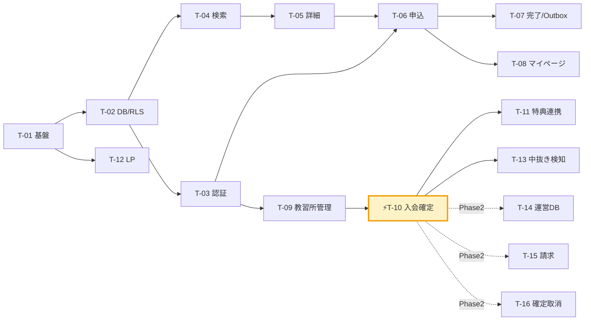
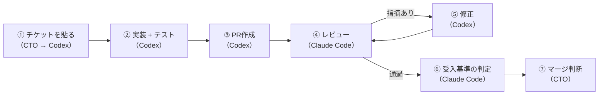

# 開発指示書（Codex向け） — BestBike × 教習所マッチング

版数 v1.0 ／ 2026-08-04

> **本書の使い方**
> §1 の「共通コンテキスト」を最初に一度だけ Codex に渡す。
> 以降は §3 の各チケットのブロックを**そのままコピーして貼る**。
> 実装が返ってきたら §5 のレビューチェックリストを機械的に適用する。
>
> **役割分担**
> | 役割 | 担当 |
> |---|---|
> | 仕様作成・チケット分解・受入基準の定義 | プロジェクト責任者（CTO） |
> | 実装・テストコードの記述 | **Codex** |
> | コードレビュー・仕様突合・品質チェック | **Claude Code** |
> | マージ判断 | プロジェクト責任者 |

---

## 1. 共通コンテキスト（Codex に最初に渡す）

```
あなたは「BestBike × 教習所マッチング」プラットフォームの実装担当エンジニアです。

## プロダクト概要
バイクレンタル事業「BestBike」が運営する、バイク免許取得の教習所マッチングサイト。
ユーザーが提携教習所に本プラットフォーム経由で申し込み、教習所が「入会確定」操作を行うと、
(1) 教習所に紹介料 ¥5,000 が計上され、
(2) ユーザーに BestBike レンタル永年10%OFF の特典コードが自動発行される。

## 技術スタック（変更しないこと）
- Next.js 15 App Router / TypeScript strict / Tailwind CSS
- Supabase (PostgreSQL 15) — Auth + DB + RLS
- Zod（入力検証。型はスキーマから導出する）
- Vitest（単体）/ Playwright（E2E）
- デプロイ: Vercel

## ディレクトリ構成
app/(public)/ 公開ページ  app/(user)/ ユーザー  app/school/ 教習所  app/admin/ 運営
app/api/ Route Handlers
components/ui/ 汎用  components/features/ 画面固有
lib/db/ クエリ層  lib/validation/ Zod  lib/auth/ 認可  lib/outbox/ 外部連携  lib/mail/
supabase/migrations/  e2e/  docs/

## 絶対に守るルール
1. 認可はサーバ側で判定する。クライアントの表示制御は演出であって防御ではない。
2. 未確定の申込に対して、特典（クーポンコード）を API レスポンスに含めない。
   キーごと存在させない。null で返すのも不可。
3. 金銭が動く処理（入会確定）は、冪等キー・行ロック・DBのUNIQUE制約の三重で二重計上を防ぐ。
4. 外部システム連携（メール・BestBike本体）は outbox_events に積むだけにする。
   同期呼び出しにしない。外部が落ちても入会確定は成立させる。
5. 権限のないリソースには 403 ではなく 404 を返す（存在を秘匿する）。
6. マジックナンバーを書かない。¥5,000 は schools.referral_fee_amount、
   10% は benefit_masters.discount_rate から取得する。
7. any を使わない。dangerouslySetInnerHTML を使わない。文字列連結のSQLを書かない。
8. SUPABASE_SERVICE_ROLE_KEY はサーバ側でのみ参照する。
   NEXT_PUBLIC_ を付けない。Client Component から絶対に触らない。

## 参照ドキュメント（リポジトリ内）
- docs/01_requirements.md  要件・業務ルール(BR-1〜BR-10)・受入基準(AC-*)
- docs/02_screen-spec.md   画面仕様・デザイントークン・アクセシビリティ
- docs/03_data-model.md    テーブル定義・DDL・RLSポリシー
- docs/04_api-spec.md      エンドポイント・リクエスト/レスポンス・エラーコード
- docs/05_nonfunctional.md 技術方針・セキュリティ・法令対応
- docs/07_test-plan.md     テストケース・受入基準

## デザインの参照元
prototype/index.html および src/App.js に、全10画面の動作プロトタイプがある。
UIはこれを正とし、Tailwind クラスをそのまま流用する。
色・余白・角丸・フォントウェイトを勝手に変えないこと。

## 成果物の形式
- 1チケット1PR。差分は原則500行以内。
- PR本文に「実装した受入基準（AC-*）の一覧」と「未対応事項」を明記する。
- テストコードを同じPRに含める。テストのないPRはレビューを通さない。
```

---

## 2. チケット一覧

| # | チケット | Phase | 依存 | 規模 | 対応要件 |
|---|---|:---:|---|:---:|---|
| **T-01** | プロジェクト基盤セットアップ | 1 | — | S | — |
| **T-02** | DBスキーマ・マイグレーション・RLS | 1 | T-01 | **L** | 03全体 |
| **T-03** | 認証と3ロールの認可基盤 | 1 | T-02 | M | FR-11 |
| **T-04** | 教習所検索API + 一覧画面 | 1 | T-02 | **L** | FR-1 |
| **T-05** | 教習所詳細画面 | 1 | T-04 | M | FR-2 |
| **T-06** | 入会申込フォーム + 申込API | 1 | T-03,T-05 | **L** | FR-3 |
| **T-07** | 申込完了画面 + 通知基盤（Outbox） | 1 | T-06 | M | FR-4 |
| **T-08** | マイページ（ステータス・特典表示） | 1 | T-06 | M | FR-5 |
| **T-09** | 教習所管理画面（一覧・入校日登録） | 1 | T-03 | M | FR-6 |
| **T-10** | ⚡ **入会確定トランザクション** | 1 | T-09 | **L** | **FR-7** |
| **T-11** | 特典発行・BestBike本体連携 | 1 | T-10 | M | FR-8 |
| **T-12** | LP（トップページ） | 1 | T-01 | S | — |
| **T-13** | 中抜き検知アラート（L-1/L-2） | 1 | T-10 | S | 05 §3.1 |
| **T-14** | 運営ダッシュボード | 2 | T-10 | **L** | FR-10 |
| **T-15** | 紹介料の月次締め・請求書 | 2 | T-10 | M | FR-9 |
| **T-16** | 確定取消フロー（運営承認） | 2 | T-10 | M | BR-6 |
| **T-17** | 口コミ・評価 | 2 | T-10 | M | 確認事項J |
| **T-18** | 教習所セルフ掲載管理 | 2 | T-09 | M | 確認事項K |

規模：S = 1〜2人日 / M = 3〜5人日 / L = 6〜10人日

### 依存関係



---

## 3. チケット詳細（そのまま Codex に貼る）

### T-01 プロジェクト基盤セットアップ

```
## T-01: プロジェクト基盤セットアップ

### やること
Next.js 15 (App Router) + TypeScript + Tailwind CSS + Supabase のプロジェクト基盤を作る。

1. `create-next-app` で App Router / TypeScript / Tailwind / ESLint を有効にして初期化
2. tsconfig.json で strict: true, noUncheckedIndexedAccess: true を設定
3. Prettier + eslint-config-prettier を導入。docs/05_nonfunctional.md §8 の基準に合わせる
4. Supabase クライアントを 2種類作る
   - lib/supabase/client.ts   … Client Component 用（anon key・RLS前提）
   - lib/supabase/server.ts   … Server Component / Route Handler 用（Cookieセッション）
   - lib/supabase/admin.ts    … service_role 用。ファイル先頭に `import 'server-only'` を書く
5. docs/05_nonfunctional.md §8.1 のディレクトリ構成を空ディレクトリ + .gitkeep で作る
6. .env.example を作る（docs/05_nonfunctional.md §7.1 の変数一覧）
7. GitHub Actions のワークフローを作る:
   lint → typecheck → test → build を PR ごとに実行
8. Vitest をセットアップし、サンプルテストが通ることを確認する

### 受入基準
- [ ] `npm run dev` が起動する
- [ ] `npm run build` が型エラー0で通る
- [ ] `npm run lint` が警告0で通る
- [ ] `npm test` が通る
- [ ] lib/supabase/admin.ts に `import 'server-only'` があり、
      Client Component からのインポートがビルドエラーになる
- [ ] .env.example に実際のシークレット値が入っていない

### 注意
- src/ と app/ を混在させない。app/ に統一する
- 既存の src/App.js（プロトタイプ）は prototype/ に移動済み。参照はするが、そこにコードを書かない
```

---

### T-02 DBスキーマ・マイグレーション・RLS

```
## T-02: DBスキーマ・マイグレーション・RLS

### やること
docs/03_data-model.md の全テーブル・制約・インデックス・RLSポリシーを、
Supabase のマイグレーションとして実装する。

1. supabase/migrations/ に以下の順でマイグレーションを作る
   - 0001_types.sql        … ENUM 型（user_role, school_status, license_type,
                              application_status, referral_fee_status, benefit_status,
                              consent_kind, outbox_status）
   - 0002_core_tables.sql  … users, schools, school_courses, school_staff
   - 0003_applications.sql … applications, application_events, consents
   - 0004_money.sql        … referral_fees, benefit_masters, benefits
   - 0005_infra.sql        … outbox_events, idempotency_keys, audit_logs, notifications
   - 0006_rls.sql          … auth_role() / is_staff_of() 関数と全RLSポリシー
   - 0007_seed_master.sql  … benefit_masters に EDU_LIFETIME_10 を投入

2. docs/03_data-model.md §3 の DDL をそのまま使う。列名・型・制約を変えない
3. 特に以下の制約は必須。1つでも欠けたら不合格
   - referral_fees に CONSTRAINT uq_referral_per_application UNIQUE (application_id)
   - benefits      に CONSTRAINT uq_benefit_per_application  UNIQUE (application_id)
   - benefits.coupon_code に UNIQUE
   - applications に部分ユニークインデックス uq_app_active_per_user_school
     （user_id, school_id）WHERE status IN ('submitted','under_review','scheduled')
   - applications に CHECK chk_confirmed_fields
   - audit_logs から UPDATE/DELETE 権限を REVOKE

4. supabase/seed.sql に docs/03_data-model.md §5 の4校とコースを投入
   （緯度経度はダミーではなく、実住所に近い妥当な値を入れる）

5. lib/db/types.ts に `supabase gen types typescript` の出力をコミットする

### 受入基準
- [ ] `supabase db reset` がエラーなく完走する
- [ ] 全テーブルで RLS が ENABLE されている（rls_disabled のテーブルが0件）
- [ ] 同一 application_id で referral_fees を2回 INSERT すると2回目が制約違反になる
- [ ] 同一 application_id で benefits を2回 INSERT すると2回目が制約違反になる
- [ ] 同一 (user_id, school_id) で status='submitted' の applications を
      2件 INSERT すると2件目が制約違反になる
- [ ] status='confirmed' かつ confirmed_at IS NULL の applications を
      INSERT すると CHECK 違反になる
- [ ] audit_logs に対する UPDATE / DELETE が権限エラーになる
- [ ] seed 投入後、schools が4件・school_courses が各校3件以上ある

### テスト
supabase/tests/ に pgTAP または Vitest + supabase-js でDB制約のテストを書く。
上記の「2回目が制約違反になる」を実際にコードで検証すること。
目視確認では不合格とする。
```

---

### T-03 認証と3ロールの認可基盤

```
## T-03: 認証と3ロールの認可基盤

### やること
Supabase Auth を使い、user / school_staff / platform_admin の3ロールを実装する。

1. 認証画面
   - /login    メール + パスワード
   - /signup   ユーザー登録（role='user' 固定）
   - /logout
   - パスワードリセット
   ※ school_staff / platform_admin は画面から自己登録できないこと（運営が手動作成）

2. auth.users への INSERT をトリガーで users テーブルに同期する
   （supabase/migrations/0008_auth_trigger.sql）

3. lib/auth/session.ts に以下を実装
   - getSession()      … 現在のセッション
   - requireUser()     … 未認証なら /login にリダイレクト
   - requireRole(role) … ロール不足なら 404 を返す（403 ではない）
   - requireSchoolStaff(schoolId) … 当該校のスタッフでなければ 404
   - requireMfa()      … MFA未完了セッションなら 403 MFA_REQUIRED

4. MFA（TOTP）を Supabase Auth の MFA 機能で実装
   - school_staff / platform_admin は初回ログイン時に登録を強制
   - user は任意

5. middleware.ts でルートグループごとにガードする
   - /school/**  → school_staff のみ
   - /admin/**   → platform_admin のみ
   - /mypage/**  → 認証済ユーザー
   - /school/** と /admin/** に X-Robots-Tag: noindex を付与

### 受入基準
- [ ] user ロールで /school にアクセスすると404になる
- [ ] user ロールで /admin にアクセスすると404になる
- [ ] school_staff で /admin にアクセスすると404になる
- [ ] 未認証で /mypage にアクセスすると /login にリダイレクトされ、
      ログイン後に /mypage へ戻る
- [ ] /signup から role='school_staff' や 'platform_admin' のユーザーを作れない
      （リクエストボディに role を入れても無視される）
- [ ] school_staff の初回ログインで MFA 登録画面に誘導される
- [ ] MFA未完了のセッションで requireMfa() を通る API が 403 を返す
- [ ] middleware のガードは Server 側で判定しており、
      クライアントのJSを無効化してもバイパスできない

### テスト
- lib/auth/session.ts の単体テスト（各ロールの許可・拒否）
- e2e/auth.spec.ts で上記のリダイレクト・404 を検証
```

---

### T-04 教習所検索API + 一覧画面

```
## T-04: 教習所検索API + 一覧画面

### やること
docs/04_api-spec.md §2.1 の GET /api/schools と、
docs/02_screen-spec.md §3.2 の一覧画面（/schools）を実装する。

1. API: app/api/schools/route.ts
   - クエリ: q, prefecture, city, lat, lng, radius_km, license_type[],
             price_max, features[], sort, page, per_page
   - Zod スキーマ lib/validation/school-search.ts で検証
   - status='active' の教習所のみ返す
   - distance_km は lat/lng があるとき Haversine で算出。なければ null
   - price_min_incl_tax は is_active な school_courses の最小額
   - sort=distance で lat/lng 未指定のときは rating にフォールバック
   - per_page の最大は 50。超過値は 50 に丸める（エラーにしない）

2. 画面: app/(public)/schools/page.tsx
   - 検索バー（フリーワード / 絞り込み / 地図⇔リスト切替）
   - 地図ビュー: Google Maps JS API。ピンのクリックで詳細へ遷移。
     現在地マーカーを表示。地図ライブラリは dynamic import で遅延読込
   - リストビュー: 教習所カード（prototype/index.html の ScreenList のマークアップを流用）
   - 絞り込み・並び替えの状態を URL のクエリに反映する（リロード・共有で再現できる）
   - 読込中はスケルトンカード4枚
   - 0件のとき、空状態と「条件をクリア」ボタンを表示

### 受入基準（docs/01_requirements.md AC-1-*, docs/02_screen-spec.md AC-LI-*）
- [ ] AC-1-1: 地図ピンのクリックで /schools/[id] に遷移する
- [ ] AC-1-2: 現在地が地図上に表示される（位置情報が拒否された場合は非表示で動作継続）
- [ ] AC-1-3: 0件のとき空状態が表示される
- [ ] AC-1-4: status != 'active' の教習所が結果に現れない
- [ ] AC-1-5: 20件超でページングされる
- [ ] AC-LI-2: 絞り込み条件がURLクエリに入り、リロードで復元される
- [ ] 位置情報が取得できない環境でも一覧が表示される（地図の失敗で画面全体が落ちない）
- [ ] Google Maps API キーにリファラ制限が設定されている（README に手順を記載）

### テスト
- lib/db/schools.ts の検索クエリの単体テスト（絞り込み・ソート・ページング）
- 距離計算（Haversine）の単体テスト
- e2e/schools-list.spec.ts: 検索 → 絞り込み → 詳細遷移

### 注意
- 地図の実装で画面全体をクライアントコンポーネントにしないこと。
  地図部分だけを 'use client' に切り出す
- prototype のSVG地図はプレースホルダ。実装では実際の地図に置き換える
```

---

### T-05 教習所詳細画面

```
## T-05: 教習所詳細画面

### やること
docs/04_api-spec.md §2.2 の GET /api/schools/:idOrSlug と、
docs/02_screen-spec.md §3.3 の詳細画面（/schools/[slug]）を実装する。

1. Server Component で SSR する（SEO が重要なページ）
2. generateMetadata で title / description / OGP を生成する
3. ISR: revalidate = 60。掲載情報の更新時にオンデマンド再検証する
4. 構成（prototype の ScreenDetail を流用）
   - ヒーロー画像 / 校名 / 評価 / エリア / タグ
   - 特典バナー（BestBike経由入会の特典）
   - 料金プラン（コース名・目安期間・税込価格）
   - アクセス・営業時間・電話
   - 申込カード（sticky）: 価格 / メリット3点 / 「この教習所に申し込む」/ 「資料請求」/
     注記「申込み時点では課金されません」
5. 1024px未満では sticky を解除し、画面下部固定のCTAバーに切り替える

### 受入基準
- [ ] AC-2-1: 「この教習所に申し込む」で /schools/[slug]/apply に遷移する
- [ ] AC-2-2: 「申込み時点では課金されません」が申込カードに表示される
- [ ] AC-2-3: 料金が税込・コースごとに表示される
- [ ] AC-D-2: 未ログインで申込を押すと /login に飛び、ログイン後に申込画面へ戻る
- [ ] AC-D-4: 存在しない slug / status != 'active' で 404 ページが出る
- [ ] AC-D-5: 1024px未満で下部固定CTAに切り替わる
- [ ] ページの HTML に構造化データ（LocalBusiness）が含まれる

### テスト
- e2e/school-detail.spec.ts: 詳細表示 → 申込導線 → 未ログイン時のリダイレクト復帰
- 404 の検証（存在しないslug / paused の教習所）

### 評価・レビュー件数について
docs/01_requirements.md 確認事項J のとおり、実データがない。
schools.review_count = 0 のときは評価ブロック全体を非表示にすること。
ダミー値を表示してはいけない（景表法リスク）。
```

---

### T-06 入会申込フォーム + 申込API

```
## T-06: 入会申込フォーム + 申込API

### やること
docs/04_api-spec.md §3.1 の POST /api/applications と、
docs/02_screen-spec.md §3.4 の申込フォームを実装する。

1. Zod スキーマ lib/validation/application.ts
   - コース / 姓 / 名 / 生年月日 / メール / 電話 は必須
   - preferred_start_date は翌日以降・1年以内
   - consents は school_terms / privacy_policy / third_party_provision の3種すべて必須
   - 生年月日から、選択コースの min_age を満たすか検証する
     （基準日は preferred_start_date、未指定なら申込日）
   - 電話番号は日本の形式に正規化する

2. API: app/api/applications/route.ts
   - Idempotency-Key ヘッダ必須。lib/idempotency.ts で処理
   - 単一トランザクションで:
     applications INSERT（price_snapshot にコース価格を凍結、
       applicant_* に申込時点の氏名等を凍結）
     consents を3件 INSERT（IP・User-Agent を記録）
     application_events に null→submitted を INSERT
     outbox_events に email.application_received / email.new_application を INSERT
   - application_no は BB-EDU-{YYYY}-{MMDDHHmm}。衝突時は連番サフィックス
   - 重複申込は 409 DUPLICATE_APPLICATION
   - レート制限 5req/10分/ユーザー

3. 画面: app/(user)/schools/[slug]/apply/page.tsx
   - ステップインジケータ（情報入力 → 確認 → 完了）
   - prototype の ScreenForm のマークアップを流用
   - 同意チェックは3つ（prototype は2つしかない。third_party_provision を追加すること）
   - blur時に項目単位でエラー表示。送信時に全項目を再検証
   - 送信中はボタンを disabled + ローディング表示

### 受入基準
- [ ] AC-3-1: 必須未入力・形式不正で送信できず、項目単位でエラーが出る
- [ ] AC-3-2: 同意3件すべてにチェックしないと送信できない
- [ ] AC-3-3: 送信しても課金レコード（referral_fees）が一切作られない
- [ ] AC-3-4: consents に3件、版数・日時・IP・UAが記録される
- [ ] AC-3-5: 同一ユーザー×同一教習所の進行中申込があると 409 になる
- [ ] AC-F-3: 年齢要件を満たさないコースで 400 AGE_REQUIREMENT_NOT_MET が返る
- [ ] AC-F-4: 同じ Idempotency-Key で2回POSTしても applications は1件しか作られない
- [ ] AC-F-6: 送信中に再クリックしても2件目が作られない
- [ ] price_snapshot に、申込時点のコース価格が入っている
- [ ] クライアント検証を無効化して不正な値を直接POSTしても、サーバ側で弾かれる

### テスト（重要）
- lib/validation/application.ts の単体テスト（境界値: 年齢ちょうど / 1日足りない）
- API の統合テスト:
  * 正常系
  * 同意欠落 → 400
  * 年齢不足 → 400
  * 重複申込 → 409
  * 同一 Idempotency-Key の二重POST → 1件のみ作成、2回目は初回レスポンスを返す
  * トランザクション途中の失敗で applications も consents も残らない（ロールバック）
- e2e/apply.spec.ts: 詳細 → 申込 → 完了
```

---

### T-07 申込完了画面 + 通知基盤（Outbox）

```
## T-07: 申込完了画面 + 通知基盤（Outbox）

### やること
1. 完了画面 app/(user)/applications/[no]/complete/page.tsx
   - docs/02_screen-spec.md §3.5 のとおり
   - 申込番号・次の3ステップを表示
   - POST-Redirect-GET。リロードで申込が再生成されないこと
   - 他人の申込番号ではアクセスできないこと（404）

2. Outbox ワーカー lib/outbox/worker.ts
   - status IN ('pending','failed') AND next_retry_at <= now() を取得
   - event_type ごとにハンドラを呼ぶ
   - 成功: succeeded / 失敗: attempts++ と指数バックオフ
     （1分 → 5分 → 30分 → 2時間 → 12時間、5回失敗で dead）
   - dead になったら Sentry にエラーを送る（アラート OP-1）
   - 実行方式: Vercel Cron（1分ごと）で app/api/cron/outbox/route.ts を叩く
     CRON_SECRET で認証する

3. メールテンプレート lib/mail/（React Email + Resend）
   - application_received（ユーザー宛・申込受付）
   - new_application（教習所宛・新規申込通知）
   - benefit_issued（ユーザー宛・特典発行）… T-10 で使う
   - すべてに送信者情報と問い合わせ先を記載（特定電子メール法）

### 受入基準
- [ ] AC-4-1: 申込番号が画面とメールで一致する
- [ ] AC-4-2: 次の3ステップが表示される
- [ ] AC-4-3: メール送信が失敗しても applications レコードは残り、再送される
- [ ] AC-C-2: 他人の application_no で完了画面を開くと404
- [ ] AC-C-3: 完了画面をリロードしても申込が増えない
- [ ] Outbox が5回失敗すると dead になり Sentry に送られる
- [ ] Cron エンドポイントが CRON_SECRET なしで叩けない
- [ ] メール本文に個人情報を必要以上に含めない（教習所宛にも生年月日は入れるが、
      それ以外の不要な情報を入れない）

### テスト
- Outbox ワーカーの単体テスト（成功 / 失敗 / バックオフ / dead 遷移）
- メール送信をモックして、テンプレートの変数展開を検証
```

---

### T-08 マイページ

```
## T-08: マイページ（ステータス・特典表示）

### やること
docs/04_api-spec.md §3.2/§3.3 と docs/02_screen-spec.md §3.6 を実装する。

1. API: app/api/me/applications/route.ts
   ★ 最重要:
     status !== 'confirmed' の申込では、レスポンスに benefit キーを含めない。
     null で返すのも不可。キーごと存在させないこと。
   - timeline は application_events から生成する（画面固定値を持たない）

2. API: app/api/me/benefits/route.ts

3. 画面: app/(user)/mypage/page.tsx
   - 申込カード（教習所名 / ステータスバッジ / コース / 申込番号 / タイムライン）
   - 特典カード（confirmed のときのみ）: クーポンコード + コピーボタン
   - 申込が0件のときは空状態 + 教習所を探すCTA
   - prototype の ScreenMypage のマークアップを流用

### 受入基準
- [ ] AC-5-1 / AC-M-1: status != 'confirmed' のとき、
      APIレスポンスのJSONに benefit というキーが存在しない
      （DevTools のネットワークタブで確認してもクーポンコードが得られない）
- [ ] AC-M-2: タイムラインの日時が application_events の実データから出る
- [ ] AC-M-3: コピーボタンでクリップボードにコードが入り、成功トーストが出る
- [ ] AC-M-4: 申込が複数あるとき全件が並ぶ
- [ ] 他人の user_id を指定しても他人の申込が取れない

### テスト（セキュリティ上、必須）
以下は必ず自動テストにすること。目視確認では不合格。
- [ ] status='scheduled' の申込に対する GET /api/me/applications のレスポンスJSONに
      'benefit' キーも 'coupon_code' 文字列も含まれないことをアサートする
- [ ] 他ユーザーのトークンで叩いたとき、自分の申込が返らないことをアサートする
- [ ] RLS が有効な状態で、anon key から benefits テーブルを直接クエリしても
      他人のレコードが取れないことをアサートする
```

---

### T-09 教習所管理画面

```
## T-09: 教習所管理画面（一覧・入校日登録）

### やること
docs/04_api-spec.md §4.1/§4.2 と docs/02_screen-spec.md §3.7 を実装する。
※ 入会確定（confirm）は T-10 で実装する。このチケットでは作らない。

1. API: app/api/school/applications/route.ts（GET）
   - requireSchoolStaff() で認可
   - 自校の申込のみ。meta.summary に
     new_this_month / pending / confirmed_this_month / referral_fee_this_month
   - can_confirm は status='scheduled' AND school_staff.can_confirm

2. API: app/api/school/applications/[id]/route.ts（PATCH）
   - submitted → under_review
   - under_review → scheduled（scheduled_start_date 必須）
   - confirmed への遷移はこのAPIでは行わない（試みたら 400 を返す）
   - application_events に履歴を追加

3. 画面: app/school/applications/page.tsx
   - サマリーカード4枚 + 申込一覧テーブル + ステータスフィルタ
   - prototype の ScreenSchoolAdmin のマークアップを流用
   - 「入会確定」ボタンは T-10 で有効化する。このチケットでは disabled で置いておく

4. 画面: app/school/applications/[id]/page.tsx（申込詳細）
   - 申込者情報・コース・希望入校日・履歴タイムライン
   - 入校日登録フォーム

### 受入基準
- [ ] AC-6-1 / AC-SA-1: 自校の申込のみが一覧に出る
- [ ] AC-SA-2: 他校の application_id を URL に直接入れても404
- [ ] 他校の application_id に PATCH しても404
- [ ] サマリーの「BestBikeへの紹介料」が referral_fees の当月合計と一致する
- [ ] PATCH で status='confirmed' を送ると 400 になる
- [ ] 遷移が application_events に記録される

### テスト
- 他校のデータにアクセスできないことの統合テスト（RLSを有効にした状態で実行する）
- ステータス遷移の単体テスト（許可された遷移 / 禁止された遷移）
```

---

### T-10 ⚡ 入会確定トランザクション【最重要】

```
## T-10: ⚡ 入会確定トランザクション【最重要チケット】

### 位置づけ
このAPIが、システム全体で唯一お金を動かす。
1件の二重計上は、教習所との信頼関係を直接毀損する。
他のどのチケットより厳格に実装・テストすること。

### やること
docs/04_api-spec.md §4.3 の POST /api/school/applications/:id/confirm を実装する。
サーバ処理の擬似コードが同節にあるので、そのとおりに実装する。

1. app/api/school/applications/[id]/confirm/route.ts
   - Idempotency-Key ヘッダ必須。欠落時は 400 IDEMPOTENCY_KEY_REQUIRED
   - requireMfa() … MFA未完了なら 403 MFA_REQUIRED
   - school_staff.can_confirm が false なら 403 CONFIRM_NOT_PERMITTED
   - 他校の申込なら 404
   - status !== 'scheduled' なら 409 APPLICATION_NOT_CONFIRMABLE
     （ただし既に 'confirmed' の場合は冪等に 200 + 初回結果を返す）

2. トランザクション内で以下をすべて実行する。1つでも失敗したら全ロールバック:
   a. SELECT ... FOR UPDATE で applications を行ロック
   b. applications: status='confirmed', confirmed_at=now(), confirmed_by=actor
   c. referral_fees INSERT
      amount は schools.referral_fee_amount から取る（5000 をハードコードしない）
      billing_month は confirmed_at の YYYY-MM
   d. benefits INSERT
      coupon_code は lib/coupon.ts の生成関数を使う（次項）
      discount_rate は benefit_masters.discount_rate から取る（10 をハードコードしない）
   e. application_events INSERT（scheduled → confirmed）
   f. audit_logs INSERT（actor / IP / UA / before / after）
   g. outbox_events INSERT × 2（benefit.issued / email.benefit_issued）

3. lib/coupon.ts: クーポンコード生成
   - 形式: EDU10-XXXXXXXX（8文字）
   - Crockford Base32 から I / L / O / U を除外した文字集合
   - crypto.randomBytes を使う。Math.random は使わない
   - UNIQUE 違反時は最大3回リトライ
   ★ 氏名や西暦から推測できる値にしないこと（docs/01_requirements.md BR-5）

4. 画面: 教習所管理画面の「入会確定」ボタンを有効化
   - 確認ダイアログを必ず経由する
   - ダイアログの文言は docs/02_screen-spec.md §3.7.3 のとおり（金額・不可逆性を明示）
   - ダイアログはフォーカストラップを持つ（A11Y-8）
   - Idempotency-Key はダイアログを開いた時点で生成し、
     同一ダイアログからの再送では同じキーを使う
   - 確定後、教習所側UIに取消ボタンを一切出さない

### 受入基準
- [ ] AC-7-1: b〜g が単一トランザクション。途中で失敗すると status も元に戻る
- [ ] AC-7-2: outbox の送信が失敗しても、確定自体は成立したままになる
- [ ] AC-7-3: 同一 application_id で referral_fees / benefits が2件作れない
- [ ] AC-7-4: 同一 Idempotency-Key の再送で、2件目の紹介料が計上されない
- [ ] AC-SA-3: 確認ダイアログを経由する
- [ ] AC-SA-5: status='submitted' / 'under_review' からは確定できない（409）
- [ ] AC-SA-6: 確定後、教習所側UIに取消ボタンがない
- [ ] AC-SA-7: audit_logs に操作者・IP・UA・前後状態が残る
- [ ] レスポンスに coupon_code が含まれない
- [ ] amount がハードコードの 5000 ではなく schools.referral_fee_amount から来ている
- [ ] discount_rate がハードコードの 10 ではなく benefit_masters から来ている

### テスト（このチケットは特にテストが本体）
必須の自動テスト:
1. 正常系: scheduled → confirmed で referral_fees 1件・benefits 1件・
   application_events 1件・audit_logs 1件・outbox_events 2件が作られる
2. 冪等: 同一 Idempotency-Key で2回叩く → referral_fees は1件のまま、
   2回目も 200 で同じレスポンス
3. 冪等キーなし: 400
4. 冪等キー再利用（異なるボディ）: 422
5. 並行実行: 同じ申込に対して確定リクエストを10本同時に投げる
   → referral_fees は必ず1件。benefits も1件
   （Promise.all で実際に並行実行すること。逐次実行のテストでは不合格）
6. 状態違反: submitted / under_review / rejected から確定 → 409
7. 他校スタッフからの確定 → 404
8. can_confirm=false のスタッフ → 403
9. MFA未完了 → 403
10. ロールバック: outbox_events の INSERT を意図的に失敗させたとき、
    applications.status が 'scheduled' のまま戻ること
11. クーポンコード生成: 10,000回生成して重複0件、
    かつ全て /^EDU10-[0-9A-HJKMNP-TV-Z]{8}$/ にマッチすること

テスト5（並行実行）は必須。これが通らない実装はマージしない。
```

---

### T-11 特典発行・BestBike本体連携

```
## T-11: 特典発行・BestBike本体連携

### 前提
docs/01_requirements.md 確認事項G/H が未回答のため、
docs/04_api-spec.md §6.3 の「クーポンコード運用」方式でMVPを作る。
Webhook 方式（§6.1）は差し替え可能な形で抽象化しておくこと。

### やること
1. lib/bestbike/ に連携インターフェースを定義する
   interface BestBikeSyncAdapter {
     syncBenefit(benefit: Benefit): Promise<SyncResult>
   }
   実装を2つ用意する:
   - CsvExportAdapter  … MVP。発行済コードを日次CSVで出力する
   - WebhookAdapter    … 本体の受け口ができたら切り替える（HMAC署名つき）
   環境変数 BESTBIKE_SYNC_MODE で切り替える

2. Outbox の benefit.issued ハンドラで Adapter を呼ぶ
   成功時に benefits.synced_to_bestbike_at を更新する

3. 運営向けのCSVエクスポート
   app/api/admin/benefits/export/route.ts
   列: coupon_code, member_email, discount_rate, issued_at, application_no
   platform_admin かつ MFA 必須

4. Webhook 受信 app/api/webhooks/bestbike/member-linked/route.ts
   - HMAC-SHA256 署名検証（timingSafeEqual を使う）
   - タイムスタンプが5分以上ズレていたら拒否
   - event_id で冪等に処理
   - 検証失敗時は 401。ボディをログに出さない

### 受入基準
- [ ] AC-8-1: 1申込につきコードは1件
- [ ] AC-8-2: コードが推測不能（T-10 のテスト11で担保）
- [ ] AC-8-3: 連携先が落ちていても benefits の発行は成立し、Outbox で再送される
- [ ] BESTBIKE_SYNC_MODE の切り替えで、コード変更なしに方式が変わる
- [ ] Webhook の署名検証が timingSafeEqual で実装されている（== 比較は不合格）
- [ ] 署名が不正なリクエストで 401 が返り、ログにボディが残らない
- [ ] CSVエクスポートが platform_admin 以外で 404 になる
```

---

### T-12 LP（トップページ）

```
## T-12: LP（トップページ）

### やること
docs/02_screen-spec.md §3.1 の LP を実装する。
prototype の ScreenLanding のマークアップをほぼそのまま流用する。

構成: ヘッダー / ヒーロー / 特典カード3点 / 3ステップ / CTA

### 受入基準
- [ ] AC-LP-1: ヒーローCTA・下部CTAの双方から /schools に遷移する
- [ ] AC-LP-2: 未ログインで全セクションが見える
- [ ] AC-LP-3: 375px幅でヒーローが1カラムになり、CTAが崩れない
- [ ] Lighthouse の Performance / Accessibility / SEO が各90以上
- [ ] OGP画像・meta description が設定されている

### 重要な注意（法令）
docs/05_nonfunctional.md §5.2 のとおり:
- 「立ちゴケ安心制度」は内容が未確定（確認事項D）。
  ★ このカードを LP に表示しないこと。実装はするが、
    フィーチャーフラグ NEXT_PUBLIC_SHOW_TACHIGOKE=false で非表示にする
- 「永年10%OFF」の近くに、利用規約へのリンクを必ず置く
- 「厳選教習所のみ掲載」は、選定基準ページへのリンクを併記する
```

---

### T-13 中抜き検知アラート

```
## T-13: 中抜き検知アラート

### 背景
docs/05_nonfunctional.md §3.1 のとおり、このビジネスの構造的な弱点は
「紹介料の発生が教習所の自発的操作に依存する」こと。
押し忘れ・意図的な未操作を検知できないと、成長するほど売上を取りこぼす。

### やること
1. L-1: 入校予定日 超過アラート
   - scheduled_start_date + 7日 を過ぎても confirmed でない申込を抽出するクエリ
   - 日次 Cron で運営に Slack / メール通知
   - 運営ダッシュボード（T-14）に一覧を出す。Phase 1 では通知のみでよい

2. L-2: ユーザー側の申告導線
   - マイページの申込カードに、scheduled_start_date を過ぎた申込について
     「通い始めましたか？」を表示
   - 「はい」を押すと applications に user_reported_started_at を記録し、
     運営にフラグを立てる
   - マイグレーション 0009_leakage_detection.sql で列を追加

3. L-3: 長期未処理リマインド
   - submitted のまま5営業日を超えた申込について、教習所へリマインドメール
   - 同一申込への再送は3日に1回まで

### 受入基準
- [ ] L-1 の抽出クエリが、境界値（ちょうど7日 / 8日）で正しく動く
- [ ] L-2 のボタンは scheduled_start_date を過ぎた申込にのみ表示される
- [ ] L-2 で「はい」を押しても、紹介料は計上されない（あくまで運営へのフラグ）
- [ ] L-3 のリマインドが同一申込に対して3日に1回を超えて送られない
- [ ] 通知はすべて Outbox 経由（同期送信しない）

### 注意
L-2 は「ユーザーの申告で自動的に課金する」機能ではない。
ユーザーの誤申告で教習所に請求が立つ設計にしてはいけない。
あくまで運営が確認するためのフラグに留めること。
```

---

### T-14〜T-18（Phase 2）

Phase 1 完了後に、同じ粒度で詳細を書き起こす。現時点では以下の骨子のみ。

| # | 概要 | 特に注意する点 |
|---|---|---|
| T-14 運営ダッシュボード | `04_api-spec.md` §5.1 | メール・クーポンコードのマスク（AC-BA-1）。集計を画面固定値にしない（AC-BA-2） |
| T-15 月次締め・請求書 | `04_api-spec.md` §5.3 | インボイス制度の要件（登録番号・税率区分・税額）。締め済月の再締め防止 |
| T-16 確定取消フロー | `04_api-spec.md` §5.2 | `platform_admin` のみ。理由必須。紹介料 `cancelled` と特典 `revoked` を同一Txで |
| T-17 口コミ・評価 | `03_data-model.md` §3.14 | `confirmed` の申込を持つ人のみ投稿可。掲載前に運営が承認 |
| T-18 教習所セルフ掲載管理 | 確認事項K | 価格変更の履歴を残す（景表法の表示根拠） |

---

## 4. 開発の進め方

### 4.1 サイクル



### 4.2 レビュー依頼の文面（Claude Code に貼る）

```
docs/06_dev-instructions-codex.md の T-{番号} に対する実装をレビューしてください。

観点:
1. §5 のレビューチェックリストを1項目ずつ機械的に確認する
2. T-{番号} の受入基準を1つずつ「満たす / 満たさない / 判定不能」で判定する
3. docs/ の仕様と実装の差分を指摘する
4. セキュリティ上の問題を最優先で報告する

出力形式:
- 【重大】マージをブロックする指摘
- 【要修正】マージ前に直すべき指摘
- 【提案】任意の改善
- 受入基準の判定表
```

### 4.3 PR テンプレート

```markdown
## チケット
T-XX

## 実装内容


## 満たした受入基準
- [x] AC-X-1: ...
- [x] AC-X-2: ...

## 未対応・積み残し


## テスト
- 単体: X件
- 統合: X件
- E2E: X件

## セキュリティへの影響
（認可・個人情報・金銭処理に触れる場合は必ず記載）
```

---

## 5. レビューチェックリスト

> Claude Code はこのリストを**1項目ずつ機械的に**確認する。
> 「たぶん大丈夫」で飛ばさない。該当なしなら「該当なし」と明記する。

### 5-A. セキュリティ（1つでもNGならマージ不可）

| # | 確認項目 |
|---|---|
| A-1 | 認可判定がサーバ側にあるか。Client Component の条件分岐だけで守っていないか |
| A-2 | **未確定の申込に対して、APIレスポンスに `benefit` / `coupon_code` が含まれていないか** |
| A-3 | 教習所スタッフが他校のデータを取得できないか（RLS ＋ アプリ層の二重） |
| A-4 | 権限のないリソースに 403 ではなく 404 を返しているか |
| A-5 | `SUPABASE_SERVICE_ROLE_KEY` が Client Component / `NEXT_PUBLIC_` から参照されていないか |
| A-6 | ユーザー入力が Zod で検証されているか。クライアント検証だけに頼っていないか |
| A-7 | `dangerouslySetInnerHTML` を使っていないか |
| A-8 | 文字列連結でSQLを組み立てていないか |
| A-9 | HMAC 検証に `timingSafeEqual` を使っているか（`==` 比較は不可） |
| A-10 | ログ・エラーメッセージに個人情報（氏名・メール・電話）が出ていないか |
| A-11 | 新規テーブルに RLS が有効化され、ポリシーが定義されているか |
| A-12 | 乱数に `Math.random()` を使っていないか（`crypto` を使うこと） |

### 5-B. 金銭処理（T-10・T-15・T-16 で必須）

| # | 確認項目 |
|---|---|
| B-1 | `Idempotency-Key` が必須になっているか |
| B-2 | `SELECT ... FOR UPDATE` で行ロックしているか |
| B-3 | `referral_fees` / `benefits` に `UNIQUE(application_id)` があるか |
| B-4 | ステータス・紹介料・特典・監査ログが**単一トランザクション**か |
| B-5 | 外部連携（メール・本体）がトランザクション内で同期呼び出しされていないか |
| B-6 | **並行実行テストが存在し、実際に `Promise.all` で並行実行しているか** |
| B-7 | 金額が `schools.referral_fee_amount` から来ているか（`5000` のハードコードでないか） |
| B-8 | 割引率が `benefit_masters.discount_rate` から来ているか（`10` のハードコードでないか） |
| B-9 | 状態遷移の前提（`scheduled` からのみ確定可）が検証されているか |
| B-10 | `audit_logs` に操作者・IP・UA・前後状態が記録されているか |

### 5-C. 仕様との一致

| # | 確認項目 |
|---|---|
| C-1 | チケットの受入基準を**すべて**満たしているか。未達があれば PR に明記されているか |
| C-2 | 画面が `prototype/` のデザインと一致しているか（色・余白・角丸・フォントウェイト） |
| C-3 | エラーコードが `04_api-spec.md` §1.3 の一覧と一致しているか |
| C-4 | DB の列名・型が `03_data-model.md` と一致しているか |
| C-5 | 法令要件（第三者提供の同意3件・税込表示・年齢検証）が実装されているか |

### 5-D. テスト

| # | 確認項目 |
|---|---|
| D-1 | テストコードが同じ PR に含まれているか |
| D-2 | 異常系・境界値のテストがあるか（正常系だけは不合格） |
| D-3 | セキュリティ要件がテストで担保されているか（目視確認では不合格） |
| D-4 | 金銭処理のカバレッジが80%以上か |
| D-5 | RLS を有効にした状態でテストが実行されているか（`service_role` で全部通していないか） |

### 5-E. 品質・保守性

| # | 確認項目 |
|---|---|
| E-1 | `any` を使っていないか |
| E-2 | DBアクセスが `lib/db/` に集約されているか |
| E-3 | Zod スキーマが型の唯一の定義になっているか（型を二重定義していないか） |
| E-4 | Server / Client Component の境界が適切か（不要に `'use client'` を広げていないか） |
| E-5 | 差分が500行以内か。超える場合は分割が検討されたか |
| E-6 | 不要な依存パッケージを追加していないか |
| E-7 | フォーカスリングを消していないか（`outline-none` の単独使用） |

### 5-F. アクセシビリティ

| # | 確認項目 |
|---|---|
| F-1 | すべてのフォーム入力に `<label>` が紐づいているか |
| F-2 | エラーが `aria-describedby` で入力に紐づいているか |
| F-3 | キーボードのみで主要導線を完了できるか |
| F-4 | ステータスを色のみで区別していないか（文言を併記しているか） |
| F-5 | モーダルにフォーカストラップがあるか |

---

## 6. Codex に渡すときの注意

| # | 注意 |
|---|---|
| N-1 | チケットは**1つずつ**渡す。複数を同時に渡すと、依存関係を無視した実装が返る |
| N-2 | 「受入基準」の節を削らない。ここが実装のゴール定義になっている |
| N-3 | 仕様に迷いがあるときは、Codex に判断させず CTO が決めてからチケットを更新する |
| N-4 | Codex が仕様と異なる実装を返したとき、**仕様側が悪い可能性を先に疑う**。曖昧な記述はドキュメントを直す |
| N-5 | T-10 は必ず単独で、他のチケットと並行させずに進める |
| N-6 | 生成されたコードに「TODO」「後で実装」が残っていないか、マージ前に必ず確認する |
