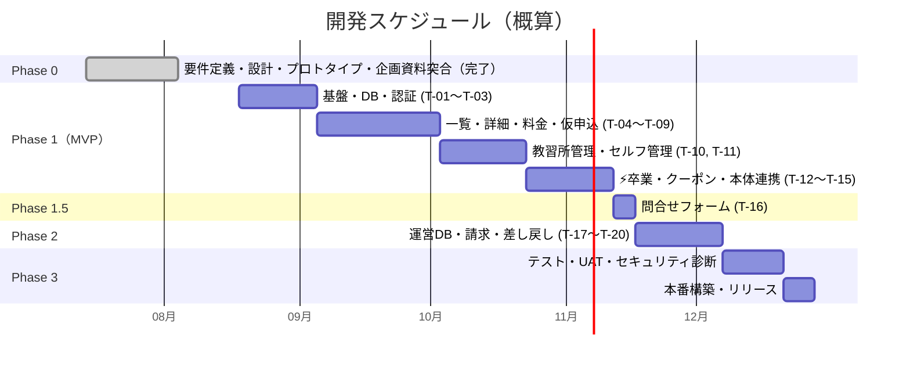
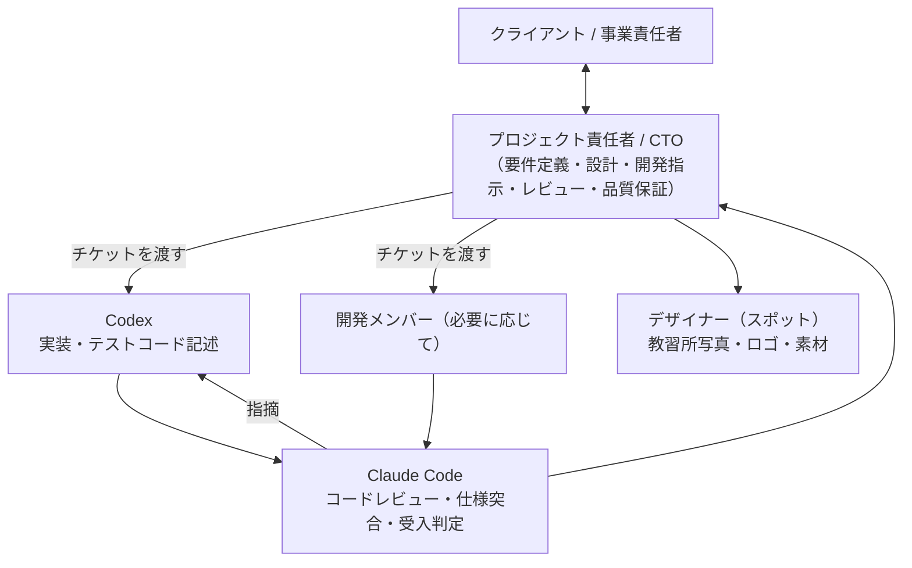
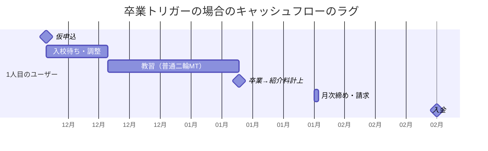

# 開発計画・体制・概算見積 — BestBike × 教習所マッチング

版数 **v1.1** ／ 2026-08-04

> **v1.0 からの改版**：企画資料（PDF）受領により機能スコープが変わったため再見積した。
> 主な増加要因は §3.4 に記載。差分の全量は [`09_pdf-reconciliation.md`](09_pdf-reconciliation.md)。
>
> 本書の金額はすべて**概算**です。確認事項 **A（紹介料の計算ルール）**・
> **B（ベストBike本体との連携）**・**C（ステータスの変更権限）** の回答によって前後します。
> 正式見積は仕様確定後に発行します。

---

## 1. フェーズ構成

| フェーズ | 内容 | 期間 | 状態 |
|---|---|---|---|
| **Phase 0** | 要件定義・画面設計・データ設計・API設計・非機能設計・開発指示書・テスト計画・**動作するプロトタイプ**・**企画資料との突合と全面改版** | 3週間 | **完了（本リポジトリ）** |
| **Phase 1** | MVP：仮申込 → 入校 → 卒業 → 特典 の一本道（T-01〜T-15） | 約3ヶ月 | — |
| **Phase 1.5** | 問合せフォーム（T-16） | 1週間 | — |
| **Phase 2** | 運営ダッシュボード・請求・差し戻し・免許証（T-17〜T-20） | 約1ヶ月 | — |
| **Phase 3** | テスト・UAT・セキュリティ診断・本番構築・リリース | 約3週間 | — |
| | **合計** | **約5.5ヶ月** | |

---

## 2. 体制

| 役割 | 担当 | 責務 |
|---|---|---|
| プロジェクト責任者 / CTO | **本人** | 要件定義、画面・データ・API・非機能設計、チケット分解、開発指示、レビュー最終判断、クライアント折衝、マージ判断 |
| 実装 | **Codex**（＋必要に応じて開発メンバー） | チケット単位の実装、単体・統合・E2Eテストの記述 |
| コードレビュー・品質保証 | **Claude Code** | `06_dev-instructions-codex.md` §5 のチェックリスト（**58項目**）の適用、受入基準の1件ずつの判定、セキュリティレビュー |
| デザイン | デザイナー（スポット） | 教習所写真のディレクション、ロゴ、素材制作 |

### 2.1 この体制の要点

**設計と品質保証を1人に集約し、実装だけを外に出す。**
仕様を書いた人間がレビューするため、認識ズレによる手戻りが構造的に発生しにくい。

さらに本プロジェクトでは、レビューを Claude Code に機械的に実行させる。
`06_dev-instructions-codex.md` §5 のチェックリストは、
「たぶん大丈夫」を排除するために、1項目ずつ判定させる形式で書いてある。

---

## 3. 概算見積

### 3.1 チケット別 工数

| # | チケット | 規模 | 素の工数 | Codex活用後 |
|---|---|:---:|---:|---:|
| T-01 | プロジェクト基盤 | S | 1.5 | 1.0 |
| T-02 | DBスキーマ・RLS | **XL** | 12.0 | 7.0 |
| T-03 | 認証・3ロール認可 | M | 4.0 | 2.5 |
| T-04 | エリア階層API + 都道府県/市区町村一覧 | M | 4.0 | 2.5 |
| T-05 | 教習所一覧 | M | 4.0 | 2.5 |
| T-06 | 教習所詳細 + **料金2テーブル** | L | 8.0 | 5.0 |
| T-07 | **仮申込フォーム + 申込API** | L | 8.0 | 5.0 |
| T-08 | 申込完了 + Outbox + メール基盤 | M | 4.0 | 2.5 |
| T-09 | マイページ | M | 4.0 | 2.5 |
| T-10 | 教習所ダッシュボード（入校） | L | 8.0 | 5.0 |
| T-11 | **教習所セルフ管理** | L | 8.0 | 5.0 |
| **T-12** | **⚡ 卒業 + クーポン2種発行** | **XL** | **12.0** | **9.0** |
| T-13 | ベストBike本体連携 | M | 4.0 | 2.5 |
| T-14 | トップページ | S | 1.5 | 1.0 |
| T-15 | 卒業漏れ検知アラート | S | 1.5 | 1.0 |
| | **Phase 1 小計** | | **84.5** | **54.0** |
| T-16 | 問合せフォーム | M | 4.0 | 2.5 |
| | **Phase 1.5 小計** | | **4.0** | **2.5** |
| T-17 | 運営ダッシュボード | L | 8.0 | 5.0 |
| T-18 | 月次締め・請求書DL | M | 4.0 | 3.0 |
| T-19 | ステータス差し戻し | M | 4.0 | 2.5 |
| T-20 | 免許証アップロード | M | 4.0 | 2.5 |
| | **Phase 2 小計** | | **20.0** | **13.0** |

> **T-12 の圧縮率が最も低いのは意図的**（12.0 → 9.0）。
> 並行実行テスト・ロールバック検証・ハードコード検出テスト・監査ログの妥当性確認など、
> 生成コードをそのまま信用できない領域が最も大きい。ここは工数を削らない。
>
> **T-02 も同様**（12.0 → 7.0）。制約・RLSポリシーの1つの漏れが、
> そのまま情報漏洩や二重発行につながる。

### 3.2 見積内訳

| # | 項目 | 人日 | 単価 | 金額（税別） |
|---|---|---:|---:|---:|
| 1 | **Phase 0**：要件定義・画面設計・データ設計・API設計・非機能設計・開発指示書・テスト計画・**動作するプロトタイプ**・**企画資料との突合と全面改版** | 24 | ¥60,000 | **¥1,440,000** |
| 2 | **Phase 1**：MVP開発（T-01〜T-15） | 54 | ¥60,000 | ¥3,240,000 |
| 3 | **Phase 1.5**：問合せフォーム（T-16） | 2.5 | ¥60,000 | ¥150,000 |
| 4 | **Phase 2**：運営DB・請求・差し戻し・免許証（T-17〜T-20） | 13 | ¥60,000 | ¥780,000 |
| 5 | **Phase 3**：テスト・UAT対応・セキュリティ診断・本番構築・リリース | 14 | ¥60,000 | ¥840,000 |
| 6 | コードレビュー・品質保証（全期間） | 12 | ¥60,000 | ¥720,000 |
| 7 | デザイン仕上げ（教習所写真ディレクション・ロゴ・素材） | — | 一式 | ¥350,000 |
| 8 | プロジェクト管理（全期間） | — | 一式 | ¥380,000 |
| | **小計（税別）** | **119.5** | | **¥7,900,000** |
| | **合計（税込10%）** | | | **¥8,690,000** |

### 3.3 収益構造（社内向け）

ご要望の「Phase 0 を自身の稼働費として計上し、Phase 1 以降を開発チームで進める」構成。

| 項目 | 金額（税別） | 誰の取り分か |
|---|---:|---|
| Phase 0（要件定義・設計・プロトタイプ・企画資料突合） | ¥1,440,000 | **全額 自身**（納品済） |
| コードレビュー・品質保証 | ¥720,000 | **全額 自身** |
| プロジェクト管理 | ¥380,000 | **全額 自身** |
| **自身の取り分 小計** | **¥2,540,000** | |
| Phase 1（MVP開発） | ¥3,240,000 | 開発チーム |
| Phase 1.5（問合せ） | ¥150,000 | 開発チーム |
| Phase 2（運営DB ほか） | ¥780,000 | 開発チーム |
| Phase 3（テスト・リリース） | ¥840,000 | 開発チーム |
| デザイン | ¥350,000 | デザイナー |
| **外注 小計** | **¥5,360,000** | |

#### 実装の進め方による利益差

| シナリオ | 実装の主体 | 外注費 | 自身の取り分 | 利益率 |
|---|---|---:|---:|---:|
| **A. 人間の開発チームに全量外注** | 開発メンバー | ¥5,360,000 | ¥2,540,000 | 32% |
| **B. Codex主体 ＋ 自身がレビュー** | Codex | ¥350,000（デザインのみ） | ¥7,550,000 | 96% |
| **C. 併用（推奨）** | Codex主体・難所は人間 | ¥1,800,000前後 | ¥6,100,000 | 77% |

> **推奨は C**。**T-12（卒業・クーポン発行）と T-02（DB・RLS）だけは
> 経験のある人間の目を通し**、それ以外を Codex で回す。
> 全量を Codex に任せる B は、クーポンの二重発行や情報漏洩のリスクを1人で背負うことになる。

> **注意**：Phase 0 の ¥1,440,000 は「24人日 × ¥60,000」の積み上げです。
> 単価・人日は市況と関係性に応じて調整してください。値付けの根拠としては
> 「動くプロトタイプ＋設計9種＋開発指示書（20チケット）＋テスト計画（約180ケース）が
> 着手前にすべて揃っている」という成果物の密度が使えます。

### 3.4 v1.0 からの増額理由

| | v1.0 | **v1.1** | 差 |
|---|---:|---:|---:|
| 合計（税込） | ¥7,018,000 | **¥8,690,000** | **+¥1,672,000** |
| 期間 | 約4ヶ月 | **約5.5ヶ月** | +1.5ヶ月 |

**増加した機能**（すべて企画資料に記載があり、v1.0 で捕捉できていなかったもの）

| # | 機能 | 追加工数 | 出典 |
|---|---|---:|---|
| 1 | **教習所セルフ管理（自社情報・料金・通知先）** — v1.0 は Phase 2 に置いていた | +5.0 | P-1 §5 |
| 2 | **料金2テーブル構成**（希望免許 × 保有免許） — v1.0 は単一テーブルで表現不能だった | +2.5 | P-1 §2 / P-2 §3 |
| 3 | **入校確定と卒業の2段階化**（v1.0 は「入会確定」の1段階） | +3.0 | P-2 §1 |
| 4 | **クーポン2種＋使用回数・有効期限・使用済み管理** | +2.5 | P-1 §4・§10 / P-2 §6 |
| 5 | **エリア階層ナビ**（SUUMO型） | +2.5 | P-1 §1 |
| 6 | 問合せフォーム | +2.5 | P-1 §3 |
| 7 | 写真4枚・Google地図・請求書DL・通知先2件・メーラー起動 | +2.0 | P-1 §2・§5 |
| 8 | 免許証アップロード（Phase 2） | +2.5 | P-1 §4 / P-2 §5 |
| | **合計** | **+22.5人日** | |

**減額した項目**

| # | 削除 | 削減 | 理由 |
|---|---|---:|---|
| 1 | 口コミ・評価機能 | −2.5 | 企画資料に記載がない |
| 2 | 地図検索（Google Maps JS API） | −1.5 | 一覧は地図なし。詳細は Embed API（無料） |
| 3 | 現在地・距離順ソート | −1.0 | P-1 §1 が明確に否定 |

> 差し引き **+17.5人日**（Codex活用後）が、そのまま増額分になっている。

---

## 4. 月額運用費

| 項目 | 月額（税込） | 内容 |
|---|---:|---|
| インフラ（Vercel + Supabase） | ¥5,000〜25,000 | 提携10〜100校・月間3万UU なら ¥10,000前後 |
| **Google Maps Embed API** | **¥0** | 詳細ページの位置表示のみ。Embed は無料 |
| メール配信（Resend） | ¥0〜3,000 | 月3,000通まで無料枠 |
| 画像ストレージ（Supabase Storage） | ¥0〜3,000 | 教習所写真4枚 × 100校 |
| 監視（Sentry） | ¥0〜4,000 | 無料枠で開始可 |
| **保守（基本）** | ¥60,000 | バグ修正・月次メンテナンス・月8hまで |
| **保守（インフラ運用）** | ¥25,000 | 監視・バックアップ・障害対応・Outbox の死活確認 |
| **合計** | **¥90,000〜120,000** | |

機能追加・改修：¥12,000/時間（要見積）

> v1.0 で見込んでいた地図費用（¥0〜8,000/月）は、
> 一覧から地図を外し詳細を Embed API にしたことで**ゼロになった**。

### 4.1 損益分岐

> **紹介料の金額・発生時点が未確定（確認事項A）のため、試算です。**

| 前提 | 値 |
|---|---:|
| 紹介料（仮） | ¥5,000 / 件 |
| 月額運用費 | ¥110,000 |
| **運用費の損益分岐** | **月22件の卒業** |

提携24校で月22件は、1校あたり**月1件弱**。
ただし **卒業がトリガーの場合、初回の入金までに仮申込から2〜3ヶ月のラグ**がある。

> **仮申込から入金まで約3ヶ月**。
> 確認事項A で「入校確定時」を選べばこれが1.5ヶ月に短縮される。
> **紹介料の発生時点は、収益の額だけでなくキャッシュフローも決める。**

初期投資（¥8,690,000）の回収は、月87件ペースで約20ヶ月。

---

## 5. リスクと対策

| # | リスク | 影響 | 対策 |
|---|---|---|---|
| **R-1** | **ベストBike本体との連携仕様が未確定**（確認事項B） | 認証・会員・特典連携の設計が根本から変わる。**最大の手戻り要因** | **Phase 1 着手前に必須で確定**。MVPは `04_api-spec.md` §6.3 の「クーポンCSV運用」で本体改修ゼロで開始できる設計にしてある |
| **R-2** | **紹介料の計算ルールが未確定**（確認事項A） | 集計・請求機能が作れない。**キャッシュフローの見通しも立たない** | `referral_fee_settings` テーブルで7項目を設定値として持つ設計。回答が来たらデータ投入だけで済む |
| **R-3** | **卒業登録の漏れ** | 送客・入校しても特典が出ず、紹介料も発生しない。**成長するほど損失が拡大** | T-15（滞留アラート・ユーザー申告・リマインド）を Phase 1 に含める。契約書に卒業操作の義務を明記 |
| **R-4** | **仮申込〜卒業のリードタイムが長い（2〜3ヶ月）** | 担当者交代・失念が起きる。初期のキャッシュフローが厳しい | 月次の突合レポート（`05_nonfunctional.md` L-6）。確認事項A で発生時点を「入校確定時」にする選択肢も検討 |
| R-5 | クーポンの二重発行・不正取得 | 事業への直接的な損害 | 冪等キー・行ロック・UNIQUE制約の三重防御。IT-03（並行実行テスト）をリリース必須項目に |
| R-6 | **教習所が料金表を更新しない** | 掲載情報が陳腐化し、景表法リスク | 教習所セルフ管理を **Phase 1 必須**にした。最終更新日を表示。90日未更新を警告（Phase 2） |
| R-7 | **料金表の入力が教習所にとって負担** | 提携が進まない／掲載が空になる | 初期データは運営が代行入力。UIは行追加型で最小限（P-2 §3 の推奨に従い、Excel自由入力は採用しない） |
| R-8 | 教習所担当者がPC操作に不慣れ | 「卒業」が押されない＝特典が出ない | UAT-03 を最重要シナリオに設定。2つのボタン（入校／卒業）の違いを明確に |
| R-9 | 「永久10%OFF」の終了条件が未定（確認事項I） | 景表法上の有利誤認 | 規約に変更・終了条件を明記してからリリース（R-14） |
| R-10 | 「報酬額5%アップ」の条件未定（確認事項K） | 景表法リスク | 数値訴求せず、シェアリングHPへのリンク誘導に留める（R-16） |
| R-11 | 免許証画像の取扱い | 重要な個人情報。漏洩時の影響が大きい | **P-2 §5 の推奨どおり MVPから除外**。実装する場合は `05_nonfunctional.md` §2.6 の L-1〜L-7 を満たす |
| R-12 | 個人情報の第三者提供・自動会員登録の同意漏れ | 個人情報保護法違反 | 同意4件を必須化（T-07）。`consents` に版数・日時・IPを記録 |
| R-13 | Codex の実装品質のばらつき | 手戻り・レビュー工数増 | 1チケット1PR、受入基準の明文化、`06_dev-instructions-codex.md` §5 の機械的適用。T-12 は単独で進める |
| R-14 | **旧プロトタイプを参照した実装のズレ** | 企画資料と異なる業務モデルで実装される | Codex に旧プロトタイプを見せるときは `09_pdf-reconciliation.md` を必ず併せて渡す（N-6） |

---

## 6. 次のステップ

| # | アクション | 担当 | 期限目安 |
|---|---|---|---|
| 1 | 本ドキュメント群（v1.1）の内容確認 — 企画資料の意図と合っているか | クライアント | 1週間 |
| 2 | **確認事項 A・B・C の回答**（`01_requirements.md` §8） | クライアント | 1週間 |
| 3 | ベストBike本体の連携方式の技術確認（R-1） | 双方 | 1週間 |
| 4 | 確認事項 D〜L の回答 | クライアント | 2週間 |
| 5 | 技術スタックの合意（Supabase構成） | 双方 | 1週間 |
| 6 | 提携教習所との契約書に「卒業操作の義務」を追記 | クライアント | 2週間 |
| 7 | 初期提携教習所の料金データ収集（運営が代行入力する前提） | クライアント | 3週間 |
| 8 | 要件定義書の確定 | 双方 | 2週間 |
| 9 | Phase 1 キックオフ（T-01, T-02 着手） | 開発チーム | 2週間後 |

---

## 7. 提案の要旨（クライアント向けサマリー）

1. **企画資料の内容を、そのまま設計に落としました。**
   免許6種の料金表（希望免許 × 保有免許）、5段階のステータス、
   卒業時の2種クーポン、シェアリングオーナー導線まで反映しています。
   レビュー資料で指摘されていた8つの修正点も、すべて設計に取り込みました。

2. **開発は着手前にすべて揃っています。**
   要件定義・画面仕様・データモデル（DDL・RLS込み）・API仕様・非機能要件・
   開発指示書（20チケット）・テスト計画（約180ケース）。
   開発チームは初日からコードを書き始められます。

3. **約5.5ヶ月・税込 ¥8,690,000。**
   実装を Codex 主体で回すことで、素の工数 108.5人日を 69.5人日まで圧縮しています。

4. **このシステムの成否は「卒業」ボタンの1点に集約されます。**
   お金と特典が動くのはこのボタン1つだけです。
   二重発行を防ぐ三重の仕組みと、押し忘れを検知する仕組みの両方を設計に織り込んでいます。

5. **最大の事業リスクは技術ではなく、卒業登録の漏れです。**
   仮申込から卒業まで2〜3ヶ月あり、その間に担当者交代・失念が必ず起きます。
   ただし**ユーザーも「卒業が記録されないと特典をもらえない」**ため、
   ユーザー側からの申告導線（T-15）が機能しやすい構造です。

6. **未確定の3点は、設定値で吸収できる設計にしてあります。**
   紹介料のルールは `referral_fee_settings` テーブル、
   本体連携は Adapter の差し替えで対応します。
   回答が遅れても、Phase 1 の着手自体はブロックされません。

---

## 8. この計画で最も注意して見ていただきたい3点

### ① 確認事項 B（ベストBike本体との関係）

同一DB / API連携 / SSO のどれを取るかで、認証・会員・特典連携の設計が根本から変わります。
**唯一の大きな手戻り要因**です。

MVPは本体改修ゼロで開始できる設計（クーポンCSV運用）にしてありますが、
最終形は決めてから Phase 1 に入るべきです。

### ② 確認事項 A（紹介料の発生時点）— 収益とキャッシュフローの両方を決める

| 選択肢 | 収益認識 | 入金までのラグ | リスク |
|---|---|---|---|
| **入校確定時** | 早い | 約1.5ヶ月 | 中途退学者からも紹介料が発生し、教習所と揉める可能性 |
| **卒業時** | 遅い | 約3ヶ月 | 教習所が卒業を押し忘れると1円も入らない |

**どちらを選ぶかで、必要な運転資金と、システムが検知すべき異常が変わります。**

### ③ 卒業漏れ検知（T-15）を Phase 2 に落とさないこと

運営ダッシュボードは Phase 2 で構いません。
しかし **T-15（滞留アラート・ユーザー申告導線・リマインド）は Phase 1 に必要**です。

提携校が10校のうちは目視でも追えますが、100校になったら追えません。
そして卒業が記録されなければ、**ユーザーは約束した特典を受け取れません**。
これは売上の問題であると同時に、ユーザーとの約束の問題です。
