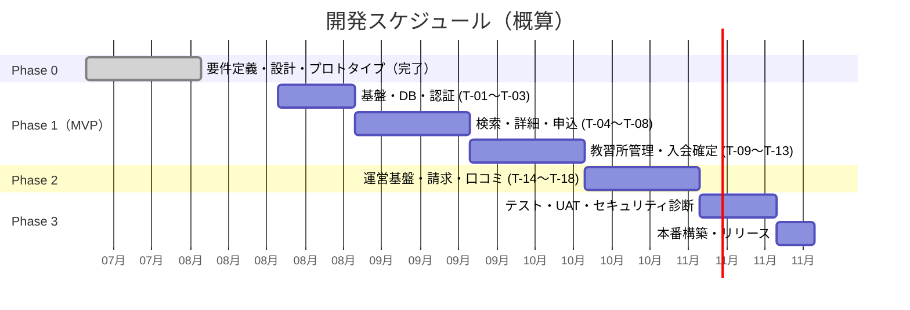
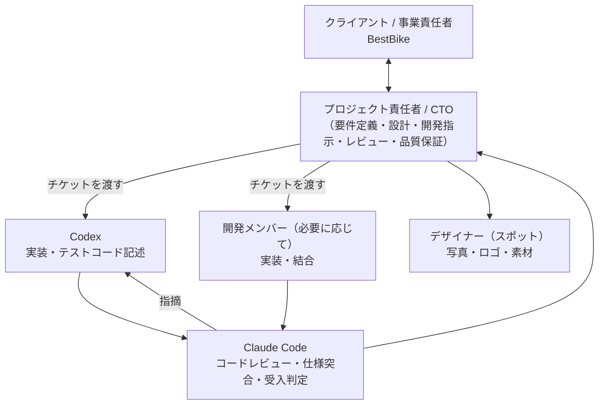
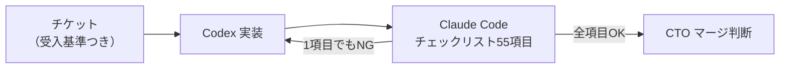

# 開発計画・体制・概算見積 — BestBike × 教習所マッチング

版数 v1.0 ／ 2026-08-04

> 本書の金額はすべて**概算**です。`01_requirements.md` §9 の確認事項（特に A・C・E・G）の
> 回答、および BestBike本体の連携仕様によって前後します。正式見積は仕様確定後に発行します。

---

## 1. フェーズ構成

| フェーズ | 内容 | 期間 | 状態 |
|---|---|---|---|
| **Phase 0** | 要件定義・画面設計・データ設計・API設計・非機能設計・開発指示書・テスト計画・**動作するプロトタイプ** | 3週間 | **完了（本リポジトリ）** |
| **Phase 1** | MVP：申し込んで特典を受け取れる最小構成（T-01〜T-13） | 約2ヶ月 | — |
| **Phase 2** | 運営ダッシュボード・請求・確定取消・口コミ（T-14〜T-18） | 約1ヶ月 | — |
| **Phase 3** | テスト・UAT・セキュリティ診断・本番構築・リリース | 約3週間 | — |
| | **合計** | **約4ヶ月** | |

---

## 2. 体制

| 役割 | 担当 | 責務 |
|---|---|---|
| プロジェクト責任者 / CTO | **本人** | 要件定義、画面・データ・API・非機能設計、チケット分解、開発指示、レビュー最終判断、クライアント折衝、マージ判断 |
| 実装 | **Codex**（＋必要に応じて開発メンバー） | チケット単位の実装、単体・統合・E2Eテストの記述 |
| コードレビュー・品質保証 | **Claude Code** | `06_dev-instructions-codex.md` §5 のチェックリスト適用、受入基準の1件ずつの判定、セキュリティレビュー |
| デザイン | デザイナー（スポット） | 教習所写真のディレクション、ロゴ、素材制作 |

### 2.1 この体制の要点

**設計と品質保証を1人に集約し、実装だけを外に出す。**
仕様を書いた人間がレビューするため、認識ズレによる手戻りが構造的に発生しにくい。

さらに本プロジェクトでは、レビューを Claude Code に機械的に実行させる。
`06_dev-instructions-codex.md` §5 のチェックリストは、
「たぶん大丈夫」を排除するために、1項目ずつ判定させる形式で書いてある。

---

## 3. 概算見積

### 3.1 チケット別 工数

| # | チケット | 規模 | 素の工数 | Codex活用後 |
|---|---|:---:|---:|---:|
| T-01 | プロジェクト基盤 | S | 1.5 | 1.0 |
| T-02 | DBスキーマ・RLS | L | 8.0 | 5.0 |
| T-03 | 認証・3ロール認可 | M | 4.0 | 2.5 |
| T-04 | 教習所検索API + 一覧 | L | 8.0 | 5.0 |
| T-05 | 教習所詳細 | M | 4.0 | 2.0 |
| T-06 | 入会申込フォーム + API | L | 8.0 | 5.0 |
| T-07 | 申込完了 + Outbox | M | 4.0 | 2.5 |
| T-08 | マイページ | M | 4.0 | 2.5 |
| T-09 | 教習所管理画面 | M | 4.0 | 2.5 |
| **T-10** | **⚡ 入会確定トランザクション** | **L** | **8.0** | **6.0** |
| T-11 | 特典発行・本体連携 | M | 4.0 | 2.5 |
| T-12 | LP | S | 1.5 | 1.0 |
| T-13 | 中抜き検知アラート | S | 1.5 | 1.0 |
| | **Phase 1 小計** | | **60.5** | **38.5** |
| T-14 | 運営ダッシュボード | L | 8.0 | 5.0 |
| T-15 | 月次締め・請求書 | M | 4.0 | 3.0 |
| T-16 | 確定取消フロー | M | 4.0 | 2.5 |
| T-17 | 口コミ・評価 | M | 4.0 | 2.5 |
| T-18 | 教習所セルフ掲載管理 | M | 4.0 | 2.5 |
| | **Phase 2 小計** | | **24.0** | **15.5** |

> **T-10 の圧縮率が低いのは意図的**。並行実行テスト・ロールバック検証・
> 監査ログの妥当性確認など、生成コードをそのまま信用できない領域が最も大きいチケット。
> ここは工数を削らない。

### 3.2 見積内訳

| # | 項目 | 人日 | 単価 | 金額（税別） |
|---|---|---:|---:|---:|
| 1 | **Phase 0**：要件定義・画面設計・データ設計・API設計・非機能設計・開発指示書・テスト計画・**動作するプロトタイプ** | 20 | ¥60,000 | **¥1,200,000** |
| 2 | **Phase 1**：MVP開発（T-01〜T-13） | 38.5 | ¥60,000 | ¥2,310,000 |
| 3 | **Phase 2**：運営基盤・請求・確定取消・口コミ（T-14〜T-18） | 15.5 | ¥60,000 | ¥930,000 |
| 4 | **Phase 3**：テスト・UAT対応・セキュリティ診断・本番構築・リリース | 12 | ¥60,000 | ¥720,000 |
| 5 | コードレビュー・品質保証（全期間） | 10 | ¥60,000 | ¥600,000 |
| 6 | デザイン仕上げ（教習所写真ディレクション・ロゴ・素材） | — | 一式 | ¥300,000 |
| 7 | プロジェクト管理（全期間） | — | 一式 | ¥320,000 |
| | **小計（税別）** | **96** | | **¥6,380,000** |
| | **合計（税込10%）** | | | **¥7,018,000** |

### 3.3 収益構造（社内向け）

ご要望の「Phase 0 を自身の稼働費として計上し、Phase 1 以降を開発チームで進める」構成。

| 項目 | 金額（税別） | 誰の取り分か |
|---|---:|---|
| Phase 0（要件定義・設計・プロトタイプ） | ¥1,200,000 | **全額 自身**（納品済） |
| コードレビュー・品質保証 | ¥600,000 | **全額 自身** |
| プロジェクト管理 | ¥320,000 | **全額 自身** |
| **自身の取り分 小計** | **¥2,120,000** | |
| Phase 1（MVP開発） | ¥2,310,000 | 開発チーム |
| Phase 2（運営基盤ほか） | ¥930,000 | 開発チーム |
| Phase 3（テスト・リリース） | ¥720,000 | 開発チーム |
| デザイン | ¥300,000 | デザイナー |
| **外注 小計** | **¥4,260,000** | |

#### 実装の進め方による利益差

| シナリオ | 実装の主体 | 外注費 | 自身の取り分 | 利益率 |
|---|---|---:|---:|---:|
| **A. 人間の開発チームに全量外注** | 開発メンバー | ¥4,260,000 | ¥2,120,000 | 33% |
| **B. Codex主体 ＋ 自身がレビュー** | Codex（レビューは自身） | ¥300,000（デザインのみ） | ¥6,080,000 | 95% |
| **C. 併用（推奨）** | Codex主体・難所は人間 | ¥1,500,000前後 | ¥4,880,000 | 76% |

> **推奨は C**。T-10（入会確定）と T-02（RLS）だけは経験のある人間の目を通し、
> それ以外を Codex で回す。全量を Codex に任せる B は、
> 金銭処理の不具合が事業に直撃するリスクを1人で背負うことになる。

> **注意**：Phase 0 の ¥1,200,000 は「20人日 × ¥60,000」の積み上げです。
> 単価・人日は市況と関係性に応じて調整してください。値付けの根拠としては
> 「動くプロトタイプ＋設計8種＋開発指示書＋テスト計画が、着手前にすべて揃っている」
> という成果物の密度が使えます。

### 3.4 支払スケジュール（案）

| # | タイミング | 割合 | 金額（税別） |
|---|---|---:|---:|
| 1 | 契約時（Phase 0 納品済につき） | 20% | ¥1,276,000 |
| 2 | Phase 1 完了時 | 40% | ¥2,552,000 |
| 3 | Phase 2 完了時 | 20% | ¥1,276,000 |
| 4 | リリース時 | 20% | ¥1,276,000 |

---

## 4. 月額運用費

| 項目 | 月額（税込） | 内容 |
|---|---:|---|
| インフラ（Vercel + Supabase） | ¥5,000〜25,000 | 提携24校・月間3万UU なら ¥10,000前後 |
| Google Maps API | ¥0〜8,000 | 月$200の無料枠内なら¥0。月28,000ロードまで実質無料 |
| メール配信（Resend） | ¥0〜3,000 | 月3,000通まで無料枠 |
| 監視（Sentry） | ¥0〜4,000 | 無料枠で開始可 |
| **保守（基本）** | ¥60,000 | バグ修正・月次メンテナンス・月8hまで |
| **保守（インフラ運用）** | ¥25,000 | 監視・バックアップ・障害対応・Outbox の死活確認 |
| **合計** | **¥90,000〜125,000** | |

機能追加・改修：¥12,000/時間（要見積）

### 4.1 損益分岐

| 前提 | 値 |
|---|---:|
| 紹介料 | ¥5,000 / 件 |
| 月額運用費 | ¥110,000 |
| **運用費の損益分岐** | **月22件の入会確定** |

提携24校で月22件は、1校あたり**月1件弱**。
初期投資（¥7,018,000）の回収は、月87件ペース（プロトタイプの想定値）で約16ヶ月。

> この数字は「入会確定が確実に記録されること」が前提。
> `05_nonfunctional.md` §3.1 の中抜き対策（T-13）が、
> そのままこの回収計画の前提条件になっている。

---

## 5. リスクと対策

| # | リスク | 影響 | 対策 |
|---|---|---|---|
| **R-1** | **BestBike本体との連携仕様が未確定**（確認事項G/H） | 認証・会員・特典連携の設計が根本から変わる。最大の手戻り要因 | **Phase 1 着手前に必須で確定**。MVPは `04_api-spec.md` §6.3 の「クーポンコード運用」で本体改修ゼロで開始できる設計にしてある |
| **R-2** | **中抜き（確定漏れ）** | 送客しても紹介料が発生せず、売上が構造的に取りこぼされる | T-13（超過アラート・ユーザー申告）を Phase 1 に含める。契約書に確定操作の義務を明記 |
| **R-3** | 二重計上・特典の不正取得 | 教習所との信頼毀損／事業への直接的損害 | 冪等キー・行ロック・UNIQUE制約の三重防御。IT-03（並行実行テスト）をリリース必須項目に |
| R-4 | 紹介料 ¥5,000 の妥当性が未検証（確認事項A） | 提携が進まない／利益が出ない | 校ごとに上書き可能な設計（`schools.referral_fee_amount`）。初期は交渉余地を残す |
| R-5 | 教習所担当者がPC操作に不慣れ | 「入会確定」が押されない＝売上が立たない | UAT-02 を最重要シナリオに設定。押しやすさを機能の正しさと同列に扱う |
| R-6 | 口コミ・評価の実データがない（確認事項J） | ダミー表示は景表法リスク | `review_count = 0` のとき評価ブロックを非表示（T-05） |
| R-7 | 「立ちゴケ安心制度」の内容未確定（確認事項D） | 景表法リスク | 内容確定までフィーチャーフラグで非表示（T-12） |
| R-8 | 「永年10%OFF」の終了条件が未定（確認事項B） | 将来の変更が有利誤認になる | 規約に変更・終了条件を明記してからリリース（R-11） |
| R-9 | 提携教習所の獲得が想定を下回る | 掲載数が少なくユーザーが定着しない | 開発と並行して営業を進める。10校未満ならエリアを絞ってリリース |
| R-10 | 教習所の掲載情報が陳腐化 | 実態とのズレ＝景表法リスク | 最終更新日の表示（Phase 1）＋ 90日警告（Phase 2） |
| R-11 | Codex の実装品質のばらつき | 手戻り・レビュー工数増 | 1チケット1PR、受入基準の明文化、`06_dev-instructions-codex.md` §5 の機械的適用。T-10 は単独で進める |
| R-12 | 個人情報の第三者提供の同意漏れ | 個人情報保護法違反 | 同意3件を必須化（T-06）。`consents` に版数・日時・IPを記録 |

---

## 6. 次のステップ

| # | アクション | 担当 | 期限目安 |
|---|---|---|---|
| 1 | **企画資料（PDF）の再共有** — 本設計との差分を突合し v1.1 を発行 | クライアント | 即時 |
| 2 | 本プロトタイプのデモ提示 | 本人 | 即時 |
| 3 | 確認事項 A・C・E・G の回答取得（`01_requirements.md` §9） | クライアント | 1週間 |
| 4 | BestBike本体の連携方式の技術確認（R-1） | 双方 | 1週間 |
| 5 | 技術スタックの合意（Supabase構成） | 双方 | 1週間 |
| 6 | 提携教習所との契約書に「確定操作の義務」を追記 | クライアント | 2週間 |
| 7 | 要件定義書の確定 | 双方 | 2週間 |
| 8 | Phase 1 キックオフ（T-01, T-02 着手） | 開発チーム | 2週間後 |

---

## 7. 提案の要旨（クライアント向けサマリー）

1. **すでに動くものがあります。**
   絵ではなく、実際に触れる全10画面のプロトタイプがあります。
   仕様の認識合わせを「文書の読み合わせ」ではなく「操作して確認」で行えます。

2. **設計は着手前にすべて揃っています。**
   要件定義・画面仕様・データモデル（DDL・RLS込み）・API仕様・非機能要件・
   開発指示書（18チケット）・テスト計画（約130ケース）。
   開発チームは初日からコードを書き始められます。

3. **約4ヶ月・税込 ¥7,018,000。**
   実装を Codex 主体で回すことで、素の工数 84.5人日を 54人日まで圧縮しています。

4. **このシステムの成否は「入会確定」の1点に集約されます。**
   お金が動くのはこのボタン1つだけです。
   二重計上を防ぐ三重の仕組みと、押し忘れを検知する仕組みの両方を設計に織り込んでいます。

5. **最大の事業リスクは技術ではなく、中抜きです。**
   教習所が「入会確定」を押さなければ紹介料は発生しません。
   悪意がなくても押し忘れは必ず起きます。
   入校予定日の超過アラートとユーザー側の申告導線を Phase 1 に入れているのは、
   このためです。

6. **将来の拡張余地を残しています。**
   紹介料は校ごとに可変、特典はマスタ定義で率を変更可能、
   BestBike本体との連携は Adapter で差し替え可能な形にしてあります。

---

## 8. この計画で最も注意して見ていただきたい2点

### ① 確認事項 G（BestBike本体との関係）

本体と「同一DB」「API連携」「SSO」のどれを取るかで、
認証・会員・特典連携の設計が根本から変わります。**唯一の大きな手戻り要因**です。

MVPは本体改修ゼロで開始できる設計（クーポンコード運用）にしてありますが、
最終形は決めてから Phase 1 に入るべきです。

### ② 中抜き対策を Phase 2 に落とさないこと

運営ダッシュボードは Phase 2 で構いません。
しかし **T-13（入校予定日の超過アラート・ユーザー申告導線）は Phase 1 に必要**です。

売上の取りこぼしを検知できない状態でスケールさせると、
成長するほど損失が拡大します。
提携校が10校のうちは目視でも追えますが、100校になったら追えません。
